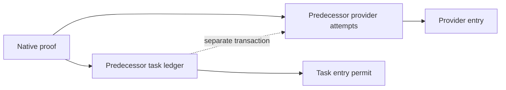
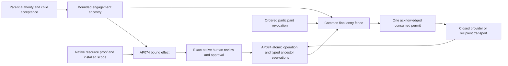

# ADR 0018: Engagement delegation within the native effect owner

- Date: 6 November 2026
- Status: Implementation decision; AP073 evidence and qualification remain open
- Foundation: merged AP074, `68987975`
- Preserved predecessor: `97163513` on `codex/identity-authority-foundation`

## Problem and ownership

The predecessor has independently useful native enrollment, bounded ancestry and
child-acceptance checks. Its AP071 task ledger and execution protocols predate
AP074. Importing them would give one managed effect two admission owners and
separate task/attempt transactions. Neither a task receipt nor enrollment proof
may replace native effect authorization, approval, journal admission or entry.

Retain the five shipping layers, native verifier, approved recipes, canonical
codec, gateway effect compiler, journal, adapter fences and entry permits.
Implement enrollment as bounded native control data in `auths-gateway`. Pure
representation and narrowing belong beside the existing effect owner; store
adapters remain opaque mechanisms. Extend the existing transaction and final
entry dependency set for engagement state. No new executor, task ledger, token
format, provider dispatch or credential callback is admitted.

## Exact relations

The root contract is `auths.engagement-root/3`. It includes the shared admission
authority namespace/partition, exact connection commitments for resource scopes,
and native transport-policy commitments for registered channels. Recipe-local
replay partitions remain distinct from shared engagement accounting. Changing
these pins requires a fresh signed root; identifiers alone cannot substitute for
the approved account/credential or channel. The tree is version 3, with no
version 2 reader.

`configuration::EngagementConfiguration` stores only enrollment/withdrawal data
as an `EffectConfiguration` row under `auths.engagement-configuration-key/1`.
This is an additional authorization-configuration format in the existing opaque
record kind, not a new store or task/operation ledger. All insert/replacement
decisions use the same file/PostgreSQL writer fence, an installed-configuration
dependency and the existing deployment clock. One record can be referenced by
multiple recipe workers. It owns no usage count, operation result or capability.
Operation admission and entry still require integration with that dependency
and with typed ancestor allocations before executable delegation is supported.

Native subtree withdrawal requires a currently active enrolled controller and
the exact selected control-grant suffix. A controller may withdraw itself or a
descendant, not an ancestor or sibling. The signed action binds the root and
target commitments. Repeated withdrawal by a still-authorized controller is
idempotent. History retains IDs, ancestry and revocations after restart. A
qualification eligibility failure is not an additional narrowing-only withdrawal
gate; current installed configuration, qualification memory and trusted-time
policy still apply. Independent operator emergency stop remains available when
those inputs cannot establish current authority.

Configuration acknowledges only after native persistence succeeds. A lost
commit reply reports uncertainty/error even if later inspection finds the new
child. It does not publish a provider permit or silently retry enrollment.
Restoring the complete protected store remains outside rollback detection in the
absence of an independent monotonic floor.

Initiation, control, resource authority and human approval are independent roles.
Operator installation pins the engagement, partition/epoch, resource scopes,
channels and root authority. A root must prove native holder control and each
resource grant. A child needs parent control authority, its own acceptance of
the complete descriptor and a valid native child grant for each retained scope.
Native verification still establishes signatures, parent linkage and grant
attenuation. Product enrollment further narrows validity, instance, scope,
channel, ceilings and remaining delegation depth.

One participant principal identifies one commissioned instance in a tree.
This requires distinct protected instance keys: a generation label or native
signature alone does not prove process uniqueness or isolation after key theft.
The installed boundary and identity lifecycle evidence must establish those
assumptions separately. Recognized raw-key/`did:key` aliases use the existing shared key-identity
comparison and cannot create independent participants. Other identity methods
retain their declared comparison limits. Revocation and expiry retain ancestry
and IDs. Recovery rotates into a distinct
instance/epoch with fresh authority; it never makes old grants or descendants
eligible again. Federation requires explicit resource-side trust and acceptance;
an authenticated foreign identity conveys no resource permission.

Operation compilation must compare the complete selected root-to-leaf resource
grant suffix, exact actor, audience and current enrolled scope. Enrollment
metadata or a principal match cannot stand in for that comparison. A read and
disclosure must retain the same engagement and permitted information flow;
cross-engagement composition fails closed.

Every shared ceiling is charged at every relevant ancestor, using typed units.
The existing journal owns atomic operation plus reservation publication and
checks retained allocations at final entry. Enrollment does not allocate a new
root allowance. Unknown retains capacity, and age/absence never refunds it.
Revocation and admission/entry share the file or PostgreSQL writer fence.
Native revalidation runs after lock acquisition with deployment time; dependency
changes that win first block grants. Earlier grants retain AP074 semantics.

## Bounds and unsupported behavior

Preserve the predecessor's sixteen retained participants, sixteen scopes and
four MiB combined enrollment proof/action budget; each action is at most 64 KiB.
Integers in JCS control data are at most `2^53 - 1`. Preserve AP074's sixteen
native bounded links, 34 effect reservations, 64 total adapter records, two
second cooperative fence deadline and existing record byte bounds. Reaching a
bound denies the operation; it does not truncate ancestry, skip a charge or
drop revocation memory. Native verifier limits may impose tighter bounds.

Online coordinated admission is the first supported topology: one protected
file store on one host or the maintained TLS PostgreSQL adapter. Disconnected
capacity requires a separately specified disjoint escrow protocol and delayed
revocation contract before support. A restored store cannot detect its own
rollback without an independent floor. Native resource participation requires
its own enforcement ADR and conformance evidence before qualification.

## Comparison and assurance

This extends an admitted provider-independent mechanism, rather than extracting
provider meaning. Mutation, acquisition and disclosure already share immutable
effect binding, current dependencies, typed reservations, writer fences and
single-grant evidence. They retain distinct protocols, observations and recovery
facts. The old enrollment relation is reusable; old task charging, permit types,
Google materializers and response interpretation are not.

Native control verification, cryptography, canonical decoding, adapters, clocks,
host isolation and provider behavior remain runtime assumptions. Formal work
must link shipping narrowing/accounting/transition predicates to the repository's
translation and refinement inventory. Predecessor model-only participant proofs
and AP074 proofs cannot be relabeled as AP073 runtime evidence.

## Required direct-cutover evidence

Map F01–F16 before running the complete check batch. Require canonical/malformed
fixtures, native signature and branch tests, participant substitution and
widening refusals, atomic ancestor capacity races, revocation-before/after-entry,
crash/ACK uncertainty, independently authorized recovery, public/private audit
separation, installed Rust/Python/TypeScript parity, isolated machine/A/B/human
journey and exact-revision hosted gates. Preserve every AP074 acceptance test.
No AP073 acceptance closes merely by restoring candidate source or this ADR.
