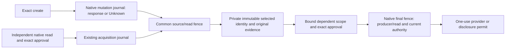

# ADR 0019: Created-resource lineage within the native journal

Status: implementation contract for AP073 F10; acceptance remains open.

## Missing contract

An exact create may enter while its response is lost. A response-derived locator
cannot recover that case. The gateway currently compares one value/echo at a
known URL; `CreatedChild` consequently refuses executable operations. An agent's
chosen ID, filename, matching state, HTTP success or assertion of uniqueness
cannot supply the missing provenance.

## Decision and ownership

Extend the existing data-only observation with a closed created-resource
selection. Its GET uses only fixed and verified-argument path segments. The
existing compiler inserts the action's echo in the write. The bounded response
must explicitly satisfy the declared completeness conditions, expose an array
within its item bound, and contain exactly one object whose marker and parent
match the original source. Its resource ID is a bounded string. No match,
multiple matches, malformed candidates or incomplete/paginated evidence supplies
lineage. Even duplicate matches with identical IDs are ambiguous.

Selection is a projection of provider bytes, never authority or a permit.
Independent current native read authority, exact human approval, account and
connection binding, permanent read charges, response/version/freshness checks,
and the existing source/read transaction remain mandatory. Store the selected
identity only with its original recovery evidence in the mutation journal.
Original attribution, Unknown capacity and no-retry behavior are preserved.
Neither a no-match result nor lease expiry establishes non-effect or a refund.

The producer's mutable status is distinct from the selected resource identity.
`observed-by-provider` states the declared marker relationship, subject to
provider integrity assumptions; it does not establish exclusive causation.
The selected ID remains private. Public recovery results retain redacted facts.

Ordinary native mutation lookup also reopens the original acquisition and its
finite permanent source-lifetime allocations under the shared writer fence.
The read must retain its exact native effect, revision, response digest and
receipt time, exact source contract and usable status/version; its response
bytes must equal the source's retained evidence. Inspection aborts without
rewriting either record. This checks historical provenance at the original
recorded time; it does not refresh evidence or require the historical actors
to remain currently eligible. Missing/corrupt/substituted original history
fails closed. This is not yet the dependent consumer's final entry fence.

Executable dependent scope must additionally bind the producer replay identity,
original effect/recipe, exact parent scope, engagement/root/epoch and selected
resource. Its native final fence must include and validate the producer and
original recovery acquisition, as well as current participant/ancestor,
connection/configuration/approval/charge dependencies. A serialized candidate or
pre-lock selection cannot satisfy this boundary. Pending-child graph traversal
is finite and acyclic; unsupported or missing lineage fails closed.

No task ledger, provider dispatch, arbitrary callback, new token format or
independent approval/verification owner is admitted. AP070's application-owned
broker and preserved AP071/old AP073 task owners are not migrated or trusted as
managed evidence.

## Closed data grammar and bounds

`observation.created_resource` declares resource and parent JSON pointers,
`scalar` or `sole-string-array` parent shape, one or two explicit completeness
conditions (`absent` member or exact boolean), and a maximum of 1–64 items.
`observation.json_pointer` selects the response array; `expected_field` is the
verified parent string; the existing `echo.observe` is relative to each item.
IDs and parents are 1–256 UTF-8 bytes without control characters. Existing
65,536-byte response, 128-byte/eight-token pointer, JSON recursion, request,
transport and transaction bounds remain in force.

Pointers are strict RFC 6901. An `absent` condition requires its immediate parent
object to exist: missing ancestors or a wrong container type cannot manufacture
completeness. Conditions cannot overlap the items array or use the same pointer.
Resource, marker and parent pointers are distinct and non-overlapping. Every
array member must be an object with a bounded string marker; an omitted marker
is uncertainty, not evidence of a different marker. Matching markers require a
well-formed resource and parent. A sole-parent array must contain exactly one
string. Invalid/oversized/ambiguous bytes produce no selected identity.

## Extraction and evidence

[Case 0010](../research/domains/abstraction-cases/0010-created-resource-lineage.md)
compares the existing references and limits the extraction to bounded JSON
projection/cardinality and the already shared journal/fence. This ADR explicitly
uses the boundary plan's smaller-promotion exception for that closed parsing
primitive; it does not assert identical provider creation/lifecycle semantics.

Required evidence includes structural/malformed/boundary/property corpus,
independent reference comparison, actual authorized recovery with zero/multiple/
incomplete/unique candidates, response-less create, original evidence retention,
cross-task/recipe/account/parent substitution, revocation/expiry while waiting for
the final fence, races, crashes, file and TLS PostgreSQL, installed bindings and
private/public leakage probes. Source-linked formal and hosted acceptance remain
required. A projection corpus alone cannot close F10.

## External assumptions

The provider's completeness, marker persistence/integrity, account isolation,
search consistency and identifier lifetime are declared deployment/qualification
assumptions. A mutable unkeyed echo is not a signature. Other authorized writers
must not be able to forge a convincing candidate within the claimed deployment.
No gateway claim can repair dishonest/incomplete provider evidence. Live provider
qualification requires its own reviewed contract and execution evidence.

The selection/recovery checkpoint retained pending-child execution refusal.
The following consumer batch removes it only through dependency-complete native
compilation and final-entry integration, never an application-supplied handle.

## Consumer lineage contract

A pending scope explicitly pins producer namespace, replay partition and epoch,
logical operation, recipe digest and the exact parent-scope commitment. The
parent commitment includes scope ID, recipe, connection, service, tool, argument
name and exact resource; it excludes the grant witness to avoid a signed-root
commitment cycle. Native entry still verifies the complete actual grant suffix.
Old incomplete pending declarations are rejected; there is no compatibility
reader or inference from the consumer's replay context.

Protected history alone constructs the private `auths.created-resource-lineage/1`
projection. It includes the original producer/read keys, effects and revisions,
the original charged acquisition row, root/engagement/epoch, exact parent and
selected identity. Consumer connection pins must equal the original producer's
connection commitment, binding account and credential generation. The native
compiler compares the signed consumer handle with that resolved identity while
retaining the signed pending declaration. Native proof, full enrolled ancestry,
exact approval and permanent current consumer charges remain mandatory.

Admission and final entry both append the original producer, original acquisition
and its permanent source-lifetime allocation to the existing native dependency
set. The same pure historical relation used by lookup revalidates these snapshots
without nested store I/O. Missing/substituted data, a changed projection or current
authority/configuration mismatch refuses entry. The exact consumer approval binds
the complete lineage. The consumer cannot reuse its producer/read replay key.
Recovery/disclosure must preserve this same resolved provenance.

The first closed lineage relation admits only a producer with an exact parent.
It is a one-edge acyclic dependency graph. A producer that itself has pending-child
lineage cannot manufacture another usable child projection; recursive traversal
is unsupported and fails closed. This is an explicit finite support boundary,
not a claim of arbitrary recursive lineage. No candidate becomes a permit.

Native evidence must exercise unresolved producer, wrong child, all replay/root/
connection/recipe/parent/effect/revision/key substitutions, a changed original read
after reservation, exact restoration with no new charge, child acquisition replay
and child disclosure without a delivery permit. Injected response facts do not
establish actual HTTP creation or installed-process F10 acceptance.
