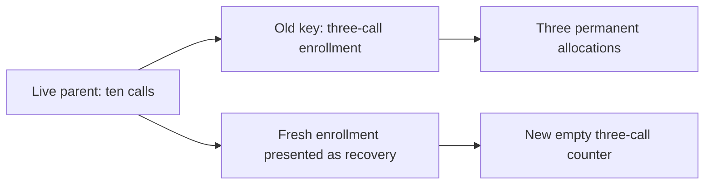
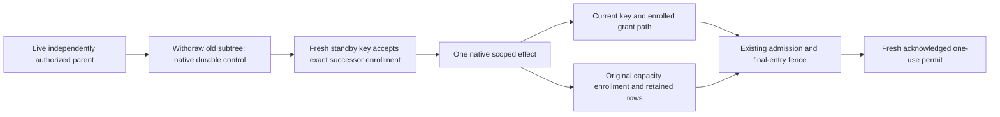

# ADR 0020: Commissioned instance recovery without restored capacity

Status: AP073 M4 implementation contract; no lifecycle acceptance result yet.

## Concrete missing boundary

The maintained tree revokes a subtree irreversibly and retains its operations,
allocations and original native evidence. It does not yet relate a fresh-key
successor to a withdrawn instance. Merely enrolling another key can create a new
participant counter: a root with ten calls and a child capped at three could
otherwise let a transparent key recovery regain three calls after spending its
original three. Root conservation alone would not preserve that child's grant.

Existing core identity adapters establish control of explicit keys and evidence.
They do not establish that a new process is the authorized recovery of an old
instance or that historical capacity may be forgotten. A generation label is
not proof of a fresh key. Restoring old signed grants, translating descendants,
resetting an epoch or clearing counters is not this recovery protocol.

Before the change, independent fresh enrollment has independent child capacity:

## First supported lifecycle contract

Support recovery of one non-root participant into a distinct, independently
commissioned standby instance in the same engagement and replay epoch. The
immutable root already pins the standby principal, instance generation and
registered channel. It grants the standby no live enrollment by itself. Native
holder acceptance and fresh parent/resource grants are still required.

The first deployment precommissions a finite set of standby keys/channels. It
does not accept an arbitrary new key or agent-supplied registration at recovery
time. No identity provider, key-management framework, discovery service or new
trust-anchor authority is introduced. Uncommissioned replacements fail closed.

Recovery has two explicit stages using the existing control owner:

1. An independently eligible parent withdraws the old subtree through the
   maintained native control proof and common writer fence. Durable
   acknowledgement precedes the recovery workflow's next stage. A lost reply is
   resolved by original-evidence replay, not by presuming withdrawal failed.
2. That live parent proposes a successor enrollment. The new holder accepts its
   complete descriptor and supplies separately verified fresh native resource
   grant suffixes. The existing enrollment transaction checks the retained
   predecessor's withdrawal and publishes the successor under the same fence.

A crash between these stages leaves the old subtree withdrawn and the standby
unentitled. A lost successor acknowledgement is resolved through its exact
original evidence and revision. Neither case restores the old node, allocates a
new counter or grants provider/disclosure entry.

### Successor invariants

A typed enrollment lifecycle distinguishes `fresh` from `recover { predecessor }`.
The complete lifecycle is covered by parent authorization, child acceptance,
enrollment commitment and audit evidence. There is no unsigned alias map.

The native tree, including decode-time historical consistency, must enforce:

- Predecessor is a retained non-root node, explicitly withdrawn, in this root.
- Its original direct parent equals the currently eligible enrolling parent.
- New principal does not overlap any retained principal, including raw-key /
  `did:key` aliases; actual commissioned standby channel and generation match.
- New instance generation is exactly predecessor generation plus one, checked
  within the existing exact-JSON bound. An old key cannot satisfy new-holder
  acceptance merely by changing its label.
- Validity interval, scope set and delegation depth preserve or narrow the
  predecessor's original limits as well as the current parent's limits. Expired
  authority cannot be revived through a later validity interval.
- Participant ceilings are immutable across a recovery chain. They are the
  original lifetime capacity contract, not a replacement key's fresh allowance.
  Scope/time/depth may narrow; changing the capacity policy is a different,
  explicitly authorized fresh-grant operation.
- Each retained node has at most one successor, even if that successor is later
  withdrawn. Further recovery names the latest withdrawn successor. IDs,
  principals and predecessor references are never reused or removed.
- Predecessor links are bounded, acyclic and remain in the same direct-parent
  context. Existing sixteen-participant limits include withdrawn and successor
  records; exhaustion is a refusal, not compaction or a counter reset.
- Old descendants remain under the withdrawn old node. No descriptor, grant,
  approval, recipient channel or permit is translated into the new ancestry.

An independently authorized parent may deliberately issue a different fresh
child grant within its own retained allowance. That is new authority, not a
successful recovery receipt or restoration of the old grant. This distinction
must remain explicit in the protocol, review and audit.

## Stable capacity identity in the existing effect owner

Derive the capacity origin by following a node's retained predecessor links to
its first fresh enrollment. A root's origin is itself. The derivation is pure,
bounded by the retained tree and repeated from current protected state; an
application cannot supply it.

Bind both identities in every scoped effect:

- **Current enrollment/principal/instance:** fresh native authority, resource
  grant suffix, registered channel, validity and revocation checks.
- **Capacity enrollment:** immutable original accounting identity with the same
  lifetime ceilings, used by the existing ancestor allocation key.

The common actor and recipient path compiler supplies these values. Its current
identity checks remain separate from historical accounting. Two distinct live
nodes cannot share an origin: the predecessor must be withdrawn and the tree
allows only one successor. Disclosure path union must preserve that relation.

Use the existing `auths.engagement-ancestor-capacity/1` key derivation with the
capacity enrollment. Fresh nodes keep the same capacity identity as their own
current enrollment. Successors use the predecessor chain's original counter.
Ceilings remain identical, so the existing immutable allocation rows and
predecessor comparisons retain their exact meaning. No allocation migration,
second usage total, counter-release transition or new store kind is introduced.

Current revocation/configuration/native proof/approval checks and historical
capacity references meet at the same existing admission and final-entry fence.
An entry granted before withdrawal retains AP074's possible-effect semantics
and its permanent charge. An old cached compilation after withdrawal cannot get
another grant. Stored facts and restart cannot reconstruct a permit. Successor
entry must include the old consumed capacity even when the old holder's key is
compromised or unavailable.

Historical mutation/acquisition/disclosure attribution remains the original
actor. A successor may acquire or reconcile only with independent current
native authority and exact approval. Recovery never rewrites an old action,
proof, receipt, timestamp or unknown outcome.

## Ownership and direct cutover

Keep ownership in `participant_enrollment::EnrollmentTree`, the existing native
control/configuration audit, `effect::EngagementScope`, `store::engagement` and
`entry::EntryValidation`. Reuse native grant/identity verification, configuration
CAS, immutable audit blobs and replay. Do not create an identity-recovery ledger,
authorization service, generic workflow runner or credential recovery callback.

This is a new enrollment lifecycle contract and capacity-identity binding.
Version its closed objects explicitly and update specs, fixtures, bindings,
compliance and assurance together. Reject obsolete disposable state directly;
there are no legacy decoders, dual formats, re-signing tools or migration paths.
Fresh operational backup/restore still obeys the independent rollback-floor
assumptions; a self-consistent restored store cannot certify its own freshness.

## Limits and unestablished claims

This first profile does not recover a compromised engagement root, invent a new
trust anchor, dynamically commission an unknown channel, support a changed
parent, inherit old descendants, extend expired authority or provide offline
escrow. A root compromise needs an independently trusted operator/recovery
contract and explicit accounting for unresolved old effects; none is inferred
from a new epoch. Unsupported modes fail closed.

Key isolation, trustworthy commissioning, authenticated recovery decisions and
external floor/checkpoint protection are deployment assumptions requiring their
own evidence. A signed recovery request does not prove key theft, human intent,
process isolation or provider outcome. Federation and native-resource enforcement
retain their separate explicit resource-side trust/qualification gates.

## Complete verification batch before execution

Write implementation, canonical/malformed corpus, both adapter suites, installed
actors, binding parity, CI and source-linked assurance changes before running
constructors. At minimum exercise:

- Genuine parent/standby acceptance and fresh native resource suffixes;
  missing/invalid parent, child, resource, standby or predecessor evidence.
- Active/unknown/root/foreign predecessor; generation overflow or skip; old-key
  relabel and raw-key/`did:key` alias; widened time, scope, depth or ceilings;
  conflicting successor, cycles, reused IDs and participant exhaustion.
- Old subtree denial after acknowledged withdrawal, including old descendants,
  prior compiled approvals and late native control evidence.
- Crash/lost reply before and after withdrawal/successor publication, exact
  original revision replay and independent historical audit.
- A partially spent original allowance usable only up to its original remainder;
  an exhausted allowance remains exhausted after any number of recoveries;
  root/shared source and recipient accounting remains conserved.
- Competing old/successor entries, lock-wait expiry/revocation, original response
  loss and retained Unknown, no blind mutation retry or disclosure redelivery.
- File and TLS PostgreSQL, fresh process-held standby keys, actual provider or
  recipient effects, public/private leakage probes and exact installed SDKs.
- Canonical decoder/refinement relationships and checked source-linked formal
  statements for no old-authority resurrection and no capacity restoration.

A pure relation, happy path, prewritten expected artifact or source-only test is
not end-to-end lifecycle acceptance. Record actual results and remaining
assumptions in the AP073 ledger; M4 and F12 remain open until their gates pass.
