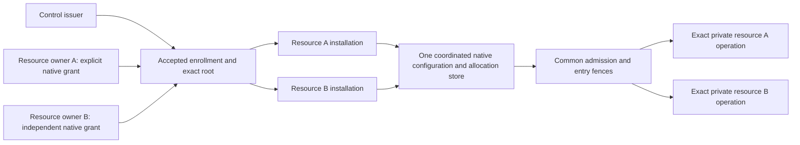
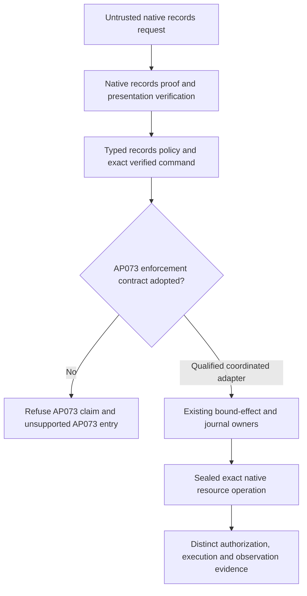

# ADR 0021: Coordinated federation and native resource boundaries

Status: coordinated federation native/file construction passed; actual evidence
and limits are in the AP073 ledger. Hosted PostgreSQL, isolation and full M4 remain
open. Native-resource qualification remains a separate implementation boundary.

## Existing owners and the missing claim

The gateway already verifies independent participant-control and resource-grant
paths. Its installed root fixes every resource grant suffix, recipe, connection,
scope and channel; native admission and entry use one retained configuration and
permanent ancestor allocations. Two recipe installations already exercise this
common owner across real processes. Those tests currently use one resource issuer.
They cannot establish consent by independently administered resource issuers.

The records API vertical already owns typed create/read semantics, native proof
and presentation verification, lifecycle, sealed commands, disclosure and receipts
(`product/integrations/auths-records-api`, AP024). It must not be replaced by a new
generic native executor, nor treated as an AP073 participant/budget enforcement
implementation merely because it invokes the same offline verifier.

## First federation profile

Support explicit resource-owner federation within one coordinated admission
partition. A control issuer enrolls machine/agent instances; each independent
resource owner separately delegates its exact native resource authority. An
operator-approved immutable root pins those grant IDs and exact resource scopes.
Accepted principal methods and issuer trust are explicit installed inputs.
No organizational label, channel, transport or valid unrelated signature joins
the accepted set. In particular, trusting an issuer for one scope does not replace
the pinned grant path of another scope.

Both installations must adopt the exact root and use the same authoritative
adapter state. File deployment is one host with a common protected store;
multi-host deployment uses the supported TLS PostgreSQL owner. Separate custody,
connection and review/configuration partitions do not imply separate ancestor
capacity. All participants in this contract serialize withdrawal and final entry
through that same owner. A resource refusing these assumptions is outside this
profile and must not be advertised as sharing its budget or prompt revocation.

Do not add an agent-controlled trust-discovery service, registry, remote policy
callback, issuer alias or transport-derived authority. Local source-free isolation,
real operator consent and authenticated configuration publication remain separate
deployment evidence. Test fixture keys demonstrate independent cryptographic
authorization paths, not independent human administrations.

### Withdrawal, recovery and trust changes

Participant withdrawal and commissioned recovery retain ADR0020 semantics across
the coordinated installations. Old descendants, grants and approvals do not gain
new entry, and a new holder retains the original counter. A domain removing trust
must install its new verifier/configuration through the existing trusted operator
boundary; old approvals cannot choose old trust. Historical audit uses the
original contexts and an independently authenticated checkpoint. It must not be
reinterpreted as current federation eligibility.

The profile does not support disconnected/offline escrow, importing another
domain's self-asserted usage, cloned independent admission stores, automatic
trust-anchor rollover or recovery of a compromised coordinator. Signatures cannot
detect coherent rollback or a dishonest resource's private effects. Independent
rollback floors and operator protection of topology/state remain assumptions.
An unavailable coordinator denies new authority/entry; it does not fall back to
offline verification or allocate a fresh local allowance.

## Native resource decision and qualification boundary

A native resource is responsible for verifying its own canonical domain action,
current authority and durable limits before reading or writing protected state.
Gateway admission for an upstream invocation does not discharge those duties.
Conversely, records-domain verification alone does not establish AP073 enrollment,
recipient isolation, shared ancestor accounting or commissioned recovery.

The first comparison uses the maintained records vertical rather than inventing
a new provider or protocol. Qualification must map its canonical create/read
actions, presenter/audience binding, required configuration, replay, disclosure,
Unknown and recovery to the corresponding AP073 contract. Any adapter must derive
its exact operation from verified data, retain one authoritative execution owner
per effect and fail before its protected store when a required relation is absent.

This is a qualification gate, not authorization to revive a second task ledger,
copy the gateway state machine into records, load provider callbacks into the
gateway, or call the existing records reference qualified. Production provider
writes remain data-only gateway recipes under ADR0012/0013. A production native
adapter requires explicit reconciliation of that rule and a demonstrated
refinement/qualification contract. The remaining native-resource implementation
and isolated journey are required AP073 work, not closed by the federation tests.

## Complete federation construction batch

Before running constructors, write all fixture and assurance changes together:

- Independently signed control, resource-A and resource-B chains; mix raw-key and
  did:key through maintained native adapters, with no injected verdicts.
- Refuse absent owner trust, unaccepted method, invalid signature/evidence,
  cross-resource path substitution, unapproved root and alias-based duplicate
  participant identity. Genuine positive controls must use the same inputs except
  for the rejected security dimension.
- Real independent gateway processes, exact approval, private HTTP effects,
  final shared-capacity race, replay/restart, withdrawal before and after entry,
  crash/Unknown retention and independent-engagement positive control.
- File and TLS PostgreSQL constructors, compiled-selector count checks, canonical
  artifacts, spec/compliance links and truthful formal/deployment limits.

No standalone signature test, fixture-name assertion or modeled counter can
substitute for the native compiler/admission/final-entry and real effect history.
