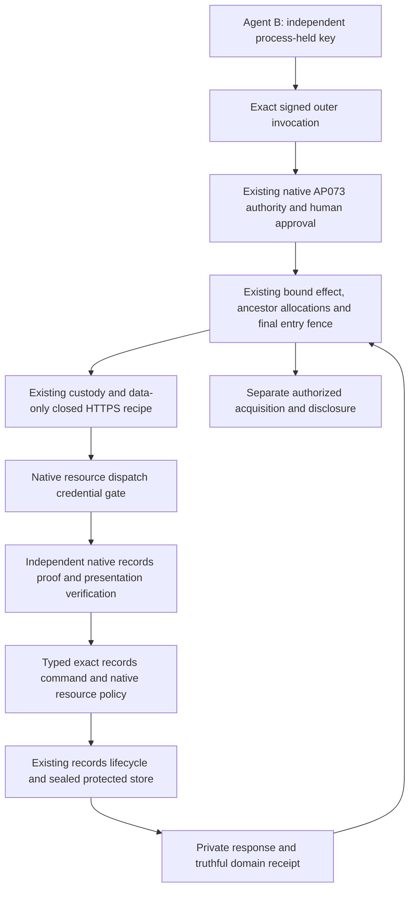

# ADR 0022: Gateway-protected native records conformance

Status: native/file/local installed conformance construction passed. Exact-head
source-free Linux, PostgreSQL and global qualification remain pending. Complements
ADR0021 rather than replacing its trust assumptions.

## Concrete topology

Use the existing native records create/read vertical as an independently
authorizing resource behind the existing credential-isolated gateway. The gateway
owns AP073 enrollment, exact approval, admission, ancestor capacity, withdrawal,
one-use entry and Unknown. The records resource owns its native canonical action,
proof/presentation verification, records policy, protected data, provider
idempotency and domain receipts. Its ledger is resource state, analogous to a
provider's operation ledger; it is not an alternate AP073 task journal.

The resource's protected entrypoint requires the gateway-held dispatch credential
**and** valid independent native records authority. Neither fact replaces the
other. The dispatch credential never appears in an agent process. No alternate
public route may reach the protected namespace without these checks. A standalone
AP024 deployment that accepts direct agent traffic is a different topology and
must not claim AP073 shared-budget or prompt-withdrawal protection.

The outer bound request contains the complete canonical native create action and
an immutable commitment to its separately exchanged proof/presentation envelope.
Approval covers that action and evidence selection, as well as the outer
resource/parent/recipe/connection. The resource retains original proof bytes,
never a cached allow verdict, and re-verifies them for every protected entry.
An evidence commitment is selection data, not authority; substitution or missing
evidence fails closed. This preserves existing finite recipe field limits rather
than adding an unbounded crypto tunnel or weakening the gateway compiler. The resource derives the native operation only
from its independently verified typed command. It checks its wrapper's declared
resource/parent against the native command and installed policy before executing.
An outer authorized request containing an invalid inner proof is a resource
refusal, not a provider success. Conversely, an inner valid proof cannot bypass
the outer gateway's credential gate, admission or withdrawal.

Native read proofs may be exchanged separately and installed at the resource by
exact canonical action digest. A fixed GET capability then selects that installed
proof; the resource must reverify it and its current policy/time before protected
read. The digest is an identifier, not bearer authority. This uses the existing
bounded data-only GET capability and avoids adding dynamic proof headers, request
bodies or provider-specific branches to the shared gateway. The first conformance
scenario uses exact preauthorized parent/child read proofs, not arbitrary listing
or agent-selected verifier contexts.

The native proof presenter and the gateway participant are independently audited
facts. This scenario uses the same key for both; the protocols do not infer
cross-domain identity equality or global key revocation. A different independently
authorized participant cannot relabel an old native signature as its own or change
its exact action. Delivery of an already valid exact native intent still requires
current gateway authority, exact approval and both domains' limits. Domains
requiring additional live presenter/channel equality need an explicit resource
contract; it is not inferred from the private dispatch connection.

## Boundaries retained

- Keep native records policy/profile meaning in the records vertical/reference
  adapter. No records profile tag, JSON interpretation or native verifier callback
  enters the shared gateway.
- Preserve one AP073 admission owner. The resource does not import task counters,
  alias old enrollments, issue gateway permits or turn its own receipt into a
  fresh gateway approval.
- A native resource receipt and a gateway entry/response are different facts.
  A lost response remains Unknown in the gateway even when the resource applied
  the operation. Independent current read authority may observe/reconcile; it
  never authorizes repeating the write or refunding its allocation.
- The resource's own policy limits compose with, and cannot widen, the gateway's
  limits. Credential substitution, direct-agent access, unverified context,
  different native action/presentation and malformed wrappers fail closed.
- Recovery of an AP073 instance does not re-sign or translate a native records
  grant. Any new native holder needs separately issued native authority. Old
  native signatures may remain mathematically valid but cannot cross a withdrawn
  gateway entry boundary in this topology.
- Deployment isolation, trusted commissioning, private resource entrypoints,
  provider durability and independently protected rollback floors remain explicit
  assumptions. The conformance double is not a production-qualified recipe.

## Reuse and test infrastructure

The records demo already authors native create/read proofs through the maintained
authoring API and native verifier. Move that exact fixture implementation into a
feature-gated records testkit and have the demo call it. Add a small external
fixture-signer port so installed Python/npm participants sign native preimages in
their own processes. Keep fixed-seed demo authoring as a wrapper, never a new
shipping credential or verifier path. The testkit performs no admission and
cannot manufacture authorized records commands or gateway permits.

This is test-authoring reuse across two actual consumers, not promotion of records
policy or lifecycle semantics into a generic product framework. Update package
features, explicit dependencies, architecture snapshots and compliance together.
The generic authoring routine remains bounded by the same native codec/profile
limits. Do not copy another state machine to make the example work.

## Complete construction and acceptance batch

Before behavioral constructors, implement the complete bounded batch:

1. Preserve the existing AP024 fixture bytes/decisions after the fixture move.
   Native proof construction must work both with fixed public fixture signers and
   externally held installed SDK keys, without exporting private key bytes.
2. A native resource conformance adapter invokes the real records service and
   protected store. Exercise valid create/read, invalid proof/signature,
   presentation/action/audience/configuration substitution and direct credential-
   free traffic. Refusals cause no protected effect or disclosure.
3. Extend the installed multi-agent journey with native parent read, exact human-
   approved native child create, actual gateway response loss/restart, independent
   native observation, bound child read/disclosure, replay and ancestor withdrawal.
   Retain all existing seven scenarios.
4. Keep the resource dispatch credential and protected contents out of agent
   files, memory, public history, errors and logs under the supported isolation
   topology. Record actual local versus source-free Linux UID evidence separately.
5. Use canonical artifacts, exact compiled-selector counts, source-free packaging
   and hosted checks. Formal claims remain conditional on their actual translated
   source/model boundaries; this composed example cannot prove topology honesty
   or universal equivalence of native resource profiles.

Complete source, fixtures, inventories, CI and the mapped adversarial cases before
constructing artifacts. This ADR does not itself close native-resource acceptance
or reduce any other AP073 requirement.
