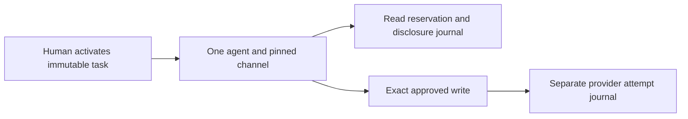
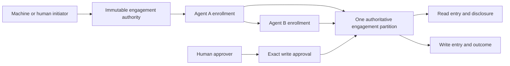
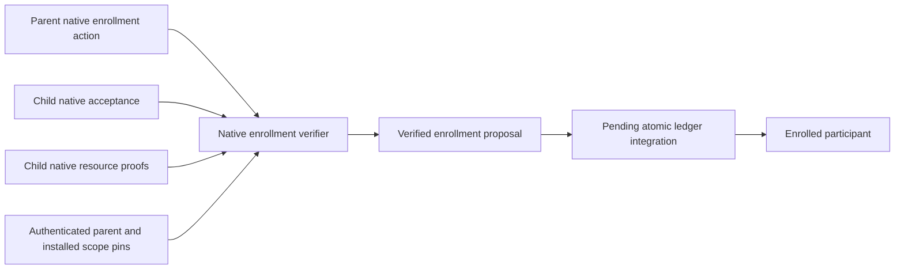
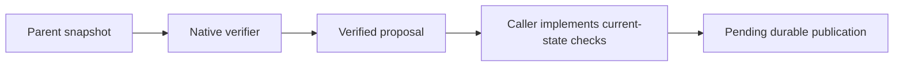
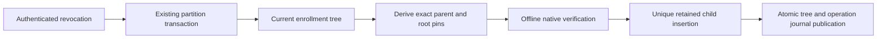

# AP073 engagement and participant contract

**Status:** implementation contract, 27 October 2026. Native enrollment verification and a pure bounded enrollment tree are implemented.
Installed enrollment, shared accounting and qualification remain incomplete. This document resolves the next bounded
design decisions under [AP-SPEC-073](../specs/0073-identity-authority-and-enforcement-foundation.md).
The [assessment](0073-foundation-assessment.md) records actual evidence.

## 1. Current boundary and intended change

The original immutable task named one human, one agent and one delivery channel.
The implemented role cutover now separates initiator and approver while retaining
one agent and one delivery channel.
The native verifier already supports attenuated delegation chains. The first
AP073 change allows that chain to reach the final agent already approved by the
human. It does not enroll another agent or grant it another budget.



Replace the single participant assumption with an explicit authority tree and
separate roles. Keep the existing native proof verifier and exact closed request
compilation. Do not duplicate task cards to simulate child authority.



## 2. Roles and immutable commitments

These are separate roles even when one principal holds several:

- **Initiator:** requests creation of the engagement; initiation alone does not
  establish authority over the resources.
- **Delegator:** holds native authority and can narrow it for a child within the
  engagement's explicit delegation rules.
- **Acting participant:** proves control of an enrolled principal and instance
  generation when requesting an operation.
- **Approver:** supplies the separately required approval of an exact effect.
  An approving human need not be the initiating machine.
- **Resource operator:** chooses trust roots, installation, credential account,
  executor and admitted recipe or native resource contract.

The root engagement binds its identity, authority partition, initiator,
authorized initial participant, approver policy, resource scopes, connection
generations, allowed channels, validity, budgets and delegation limits.
Authorization must satisfy both the native grant and this product contract.

An enrollment binds engagement commitment, parent enrollment, native child grant
commitment, participant principal, instance generation, delivery-channel
identity, scope, validity and ceilings. Enrollment IDs are never reused. The
initial implementation is a tree: one parent per enrollment, no reparenting or
multiple-parent authority unions. Additional composition needs a separate exact
authorization action and conservation contract.

Use a direct task schema cutover. Reject obsolete state; do not maintain a
parallel reader, migrate signatures, or reinterpret old human fields as machine
roles. Keep native principal, grant and canonical action types authoritative.

## 3. Enrollment and resource bounds

A fixed typed enrollment action must be signed by the enrolled parent and
authorized by its native authority. The prospective child must prove control
before activation. Verify native parent/subject linkage, attenuation, remaining
depth, current status, engagement commitment and descendant limits. Enrollment
cannot select arbitrary network destinations, filesystem paths or credential
accounts: channel identities resolve only through operator-approved bindings.

The initial product limits are 16 participant enrollments, 64 logical operations
and 16 resource scopes per engagement. These are upper bounds, including revoked
enrollments and terminal operations; pruning must not make identifiers reusable.
Native proof byte, work and delegation-depth limits still apply independently.
Reject inputs exceeding either boundary before expensive verification or state
mutation. These limits must become constants with boundary tests in the schema
cutover, not unbounded vectors justified by this prose.

Enrollment and revocation serialize in the same partition. Repeating an exact
enrollment may return its existing record, but cannot reactivate a revoked one.
The same identifier with different committed content fails. A parent revoked
before the enrollment transaction cannot create a live child.

## 4. Central capacity ownership

Root authority, participant tree, revocation epochs, logical-operation replay,
capacity and entry decisions belong to one authoritative partition. Every
admission atomically checks and charges all ancestors. Independent child stores
must never be treated as new budget sources.

For each bounded unit and each node on the ancestry path:

```text
spent + reserved + uncertain <= ceiling
```

The three accounting categories are disjoint. Moving a reservation to uncertain
does not charge twice and does not free capacity. Child ceilings restrict use;
their sum is not an allocation of extra root capacity. Siblings contend for the
same remaining parent capacity. Counts, bytes, currency and provider-specific
units must stay distinct, with checked arithmetic and explicit unit identities.

Every claim binds engagement, participant generation, exact action and compiled
request commitments, operation ID, executor audience and partition generation.
Fresh child keys, new recipes or restarted executors cannot reopen a claimed
logical operation. Unknown writes and lost disclosure acknowledgements retain
their charges. Revocation and key replacement do not refund them.

The existing file ledger supplies a single-host implementation using locking,
atomic publication and fsync. It is not a distributed transaction service. A
multi-host deployment needs a consistent transactional authority partition and
fencing enforced at resource entry. Offline escrow is deferred; no replica may
spend a cached copy of remaining capacity.

## 5. Entry, revocation and recovery

Reservation is not execution permission. A durable entry decision checks current
ancestry and generation and serializes against revocation. Specify and test both
orders rather than claiming that repeated reads eliminate races:

| History | Required result |
| --- | --- |
| Revoke, then reserve | Refuse without a new reservation. |
| Reserve, then revoke, then entry | Refuse entry; retain already consumed capacity under the selected recovery contract. |
| Reserve, then entry, then revoke | The authorized in-flight effect may complete; revocation does not undo it. |
| Entry, then crash before durable outcome | Unknown; no blind second send. |
| Fetch, then revoke, then disclosure entry | Refuse private-content release. |
| Disclosure entry, then lost acknowledgement | Retain release/byte charge; no redelivery. |

Durable entry authorization and physical transport entry are distinct facts.
A bounded, exact permit and its expiry must be checked at dispatch. Do not hold
a filesystem/database lock across network I/O. If a resource cannot enforce a
distributed fence, document the weaker in-flight guarantee and do not claim
instantaneous global revocation. Provider observation and create reconciliation
remain profile-specific; a shared counter does not prove provider idempotence.

## 6. Lifecycle and rollback

Initially a raw-key replacement is a new principal and a new instance generation,
requiring explicit enrollment. Do not silently transfer pending permits or grant
ancestry. Revoking an enrollment invalidates all descendant entry eligibility;
already uncertain effects remain observable without authorizing another send.

Recovery from whole-store restoration requires a checkpoint outside the restored
state's rollback domain, or explicit re-commissioning that rejects every old
permit and cannot reopen old operations. An epoch stored next to the database
does not solve restoration of both. F15 remains open until that mechanism and
restore tests exist.

## 7. Implementation and acceptance order

1. Verify the existing-chain extension and preserve final-recipient checks.
2. Cut over task roles and enrollment schema with bounded canonical decoding.
3. Implement signed child enrollment and atomic ancestor accounting, including
   sibling contention, revoked ancestry, expiry, overflow and crash histories.
4. Exercise machine initiation, isolated A/B processes, mediated private reads
   and independent human approval of an exact write through the installed SDKs.
5. Add the production authority partition, native resource enforcement and
   explicit second-domain federation contract. Update ADRs before those paths
   become production authority.

Required negatives include arbitrary child/channel substitution, an unrelated
human elsewhere in a proof bundle, widening scopes, exhausted delegation depth,
reusing an operation through another recipe or descendant, simultaneous last
capacity claims, parent revocation during enrollment/entry, old instance permits
after replacement, restored state, and unknown outcomes after executor restart.
Record exact artifacts and observed histories; this design is not test evidence.

## 8. Closed partition reference and grant-binding decision

`product/runtime/auths-gateway/src/engagement_reference.rs` is a phase-one,
`cfg(test)` reference. Its inputs assume native authorization and possession
verification have succeeded; it does not establish those facts, serialize
state, issue dispatch permits or perform I/O. No F acceptance criterion closes
because this reference exists. Production must demonstrate a refinement of
these transitions under the authoritative partition transaction.

Resource authority is pinned per immutable root scope. A participant's scope
entry names its exact native grant ID; a child's corresponding grant must link
to that parent's scope grant. Read and write grant paths may differ. The native
enrollment-action grant is not implicitly resource authority. On operation
admission, the verified single native branch must end in the complete sequence
of scope grants belonging to the enrollment ancestry. Merely finding each
principal somewhere in a bundle is insufficient. Native signature, subject,
issuer, permission, status, depth and attenuation checks remain prerequisites.
The future signed enrollment must commit this complete scope-to-grant mapping.

The reference derives each ancestor's usage from the bounded operation journal
rather than keeping a second mutable aggregate. Counts of provider reads,
disclosures, disclosure bytes and writes remain distinct. Provider entry moves
its reservation to uncertain; observation records it spent. Disclosure entry
adds its own uncertain count and byte charge; authenticated acknowledgement
moves that charge to spent. Recovery marks entered operations unknown without
a second charge, refund or another entry. A refused entry retains its earlier
reservation. Every refusal is atomic.

The reference checks the current partition, executor and instance bindings at
entry and disclosure, in addition to the exact recorded action and request.
Changing a partition generation in these tests assumes a trustworthy external
generation source; it does not prove rollback detection. Actual dispatch
fencing, persistence failures, signed enrollment, child possession, exact
approval and installed process isolation remain separate implementation work.

Eight reference tests cover shared sibling capacity, all ancestor charging,
revocation on both sides of entry, read-before-disclosure revocation, lost
acknowledgement, mixed read/write replay and hard limits, scope/grant splicing,
exact-request mutations, expiry, stale generations, overflow and randomized
crash/revocation histories. Hosted execution remains pending.

## 9. Native enrollment verification boundary

The Rust `participant_enrollment` module verifies a proposal before the durable
partition transaction. It is a production-callable verification API, not an
installed enrollment endpoint or a current-state authority service. Its
`VerifiedParticipantEnrollment` constructor is private. The parent snapshot
and root resource/channel pins are trusted inputs selected by the caller from
authenticated operator state; accepting those pins from an agent would violate
the API contract.

Before this boundary, the reference assumed authenticated enrollment inputs:


The new boundary establishes specific native facts but leaves persistence and
current-state ordering to the forthcoming ledger integration:



The closed service is `auths-participant`, with `enroll_participant_v1` and
`accept_participant_v1` tools. The parent submits one canonical native MCP
action containing `{"enrollment": descriptor}` under its enrolled control
grant. The child submits `{"enrollment_commitment": [32 bytes]}` under a
child control grant whose issuer, subject and parent ID match the enrolled
parent and proposed child. Native trust, configured challenge, current evidence,
validity, permission, signature, holder, parent linkage and attenuation checks
are not reimplemented. Every control proof must have exactly one action and
one authorized branch.

The descriptor uses schema `auths.participant-enrollment/1`. Its canonical JSON
is committed through the existing codec with domain
`auths.participant-enrollment.v1`. It binds root engagement commitment,
partition generation, parent enrollment commitment and instance generation,
fresh enrollment ID, child principal and instance generation, registered
channel, child control grant, sorted scope-to-resource-grant mappings, validity,
remaining depth and independent count/byte ceilings. Integer fields must be
within the exactly representable JSON integer range; canonicalization must not
round two distinct epochs into the same commitment.

For each listed scope, a separate child-signed native resource invocation must
use the installed MCP service/tool and exact resource argument. Its terminal
grant must have the enrolled parent as issuer, the child as subject, the exact
parent resource grant ID as parent, and the descriptor's child grant ID. Its
validity and remaining depth must cover the proposed enrollment. These are
verification witnesses, never provider calls; a witness consumes no operation
and does not stand in for the future invocation's native verification. The
resource scope still resolves through the immutable root engagement's recipe
and connection pins.

Limits: sixteen scopes and registered channels, sixteen native grant links,
64 KiB per canonical action and 4 MiB total evidence across the parent, child
and resource invocations. Unsupported action/grant critical extensions and
grant budget ceilings are refused; the enrollment verifier must not silently
ignore another stateful budget protocol. Initial product maxima remain 64
provider reads/disclosures, 32 writes and 16 MiB disclosed bytes.

The consuming ledger must still establish durable ID non-reuse, participant count,
current parent ancestry/status/generation, channel ownership, and ancestor
capacity atomically. A parent revoked between verification and commit must
prevent enrollment. It must also preserve native grant mappings at operation
admission and enforce the exact participant/channel and process generation at
entry. Rust verification tests alone do not establish any of those guarantees.


## 10. Transaction-owned enrollment tree

`EnrollmentTree` now provides the pure state transition that the task ledger
will embed. It is **not yet connected to `FileReleaseTaskLedger` or the installed
engine**. Its public constructor consumes authenticated root activation pins;
it does not establish native authority for a caller-created root. This is one
concrete engagement contract, not a new generic policy engine or a second store.

Before integration, a caller could verify a proposal against a snapshot and
then implement current-state checks separately:



The pure tree owns ancestry projection and verification together. The planned
ledger transaction owns serialization and publication of the tree **and** the
operation journal; no lock may cross provider or channel I/O:



The root and every child count against sixteen retained slots. Each child has
one immutable parent, unique enrollment ID, unique principal and descriptor
commitment. Records cannot be deleted, reparented or reactivated. Revocation of
any ancestor blocks both later enrollment and resource-grant-path projection.
Repeated revocation is harmless; repeated enrollment refuses rather than
minting another record. Each scope projection returns exact native grant IDs
from root participant to acting leaf, ready for comparison with the native
operation branch. This projection is not an execution permit.

Registered channels now map to the exact recipient principal and process
instance generation, not just a set of approved names. Both fields must match
the signed child descriptor. Installed transport resolution and acknowledgement
verification must preserve this same binding at disclosure; those integrations
remain open. Channel addresses and credentials are never enrollment arguments.

Canonical tree storage uses `auths.engagement-enrollment-tree/1`, bounded to
192 KiB. Decode requires separately authenticated root installation and checks
all immutable root pins, exact schema/canonical bytes, bounds, unique IDs and
principals, commitment integrity, acyclic complete ancestry and attenuation.
Expired and revoked records remain decodable. A persisted root revocation may
be stricter than activation; an externally revoked root cannot be reactivated
by decoding an active record. No legacy reader is added.

The decoder assumes a trusted protected journal. It cannot authenticate a
forged state file, reconstruct native proofs, detect restoring both journal
and commissioning state, or make `clone()` a distributed authority partition.
The owner must supply integrity, rollback protection and a single transaction.
There is no standalone file-store implementation for this tree.

Nine additional tests cover real native three-edge authority, channel owner
and instance substitution, revoke-after-verification ordering, full retained
slots, replay across revocation, exact grant ancestry, canonical restore and
adversarial topology/installation mutations. They are authored and compiled by
artifact construction; hosted behavioral evidence remains pending. An enrollment
ceiling does not allocate fresh capacity. Ancestor charging and operation entry
are still the following direct state cutover.
