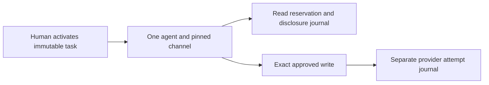
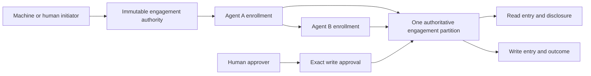

# AP073 engagement and participant contract

**Status:** implementation contract, 27 October 2026. Participant enrollment is
not yet implemented or qualified. This document resolves the next bounded
design decisions under [AP-SPEC-073](../specs/0073-identity-authority-and-enforcement-foundation.md).
The [assessment](0073-foundation-assessment.md) records actual evidence.

## 1. Current boundary and intended change

The current immutable task names one human, one agent and one delivery channel.
The native verifier already supports attenuated delegation chains. The first
AP073 change allows that chain to reach the final agent already approved by the
human. It does not enroll another agent or grant it another budget.



Replace the single participant assumption with an explicit authority tree and
separate roles. Keep the existing native proof verifier and exact closed request
compilation. Do not duplicate task cards to simulate child authority.



## 2. Roles and immutable commitments

These are separate roles even when one principal holds several:

- **Initiator:** requests creation of the engagement; initiation alone does not
  establish authority over the resources.
- **Delegator:** holds native authority and can narrow it for a child within the
  engagement's explicit delegation rules.
- **Acting participant:** proves control of an enrolled principal and instance
  generation when requesting an operation.
- **Approver:** supplies the separately required approval of an exact effect.
  An approving human need not be the initiating machine.
- **Resource operator:** chooses trust roots, installation, credential account,
  executor and admitted recipe or native resource contract.

The root engagement binds its identity, authority partition, initiator,
authorized initial participant, approver policy, resource scopes, connection
generations, allowed channels, validity, budgets and delegation limits.
Authorization must satisfy both the native grant and this product contract.

An enrollment binds engagement commitment, parent enrollment, native child grant
commitment, participant principal, instance generation, delivery-channel
identity, scope, validity and ceilings. Enrollment IDs are never reused. The
initial implementation is a tree: one parent per enrollment, no reparenting or
multiple-parent authority unions. Additional composition needs a separate exact
authorization action and conservation contract.

Use a direct task schema cutover. Reject obsolete state; do not maintain a
parallel reader, migrate signatures, or reinterpret old human fields as machine
roles. Keep native principal, grant and canonical action types authoritative.

## 3. Enrollment and resource bounds

A fixed typed enrollment action must be signed by the enrolled parent and
authorized by its native authority. The prospective child must prove control
before activation. Verify native parent/subject linkage, attenuation, remaining
depth, current status, engagement commitment and descendant limits. Enrollment
cannot select arbitrary network destinations, filesystem paths or credential
accounts: channel identities resolve only through operator-approved bindings.

The initial product limits are 16 participant enrollments, 64 logical operations
and 16 resource scopes per engagement. These are upper bounds, including revoked
enrollments and terminal operations; pruning must not make identifiers reusable.
Native proof byte, work and delegation-depth limits still apply independently.
Reject inputs exceeding either boundary before expensive verification or state
mutation. These limits must become constants with boundary tests in the schema
cutover, not unbounded vectors justified by this prose.

Enrollment and revocation serialize in the same partition. Repeating an exact
enrollment may return its existing record, but cannot reactivate a revoked one.
The same identifier with different committed content fails. A parent revoked
before the enrollment transaction cannot create a live child.

## 4. Central capacity ownership

Root authority, participant tree, revocation epochs, logical-operation replay,
capacity and entry decisions belong to one authoritative partition. Every
admission atomically checks and charges all ancestors. Independent child stores
must never be treated as new budget sources.

For each bounded unit and each node on the ancestry path:

```text
spent + reserved + uncertain <= ceiling
```

The three accounting categories are disjoint. Moving a reservation to uncertain
does not charge twice and does not free capacity. Child ceilings restrict use;
their sum is not an allocation of extra root capacity. Siblings contend for the
same remaining parent capacity. Counts, bytes, currency and provider-specific
units must stay distinct, with checked arithmetic and explicit unit identities.

Every claim binds engagement, participant generation, exact action and compiled
request commitments, operation ID, executor audience and partition generation.
Fresh child keys, new recipes or restarted executors cannot reopen a claimed
logical operation. Unknown writes and lost disclosure acknowledgements retain
their charges. Revocation and key replacement do not refund them.

The existing file ledger supplies a single-host implementation using locking,
atomic publication and fsync. It is not a distributed transaction service. A
multi-host deployment needs a consistent transactional authority partition and
fencing enforced at resource entry. Offline escrow is deferred; no replica may
spend a cached copy of remaining capacity.

## 5. Entry, revocation and recovery

Reservation is not execution permission. A durable entry decision checks current
ancestry and generation and serializes against revocation. Specify and test both
orders rather than claiming that repeated reads eliminate races:

| History | Required result |
| --- | --- |
| Revoke, then reserve | Refuse without a new reservation. |
| Reserve, then revoke, then entry | Refuse entry; retain already consumed capacity under the selected recovery contract. |
| Reserve, then entry, then revoke | The authorized in-flight effect may complete; revocation does not undo it. |
| Entry, then crash before durable outcome | Unknown; no blind second send. |
| Fetch, then revoke, then disclosure entry | Refuse private-content release. |
| Disclosure entry, then lost acknowledgement | Retain release/byte charge; no redelivery. |

Durable entry authorization and physical transport entry are distinct facts.
A bounded, exact permit and its expiry must be checked at dispatch. Do not hold
a filesystem/database lock across network I/O. If a resource cannot enforce a
distributed fence, document the weaker in-flight guarantee and do not claim
instantaneous global revocation. Provider observation and create reconciliation
remain profile-specific; a shared counter does not prove provider idempotence.

## 6. Lifecycle and rollback

Initially a raw-key replacement is a new principal and a new instance generation,
requiring explicit enrollment. Do not silently transfer pending permits or grant
ancestry. Revoking an enrollment invalidates all descendant entry eligibility;
already uncertain effects remain observable without authorizing another send.

Recovery from whole-store restoration requires a checkpoint outside the restored
state's rollback domain, or explicit re-commissioning that rejects every old
permit and cannot reopen old operations. An epoch stored next to the database
does not solve restoration of both. F15 remains open until that mechanism and
restore tests exist.

## 7. Implementation and acceptance order

1. Verify the existing-chain extension and preserve final-recipient checks.
2. Cut over task roles and enrollment schema with bounded canonical decoding.
3. Implement signed child enrollment and atomic ancestor accounting, including
   sibling contention, revoked ancestry, expiry, overflow and crash histories.
4. Exercise machine initiation, isolated A/B processes, mediated private reads
   and independent human approval of an exact write through the installed SDKs.
5. Add the production authority partition, native resource enforcement and
   explicit second-domain federation contract. Update ADRs before those paths
   become production authority.

Required negatives include arbitrary child/channel substitution, an unrelated
human elsewhere in a proof bundle, widening scopes, exhausted delegation depth,
reusing an operation through another recipe or descendant, simultaneous last
capacity claims, parent revocation during enrollment/entry, old instance permits
after replacement, restored state, and unknown outcomes after executor restart.
Record exact artifacts and observed histories; this design is not test evidence.
