# AP073 engagement and participant contract

**Status:** implementation contract, 28 October 2026. Native enrollment verification, a bounded tree and operator-session publication into the task journal are implemented.
Mandatory participant admission, retained ancestor accounting, task-specific native audiences, typed deferred-child scopes and bounded CLI preparation are implemented in source. Binding authoring forwards explicit audiences. Enrolled disclosure permits and exact-writer approval are implemented in source. End-to-end external authoring, provider execution/recovery evidence and exact-revision qualification remain incomplete. This document resolves the next bounded
design decisions under [AP-SPEC-073](../specs/0073-identity-authority-and-enforcement-foundation.md).
The [assessment](0073-foundation-assessment.md) records actual evidence.

## 1. Current boundary and intended change

The original immutable task named one human, one agent and one delivery channel.
The implemented role cutover now separates initiator and approver while retaining
one agent and one delivery channel.
The native verifier already supports attenuated delegation chains. The first
AP073 change allows that chain to reach the final agent already approved by the
human. It does not enroll another agent or grant it another budget.

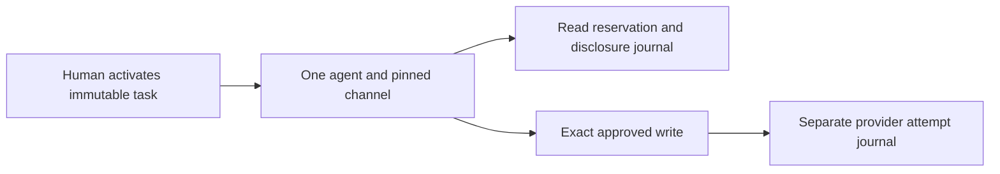

Replace the single participant assumption with an explicit authority tree and
separate roles. Keep the existing native proof verifier and exact closed request
compilation. Do not duplicate task cards to simulate child authority.

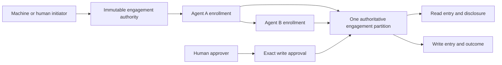

## 2. Roles and immutable commitments

These are separate roles even when one principal holds several:

- **Initiator:** requests creation of the engagement; initiation alone does not
  establish authority over the resources.
- **Delegator:** holds native authority and can narrow it for a child within the
  engagement's explicit delegation rules.
- **Acting participant:** proves control of an enrolled principal and instance
  generation when requesting an operation.
- **Approver:** supplies the separately required approval of an exact effect.
  An approving human need not be the initiating machine.
- **Resource operator:** chooses trust roots, installation, credential account,
  executor and admitted recipe or native resource contract.

The root engagement binds its identity, authority partition, initiator,
authorized initial participant, approver policy, resource scopes, connection
generations, allowed channels, validity, budgets and delegation limits.
Authorization must satisfy both the native grant and this product contract.

An enrollment binds engagement commitment, parent enrollment, native child grant
commitment, participant principal, instance generation, delivery-channel
identity, scope, validity and ceilings. Enrollment IDs are never reused. The
initial implementation is a tree: one parent per enrollment, no reparenting or
multiple-parent authority unions. Additional composition needs a separate exact
authorization action and conservation contract.

Use a direct task schema cutover. Reject obsolete state; do not maintain a
parallel reader, migrate signatures, or reinterpret old human fields as machine
roles. Keep native principal, grant and canonical action types authoritative.

## 3. Enrollment and resource bounds

A fixed typed enrollment action must be signed by the enrolled parent and
authorized by its native authority. The prospective child must prove control
before activation. Verify native parent/subject linkage, attenuation, remaining
depth, current status, engagement commitment and descendant limits. Enrollment
cannot select arbitrary network destinations, filesystem paths or credential
accounts: channel identities resolve only through operator-approved bindings.

The initial product limits are 16 participant enrollments, 64 logical operations
and 16 resource scopes per engagement. These are upper bounds, including revoked
enrollments and terminal operations; pruning must not make identifiers reusable.
Native proof byte, work and delegation-depth limits still apply independently.
Reject inputs exceeding either boundary before expensive verification or state
mutation. These limits must become constants with boundary tests in the schema
cutover, not unbounded vectors justified by this prose.

Enrollment and revocation serialize in the same partition. Repeating an exact
enrollment may return its existing record, but cannot reactivate a revoked one.
The same identifier with different committed content fails. A parent revoked
before the enrollment transaction cannot create a live child.

## 4. Central capacity ownership

Root authority, participant tree, revocation epochs, logical-operation replay,
capacity and entry decisions belong to one authoritative partition. Every
admission atomically checks and charges all ancestors. Independent child stores
must never be treated as new budget sources.

For each bounded unit and each node on the ancestry path:

```text
spent + reserved + uncertain <= ceiling
```

The three accounting categories are disjoint. Moving a reservation to uncertain
does not charge twice and does not free capacity. Child ceilings restrict use;
their sum is not an allocation of extra root capacity. Siblings contend for the
same remaining parent capacity. Counts, bytes, currency and provider-specific
units must stay distinct, with checked arithmetic and explicit unit identities.

Every claim binds engagement, participant generation, exact action and compiled
request commitments, operation ID, executor audience and partition generation.
Fresh child keys, new recipes or restarted executors cannot reopen a claimed
logical operation. Unknown writes and lost disclosure acknowledgements retain
their charges. Revocation and key replacement do not refund them.

The existing file ledger supplies a single-host implementation using locking,
atomic publication and fsync. It is not a distributed transaction service. A
multi-host deployment needs a consistent transactional authority partition and
fencing enforced at resource entry. Offline escrow is deferred; no replica may
spend a cached copy of remaining capacity.

## 5. Entry, revocation and recovery

Reservation is not execution permission. A durable entry decision checks current
ancestry and generation and serializes against revocation. Specify and test both
orders rather than claiming that repeated reads eliminate races:

| History | Required result |
| --- | --- |
| Revoke, then reserve | Refuse without a new reservation. |
| Reserve, then revoke, then entry | Refuse entry; retain already consumed capacity under the selected recovery contract. |
| Reserve, then entry, then revoke | The authorized in-flight effect may complete; revocation does not undo it. |
| Entry, then crash before durable outcome | Unknown; no blind second send. |
| Fetch, then revoke, then disclosure entry | Refuse private-content release. |
| Disclosure entry, then lost acknowledgement | Retain release/byte charge; no redelivery. |

Durable entry authorization and physical transport entry are distinct facts.
A bounded, exact permit and its expiry must be checked at dispatch. Do not hold
a filesystem/database lock across network I/O. If a resource cannot enforce a
distributed fence, document the weaker in-flight guarantee and do not claim
instantaneous global revocation. Provider observation and create reconciliation
remain profile-specific; a shared counter does not prove provider idempotence.

## 6. Lifecycle and rollback

Initially a raw-key replacement is a new principal and a new instance generation,
requiring explicit enrollment. Do not silently transfer pending permits or grant
ancestry. Revoking an enrollment invalidates all descendant entry eligibility;
already uncertain effects remain observable without authorizing another send.

Recovery from whole-store restoration requires a checkpoint outside the restored
state's rollback domain, or explicit re-commissioning that rejects every old
permit and cannot reopen old operations. An epoch stored next to the database
does not solve restoration of both. F15 remains open until that mechanism and
restore tests exist.

## 7. Implementation and acceptance order

1. Verify the existing-chain extension and preserve final-recipient checks.
2. Cut over task roles and enrollment schema with bounded canonical decoding.
3. Implement signed child enrollment and atomic ancestor accounting, including
   sibling contention, revoked ancestry, expiry, overflow and crash histories.
4. Exercise machine initiation, isolated A/B processes, mediated private reads
   and independent human approval of an exact write through the installed SDKs.
5. Add the production authority partition, native resource enforcement and
   explicit second-domain federation contract. Update ADRs before those paths
   become production authority.

Required negatives include arbitrary child/channel substitution, an unrelated
human elsewhere in a proof bundle, widening scopes, exhausted delegation depth,
reusing an operation through another recipe or descendant, simultaneous last
capacity claims, parent revocation during enrollment/entry, old instance permits
after replacement, restored state, and unknown outcomes after executor restart.
Record exact artifacts and observed histories; this design is not test evidence.

## 8. Closed partition reference and grant-binding decision

`product/runtime/auths-gateway/src/engagement_reference.rs` is a phase-one,
`cfg(test)` reference. Its inputs assume native authorization and possession
verification have succeeded; it does not establish those facts, serialize
state, issue dispatch permits or perform I/O. No F acceptance criterion closes
because this reference exists. Production must demonstrate a refinement of
these transitions under the authoritative partition transaction.

Resource authority is pinned per immutable root scope. A participant's scope
entry names its exact native grant ID; a child's corresponding grant must link
to that parent's scope grant. Read and write grant paths may differ. The native
enrollment-action grant is not implicitly resource authority. On operation
admission, the verified single native branch must end in the complete sequence
of scope grants belonging to the enrollment ancestry. Merely finding each
principal somewhere in a bundle is insufficient. Native signature, subject,
issuer, permission, status, depth and attenuation checks remain prerequisites.
The future signed enrollment must commit this complete scope-to-grant mapping.

The reference derives each ancestor's usage from the bounded operation journal
rather than keeping a second mutable aggregate. Counts of provider reads,
disclosures, disclosure bytes and writes remain distinct. Provider entry moves
its reservation to uncertain; observation records it spent. Disclosure entry
adds its own uncertain count and byte charge; authenticated acknowledgement
moves that charge to spent. Recovery marks entered operations unknown without
a second charge, refund or another entry. A refused entry retains its earlier
reservation. Every refusal is atomic.

The reference checks the current partition, executor and instance bindings at
entry and disclosure, in addition to the exact recorded action and request.
Changing a partition generation in these tests assumes a trustworthy external
generation source; it does not prove rollback detection. Actual dispatch
fencing, persistence failures, signed enrollment, child possession, exact
approval and installed process isolation remain separate implementation work.

Eight reference tests cover shared sibling capacity, all ancestor charging,
revocation on both sides of entry, read-before-disclosure revocation, lost
acknowledgement, mixed read/write replay and hard limits, scope/grant splicing,
exact-request mutations, expiry, stale generations, overflow and randomized
crash/revocation histories. These eight reference tests passed in hosted run 40583279847 on `e4bcebcb`;
the overall run failed other tests and does not qualify the implementation.

## 9. Native enrollment verification boundary

The Rust `participant_enrollment` module verifies a proposal before the durable
partition transaction. It is a production-callable verification API, not an
installed enrollment endpoint or a current-state authority service. Its
`VerifiedParticipantEnrollment` constructor is private. The parent snapshot
and root resource/channel pins are trusted inputs selected by the caller from
authenticated operator state; accepting those pins from an agent would violate
the API contract.

Before this boundary, the reference assumed authenticated enrollment inputs:


The new boundary establishes specific native facts but leaves persistence and
current-state ordering to the forthcoming ledger integration:

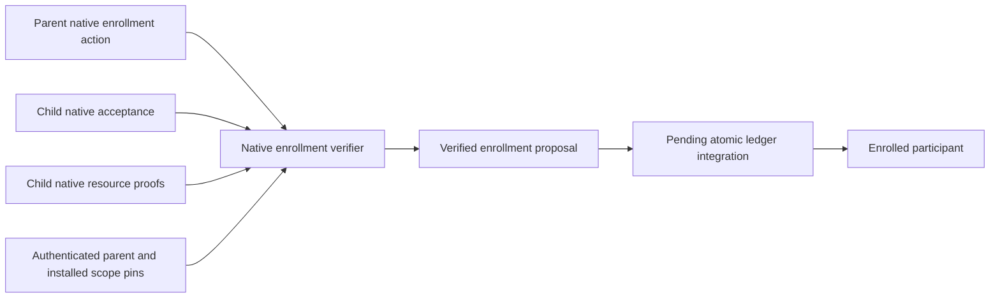

The closed service is `auths-participant`, with `enroll_participant_v1` and
`accept_participant_v1` tools. The parent submits one canonical native MCP
action containing `{"enrollment": descriptor}` under its enrolled control
grant. The child submits `{"enrollment_commitment": [32 bytes]}` under a
child control grant whose issuer, subject and parent ID match the enrolled
parent and proposed child. Native trust, configured challenge, current evidence,
validity, permission, signature, holder, parent linkage and attenuation checks
are not reimplemented. Every control proof must have exactly one action and
one authorized branch.

The descriptor uses schema `auths.participant-enrollment/1`. Its canonical JSON
is committed through the existing codec with domain
`auths.participant-enrollment.v1`. It binds root engagement commitment,
partition generation, parent enrollment commitment and instance generation,
fresh enrollment ID, child principal and instance generation, registered
channel, child control grant, sorted scope-to-resource-grant mappings, validity,
remaining depth and independent count/byte ceilings. Integer fields must be
within the exactly representable JSON integer range; canonicalization must not
round two distinct epochs into the same commitment.

For each listed scope, a separate child-signed native resource invocation must
use the installed MCP service/tool and exact resource argument. Its terminal
grant must have the enrolled parent as issuer, the child as subject, the exact
parent resource grant ID as parent, and the descriptor's child grant ID. Its
validity and remaining depth must cover the proposed enrollment. These are
verification witnesses, never provider calls; a witness consumes no operation
and does not stand in for the future invocation's native verification. The
resource scope still resolves through the immutable root engagement's recipe
and connection pins.

Limits: sixteen scopes and registered channels, sixteen native grant links,
64 KiB per canonical action and 4 MiB total evidence across the parent, child
and resource invocations. Unsupported action/grant critical extensions and
grant budget ceilings are refused; the enrollment verifier must not silently
ignore another stateful budget protocol. Initial product maxima remain 64
provider reads/disclosures, 32 writes and 16 MiB disclosed bytes.

The consuming ledger must still establish durable ID non-reuse, participant count,
current parent ancestry/status/generation, channel ownership, and ancestor
capacity atomically. A parent revoked between verification and commit must
prevent enrollment. It must also preserve native grant mappings at operation
admission and enforce the exact participant/channel and process generation at
entry. Rust verification tests alone do not establish any of those guarantees.


## 10. Transaction-owned enrollment tree

`EnrollmentTree` initially supplied only a pure state transition. Section 14
now connects it to `FileReleaseTaskLedger` and operator-owned Rust task-session
methods. Descendant operation admission and dispatch remain incomplete. Its public bootstrap constructor now verifies native root activation and resource
authority as specified in §11. Root installation pins remain trusted inputs,
independently bound to the signed engagement and operator policy. This is one
concrete engagement contract, not a new generic policy engine or a second store.

Before integration, a caller could verify a proposal against a snapshot and
then implement current-state checks separately:

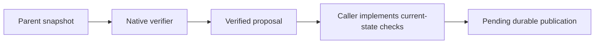

The pure tree owns ancestry projection and verification together. The planned
ledger transaction owns serialization and publication of the tree **and** the
operation journal; no lock may cross provider or channel I/O:

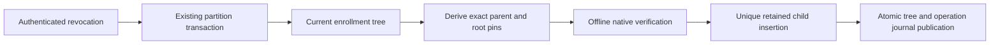

The root and every child count against sixteen retained slots. Each child has
one immutable parent, unique enrollment ID, unique principal and descriptor
commitment. Records cannot be deleted, reparented or reactivated. Revocation of
any ancestor blocks both later enrollment and resource-grant-path projection.
Repeated revocation is harmless; repeated enrollment refuses rather than
minting another record. Each scope projection returns exact native grant IDs
from root participant to acting leaf, ready for comparison with the native
operation branch. This projection is not an execution permit.

Registered channels now map to the exact recipient principal and process
instance generation, not just a set of approved names. Both fields must match
the signed child descriptor. Installed transport resolution and acknowledgement
verification must preserve this same binding at disclosure; those integrations
remain open. Channel addresses and credentials are never enrollment arguments.

Canonical tree storage uses `auths.engagement-enrollment-tree/2`, bounded to
192 KiB. Decode requires separately authenticated root installation and checks
all immutable root pins, exact schema/canonical bytes, bounds, unique IDs and
principals, commitment integrity, acyclic complete ancestry and attenuation.
Expired and revoked records remain decodable. A persisted root revocation may
be stricter than activation; an externally revoked root cannot be reactivated
by decoding an active record. No legacy reader is added.

The decoder assumes a trusted protected journal. It cannot authenticate a
forged state file, reconstruct native proofs, detect restoring both journal
and commissioning state, or make `clone()` a distributed authority partition.
The owner must supply integrity, rollback protection and a single transaction.
There is no standalone file-store implementation for this tree.

Nine additional tests cover real native three-edge authority, channel owner
and instance substitution, revoke-after-verification ordering, full retained
slots, replay across revocation, exact grant ancestry, canonical restore and
adversarial topology/installation mutations. They are authored and compiled by
artifact construction; hosted behavioral evidence remains pending. An enrollment
ceiling does not allocate fresh capacity. Ancestor charging and operation entry
are still the following direct state cutover.


## 11. Native root bootstrap before durable initialization

An installed list of grant IDs is not evidence that the root controls those
grants. `EnrollmentTree::bootstrap` now checks native root possession and
resource authority before construction; the raw constructor is crate-private.

Before:

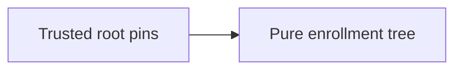

After:

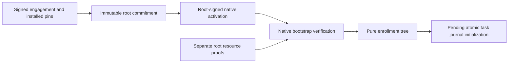

`auths.engagement-root/2` commits the engagement, partition generation, root
principal/instance, control grant, validity, depth, independent ceilings,
channel owners/instances and every installed scope including native grant,
service, tool, resource argument and exact handle. The canonical codec uses
domain `auths.engagement-root.v2`. The existing enrollment ID and mutable
active/revoked flag are excluded: an ID cannot commit itself, and revocation
must not change descendant parent links.

The fixed native tool `auths-participant/activate_engagement_root_v1` accepts
only `{"root_enrollment_commitment": [32 bytes]}`. Its verified actor and
terminal grant subject must be the pinned root; the exact terminal control
grant must cover the root's validity and native delegation depth. Separate
resource invocations prove the same holder and each exact resource grant,
installed service/tool, handle, validity and depth. These are verification
witnesses; bootstrap performs no provider calls or private-content access.
Root and child enrollment share one bounded proof-byte accounting leaf and
the maintained native verifier. No cryptographic or attenuation rules fork.

Pins still require an authenticated engagement and operator installation.
Bootstrap neither allocates capacity nor supplies commissioning, role separation,
channel transport, unique root admission or atomic publication. The journal
must claim initialization once; repeating a proof must not mint another capacity
partition. The decoder remains a trusted-store restore boundary, not an
alternate untrusted activation endpoint. Whole-store rollback remains open.

Control grants must be scoped to the required fixed tools, holder, validity and
depth. Since acceptance messages commit their control grant IDs, issuers must
avoid a circular exact-body digest containing its own grant ID. Resource grants
can retain native body constraints; every later operation must independently
satisfy them. Grant budget ceilings and unknown critical policies are refused.

Five tests cover native bootstrap followed by child enrollment, all immutable
root dimensions, other valid grants/holders, resource substitution, insufficient
depth, missing/oversized evidence, expiry and revocation. Artifact construction
compiles these tests; behavioral acceptance remains pending hosted CI. This API
does not close installed activation, ledger or F01–F16 acceptance.


## 12. Control namespaces cannot acquire provider meaning

Native control grants name MCP services/tools. Reusing such a name in a
credential-bearing recipe would let a control permission acquire unrelated
provider meaning. Matching a source to its profile lock does not prevent this
when both carry the colliding name.

Before:

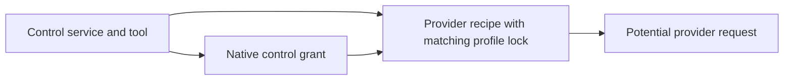

After:

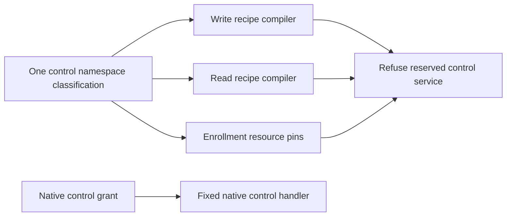

`control_namespace.rs` owns the exact `auths-agent-task` and `auths-participant`
service constants and classification. Both recipe compilers share the refusal
in profile-lock validation, using the existing `gateway.recipe.profile-mismatch`
code; resource pins refuse these services before native evidence work. The rule
reserves exact service names, without inventing a broad provider naming policy.
Control handlers still consume the same constants. No provider-specific logic
enters the shared gateway.

Three tests cover matching source-and-lock substitutions for reads/writes and
control-grant substitution into enrollment resource pins. Ordinary provider
recipes remain the positive controls. This changes compiler admission semantics;
valid provider recipe digest construction, wire result shape and binding ABI
are unchanged. SDK submission clients still obtain the server's native result.


## 13. Signed task delegation envelope

The former task format approved one actor and channel but did not say whether
that actor could enroll another. Treating a valid native delegation chain as
consent to expand the task's participants would exceed that card. Delegation
permission must therefore be explicit before installed enrollment is enabled.

Before this change:

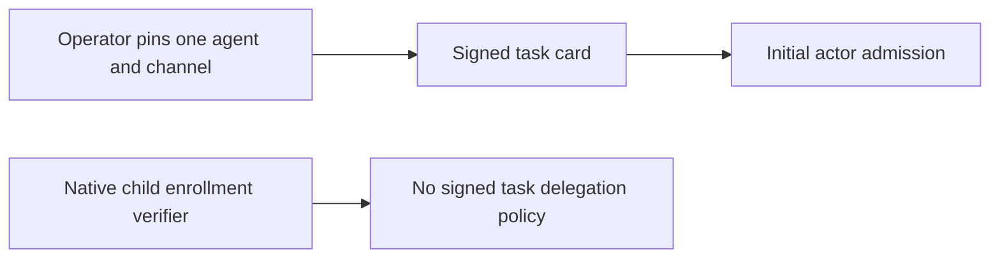

The source cutover adds one mandatory policy object, validated in Rust:

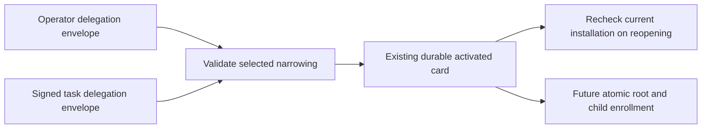

The task is now `auths.agent-task/4`, committed with domain
`auths.agent-task.v4`; installation is `auths.gateway-task-installation/5` and
task state initially became `auths.gateway-agent-task-state/9`; section 14
now supersedes it with schema 10. Old formats and a missing
`delegation` field are refused. There is no legacy decoder or default policy.
The object contains:

- `partition_generation`: the nonzero commissioned partition generation.
- `root_instance_generation`: the nonzero instance of the card's initial agent.
- `max_depth`: at most fifteen child edges from that agent.
- `permitted_channels`: one to sixteen opaque registered channel IDs, each
  binding a native principal and exact instance generation.

The native session boundary and CLI share a 16 KiB encoded installation limit,
checked before JSON decoding or journal creation.
Generations must be exact canonical JSON integers, at most 2^53 − 1. Channel
IDs contain one to sixty-four ASCII alphanumeric, hyphen or underscore bytes.
One principal has one registered channel in this first tree contract; duplicate
principals are refused. The root's signed channel must name its exact principal
and instance. The independent approver cannot be an acting participant, so its
principal is forbidden in every channel entry. Depth is strictly smaller than
the number of registered channels, including the root. The task may remove
channels or lower depth from the installed policy, but cannot change the
partition, root instance, channel principal or channel instance.

`TaskDelegationPolicy` owns this validation. Installation, signed activation,
and reopening a durable task use the same predicate. Python card production
copies the operator-controlled policy and uses the native canonical commitment;
it does not implement another authority evaluator. Existing demonstrations
explicitly author a zero-depth, one-channel policy. Generation one in those
synthetic installations is a fixture value, not a production default.

The initial agent is the root participant; a machine can remain the independent
initiator and native issuer to that agent. The future root bootstrap will bind
this task commitment, its ceilings and resource projection to the exact native
control/resource grant IDs. Those IDs need not be self-referential fields in
the task commitment: the native root activation commits them together with the
already signed task. This requires the bootstrap caller to derive and compare
all task/operator pins, not accept a caller-supplied root policy as trusted.

This change does **not** enroll any channel member or permit a child operation.
The current read/write and acknowledgement paths still require the initial
agent. Root/child persistence and ancestor accounting remain the next integration
step. Reopening refuses a changed installed generation, but restoring both
journal and installation remains outside this guarantee; F15 is still open.


## 14. Native root and enrollment in the existing task journal

The concrete `TaskWriteSession` API now offers scope/root preparation,
`bootstrap_participants`, `enroll_participant`, active participant snapshots,
and authenticated operator revocation. These are Rust operator-session methods;
there is no new public HTTP endpoint, CLI command or language wrapper yet.

Before this integration, verified root/child state and task replay were separate:

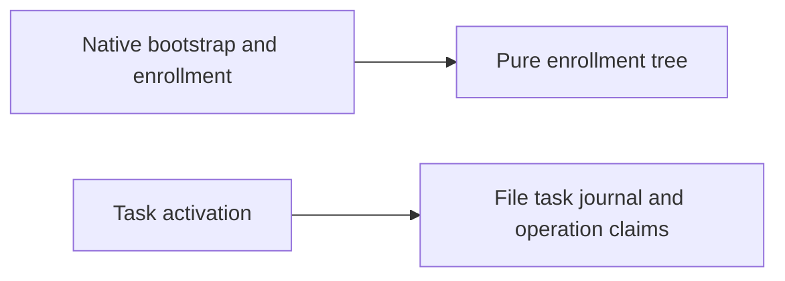

The existing file transaction now owns durable tree publication and revocation:

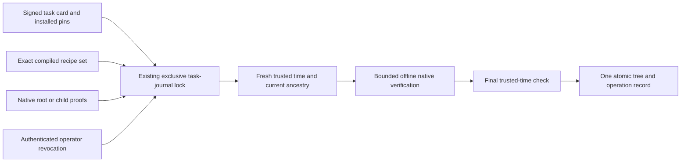

Root scope IDs are domain-separated canonical commitments with domain
`auths.engagement-resource-scope.v1`. They commit the scope kind and **all**
signed scope fields: resource, recipe, connection ID/generation/account, and
write verb where present. The root preparation API derives service, tool and
resource argument from compiled recipes whose digest set must exactly match
the task. Extra, duplicate, missing or substituted recipes are refused. The
participant proposes only native grant IDs for the derived scopes and its
control grant. Native bootstrap verifies them and the root's acceptance of the
complete root commitment. A proposed ID never establishes authority by itself.

Task state schema 10 requires an explicit `participants` lifecycle field,
`pending` or `active` with a structurally validated tree. It has no legacy reader
or implicit default. Root publication is single-use and refused after any
existing read/write claim, preventing a fresh tree from restarting a used task's
accounting. The bootstrap transaction re-derives pins from the current activated
card. Child publication re-derives parent pins from the current tree. Both sample
trusted deployment time **inside** the lock and again after native verification.
There is no network, custody or provider call under this transaction.

Canonical decoding checks the tree's bounded retained ancestry, the root's
commitment, and its association with the signed card and task commitment. A
reopened task additionally revalidates current installation pins. Root revocation
also revokes the task; task revocation also marks its root revoked. Child records,
IDs and charges remain retained. Publication acknowledges only after the existing
file fsync, atomic rename and directory fsync sequence. Uncertain publication
can be inspected by its known commitment; repeating it never creates capacity.
The protected journal assumption remains: this is not cryptographic authentication
of an arbitrary imported database or whole-store rollback detection.

The encoded journal limit is 512 KiB, including the separately bounded 192 KiB
tree. The operation limit is now sixty-four **combined** read/write claims,
checked at both reservation and decode. Task resource limits similarly count
reads, writes and a pending created-child scope together against sixteen.

Important incomplete integration: current read/write execution still uses the
initial-agent-only gate, including tasks in the pending root lifecycle. An
enrolled child does not gain execution or disclosure through these new methods.
The remaining direct cutover must require active root/participant authority at
every operation, bind the exact native grant suffix, and atomically charge every
ancestor. Current operator-session enrollment does not satisfy those obligations.
It also refuses root projection for a task with an unresolved created child,
rather than guessing a future handle or treating the parent as that child.
The profile-owned created-child lineage contract must be integrated before this
becomes the mandatory operation path. CLI/bindings, channel/ACK selection,
resource-entry fencing and the full isolated machine/A/B flow remain open.


## 15. Mandatory admission and exclusive resource audiences (cutover in progress)

An exact enrolled grant ID is insufficient isolation if the same grant still
admits `mcp://service` and `AnyBody`. Its holder could submit a valid action to
an ordinary recipe route outside the task journal. Mandatory participant checks
inside task routes do not protect that other route. This is an authority boundary,
not a request-label validation issue.

The direct cutover uses the kernel's existing audience attenuation and signed
action envelope. Each enrolled resource grant has exactly one audience:

```text
auths-engagement://v1/<lowercase task commitment>/<partition generation>/<lowercase compiled recipe digest>
```

All three values derive from signed activation and installed compiled recipes.
Generation is a positive exact JSON integer, and both commitments have fixed
canonical hexadecimal encodings. The public derivation function computes an
identifier; it neither authenticates a caller nor authorizes an operation.

Before:


After:

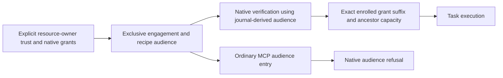

Root bootstrap and every child enrollment reject a leaf grant with any second
audience, even when its current witness verifies at the engagement audience.
Native attenuation then prevents a child from adding an ordinary or another
task/recipe audience. Control enrollment remains a separate control-service
permission and cannot be installed as a provider recipe. Root scopes now carry
an explicit recipe digest; restore compares the scope-ID-to-recipe mapping
against the signed card, as well as rechecking the whole root commitment.
Root commitment/schema version 2, enrollment tree version 2 and task state
version 11 directly replace their predecessors; there are no legacy readers.

The operator's native trust anchors must explicitly admit the engagement
resource audiences. `TrustedContext::for_request` changes only the expected
audience, never the anchors. The gateway must not rewrite ordinary anchor
permissions into engagement permissions, infer resource authority from the
initiator's task signature, or derive trust from an unverified action. Authoring
and installation therefore need a preparation phase: form the task commitment
and recipe identities, approve those audiences in resource trust, issue native
resource grants, activate the task, then verify root possession and its exact
resource witnesses. Task approval and native resource ownership remain separate.

Read admission now requires active enrollment and the entire enrolled resource
grant suffix on one sealed native branch. Initial-agent writes require the same
mapping in addition to exact human approval. Reservation checks time after
acquiring the journal lock. Capacity is computed from bounded retained records
for every ancestor, including revoked descendants. Provider-read reservations
remain spent; unknown, no-send and acknowledged disclosures all keep their byte
and disclosure charges. Root and descendants contend under one lock. A fresh
operation ID does not grant fresh ancestor capacity.

This is unfinished source work, not a qualified rollout. Existing operator CLI,
and installed-demo workflows still need the complete trust/grant/root
preparation sequence. Section 16 implements typed created-child lineage; a parent
resource never substitutes for a child.
Child writes must bind participant identity/instance in human approval, and
child disclosure must bind its enrolled delivery channel and acknowledgement.
Provider entry, disclosure freshness, external revocation/status and rollback
fencing remain separate open obligations. Audience separation alone establishes
neither whole-store rollback protection nor information-flow control after an
authorized recipient receives plaintext.

## 16. Created-resource enrollment binding

A future populate operation is already constrained by the signed pending-child
proposal and the gateway's verified creation/recovery lineage. Enrollment must
retain that distinction instead of inventing a concrete child handle at root
publication. The scope projection therefore uses a closed resource sum:
`exact(handle)` or `created-child(create operation, create recipe, parent scope)`.
The deferred scope ID commits the complete pending-child proposal and the exact
create scope, including connection identity/generation/account. Its native
audience is the populate recipe audience for this engagement.

A deferred resource witness establishes native authority for the populated tool,
not existence or identity of the future child. Every native grant on that witness
path must use `AnyBody`; an exact-body grant cannot prove authority for an unknown
future handle. The leaf must still have the exclusive engagement/recipe audience.
This deliberately refuses unsupported partial policies rather than interpreting
which arbitrary constraints might hold for an unknown child. An operator and
resource owner approve that task-scoped authority; ordinary entry cannot use it.

At actual write admission, the full scope must equal the journal's bound child
scope, which can only arise from the retained exact create and its checked
provider observation or approved recovery. Only then does admission select the
deferred enrollment scope and charge its participant ancestry. Neither a witness
sample argument nor the signed parent handle becomes a usable populate target.
The existing single-populate rule, exact human effect-plan/approval and connection
binding remain in force. This adds no provider-specific field logic.

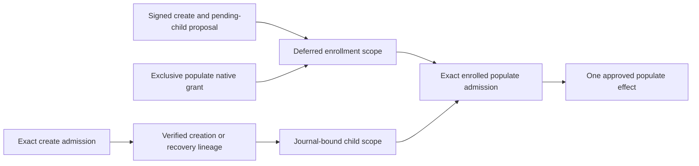

This is a direct typed projection of the existing created-child contract, not a
generic future-resource evaluator. Other resource discovery/selection semantics
need their own reviewed contract and evidence before reuse.

## 17. Bounded operator preparation and binding authoring

The development/operator CLI exposes `task-enrollment scopes`, `root`,
`bootstrap`, `enroll`, `inspect` and `revoke` against the existing task journal.
It accepts only recipes already selected by the protected installation. Scope
preparation emits the exact resource audience, typed resource binding and scope
ID from the Rust owner. These are authoring inputs, not an authorization result.
Root publication and child enrollment still require their distinct native proofs.

Authority input is bounded to 16 KiB and the closed proof manifest to 64 KiB.
At most sixteen resource witnesses share a 4 MiB proof/action-file allowance;
each canonical action is at most 64 KiB. No CLI path issues keys or credentials,
loads provider code, or sends a provider request. The manifest schema is
`auths.gateway-root-enrollment-proofs/1` or
`auths.gateway-child-enrollment-proofs/1`; unknown fields are refused.

Python and TypeScript MCP authors accept an explicit signed audience, forwarded
to the native authoring owner. The selected audience is included in custody
review. Omission retains ordinary MCP authoring for non-engagement workflows;
managed task verification always derives the engagement audience. Neither route
changes native grants or independently installed anchors. WASM and both Python
native entry points use canonical native authoring; Python's two entry points
share one projection helper.

The external workbench still needs a deliberate two-phase operator workflow:
form the final card, approve its derived audiences, issue scoped resource/control
grants and install trust, then activate and bootstrap. Resource ownership cannot
be inferred from card initiation. Current CLI and binding source is not evidence
that this external workflow or child delivery is complete.

`task-review-submission` selects the installed write recipe and the protected
activated task, verifies at the installed clock, and checks the exact signed
scope or verified child lineage. It uses the same request-review projection as
ordinary submission review. It cannot take an audience override, widen trust,
consume an approval, or reserve an operation. The ordinary review API remains
ordinary-audience-only; full offline audit of task evidence remains separate work.

## 18. Enrolled delivery binding and entered-release permit

**Source implementation in progress; behavioral verification pending.** Native
read admission recognizes an enrolled B. The preceding channel implementation
selected A from the task card in `TaskReadSession`, `release_channel` and
`release_ack`. Replacing only that principal comparison would leave
challenge, content delivery and acknowledgement with independently supplied
identities. This change centralizes this concrete disclosure protocol.

Before:

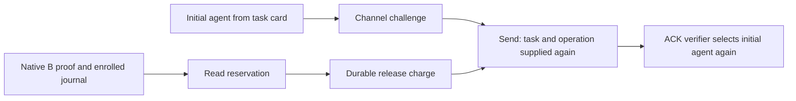

After:

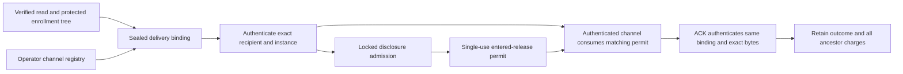

The binding is private Rust data derived from the signed task, the exact native
resource branch and current protected participant ancestry. It names task ID and
commitment, partition generation, enrollment commitment, recipient principal,
instance generation, registered logical channel and operation ID. No action,
caller-selected socket or public metadata can mint it. The operator resolves a
registered channel to a private local socket and canonical public identity. Root
identity fingerprint checks remain; child identities must agree with their
registered self-certifying principal. Instance binding is a commissioned logical
instance, not hardware/process attestation or proof that a key was never copied.

Channel authentication binds one fresh challenge to the complete tuple and
retains it. It does not take a replacement task or operation at delivery. Locked
disclosure admission rechecks active ancestry, time and capacity before charging,
then returns a non-cloneable entered-release permit for that tuple and the exact
keyed content commitment, byte count and resource. Delivery consumes that permit
and compares it with the authenticated channel and actual bytes. A review or
verification value cannot stand in for durable release entry. Neither a dropped
permit nor a known no-send failure refunds capacity.

The lock orders revocation against disclosure entry. Revocation that wins first
refuses new entry. Entry that wins first may complete or become unknown; later
revocation cannot retroactively retract plaintext or make it safe to retry. The
lock must not remain held during socket I/O. Receipt acknowledgement remains
recordable after expiry/revocation because it describes a previously charged
entry. It cannot authorize another disclosure.

Challenge and acknowledgement schemas must change together in native code and
agent bindings. Both sign the complete delivery tuple; the ACK additionally
binds resource, exact bytes and keyed commitment. Old schemas are refused.
Immutable principal/enrollment non-reuse within a task prevents a retained
operation from being reassigned to a later participant. If the new persisted
record changes shape, increment its version directly; do not add a legacy reader.

Required evidence includes real native root/A/B enrollment, delivery to B with
A receiving no content, wrong key/channel/instance/task/operation refusal,
replayed challenge/ACK refusal, matching permit consumption, changed content
refusal, revocation on either side of locked entry, lost ACK, no-send and restart
with retained ancestor charges. Existing pure channel tests may use explicit
synthetic bindings but cannot be cited as native enrollment evidence. Provider
entry and native evidence freshness remain separate obligations; this disclosure
permit must not be generalized into a universal write/recovery state machine.

The source cutover now places binding and permit construction inside the journal's
`delivery` module. The live channel consumes a matching non-cloneable permit,
checks actual bytes against the retained keyed commitment, and never accepts a
replacement task or operation. Permit mismatch sends nothing and returns unknown;
it cannot mint a no-send receipt for an unrelated channel operation. Public
identity validation is shared between operator read-session installation and
challenge/ACK verification. The operator may select any explicitly registered
channel; the signed task/enrollment must independently permit that recipient.

Challenge and ACK now use schema 2. The Python agent and loss-injection agent
require explicit enrollment commitment and exact nonzero partition/instance
generations from operator inputs. They do not echo untrusted challenge pins as
authority. Existing installed-conformance orchestration still needs native
bootstrap and handoff of these pins; it cannot run unchanged. No persisted state
shape changes: task commitment plus immutable principal/enrollment non-reuse binds
the retained operation to the same instance, including late ACKs after revocation.
Synthetic transport tests are separated from new native A/B enrollment tests.

## 19. Exact approval binds the enrolled writer

**Source cutover implemented; hosted behavioral evidence pending.** Before this
cutover, `derive_exact_write_intent` checked
that the sole native actor equaled the card's initial agent. `ExactWriteIntent`
bound canonical action and provider request commitments but had no enrolled actor
or instance. `WriteOperation` consequently attributed every write to the root.
Simply removing the initial-agent comparison would be unsafe: the canonical
provider action can be identical when different authorized principals sign its
native envelope. A human approving B's action must not thereby approve A executing
the same payload. Root-only accounting must not survive child execution.

Before:

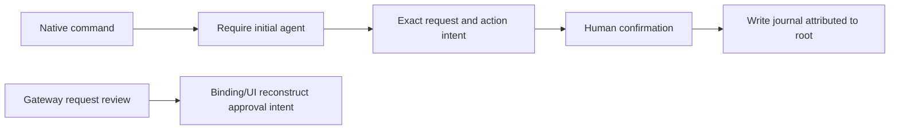

After:

```mermaid
flowchart LR
    P["Native command and exact enrolled scope ancestry"] --> A["Retained enrolled writer projection"]
    A --> I["Rust-owned exact intent with participant and instance"]
    I --> R["Task review and canonical approval payload"]
    R --> H["Independent human signature"]
    H --> C["Locked comparison to current enrollment"]
    C --> J["Persist exact writer and charge every ancestor"]
    J --> E["Existing provider attempt and recovery protocol"]
```

The enrollment tree remains the identity projection owner. The writer is derived
from the exact native branch admitted for the selected scope, never from an
unverified principal string or supplied enrollment ID. An immutable projection
names task commitment, partition generation, enrollment commitment, principal and
instance generation. Reuse this projection where its meaning is identical; do
not reuse the disclosure binding's channel, content commitment or delivery state
as write semantics.

The Rust exact-intent owner must include the writer projection in the human-signed
confirmation and applicable effect plans. A task-specific typed review returns
that same intent and request projection for presentation/authoring. Language
wrappers must not independently reconstruct request commitments or choose the
writer. The ordinary non-task review contract remains separate. A preview remains
non-executable, and its identity snapshot must be rechecked at locked reservation.

Write reservation rederives current native ancestry, compares the complete writer
projection with the approved intent, checks exact action/request/resource and
installed connection pins, and charges every ancestor under the existing journal
lock. Retained write records carry the immutable writer projection. Reopening
validates it against retained ancestry even after revocation; accounting sums
those actual writers instead of assigning every write to the initial agent.
Unknown/no-entry/failed outcomes preserve the currently conservative charges.
Any persisted shape change advances the journal schema and rejects old state.

Create/populate and reconciliation must preserve the approved writer across the
pending-child lineage. An unknown create or expired approval cannot change the
writer during recovery. The first child-write slice requires exact independent
human approval; bounded-upfront behavior stays explicitly root-only until its
participant semantics and presentation are separately supported. No ordinary
provider route or generic callback may stand in for task admission.

Required evidence: native B executes an exact human-approved write; A signing the
same canonical payload cannot reuse B's confirmation; principal, enrollment,
instance and partition substitutions fail; unrelated native grant suffixes fail;
root/B/sibling contention cannot multiply write capacity; revocation and restart
retain writer attribution; original-time recovery preserves the approved writer;
and native/binding approval payloads agree byte-for-byte. Existing recipe and
provider request tests remain unchanged except for explicit task/participant
fixtures. This design does not establish provider-entry freshness, whole-store
rollback protection, identity recovery or the complete isolated demonstration.

Implementation uses the enrollment-owned `EnrolledParticipant` as immutable
attribution, deliberately not a permit. `ReleaseTaskState::write_participant`
returns retained metadata for native actors; `admit_write_participant` separately
checks the full active native scope ancestry and exact writer under the existing
journal lock. `ExactWriteIntent.writer` is mandatory. Confirmation tool v2 and
effect-plan tool/schema/domain v2 reject obsolete authoring; journal schema 12
rejects obsolete state. The ordinary request commitment domain is unchanged
because its provider-byte meaning is unchanged.

`TaskWriteReview` contains the exact intent, ordinary closed-request projection,
and canonical confirmation arguments. Python presentation checks consistency
and preserves this Rust-owned intent; it no longer constructs the request digest.
The Google broker now requires an installed task review. Its larger final-card →
scoped native grant → root bootstrap workflow is still incomplete, so this is not
a claim that the current workbench can run the full AP073 demonstration.

The native source tests exercise B's human-signed exact intent, identical root
payloads failing to reuse it, all writer identity substitutions, concurrent
root/B capacity, revocation and restart attribution. They currently establish
no hosted result and no provider execution. Sibling concurrency, changed-grant
write mutations, child create/populate recovery, full language payload parity and
the isolated provider write remain acceptance work. The old root-only bounded
upfront restriction is preserved explicitly.

## 20. Operator issuance follows protected activation

**Design for the external workflow; not yet implemented.** The existing AP071
broker issues ordinary service-audience resource grants before its task builder
chooses a random task ID and final card. That order cannot produce the exclusive
resource audiences required by §15. Adding audiences to trust automatically when
an agent submits a proof would invert the trust boundary. Computing a different
card in a later review would invalidate the intended scope as well.

Before:

```mermaid
flowchart LR
    O[Operator reviews recipes] --> G[Issue ordinary resource grants]
    G --> C[Browser constructs final task card]
    C --> S[Sign task and agent grants together]
    S --> R[Resource operation]
```

Required sequence:

```mermaid
flowchart LR
    O[Operator pins roles recipes accounts and ceilings] --> C[Initiator signs final card]
    C --> A[Native activation: pending enrollment]
    A --> P[Gateway projects exact scopes and audiences]
    P --> O2[Explicit resource operator approval]
    O2 --> G[Issue task-specific native resource and control chains]
    G --> T[Install independently approved trust]
    T --> B[Initial agent signs root and resource witnesses]
    B --> E[Durable native root bootstrap]
    E --> D[Parent delegation and child acceptance]
    D --> X[Enrolled operations and independent exact write approval]
```

The first stage uses only authority for task-control actions. Recipe metadata,
permitted resource handles, account/credential generations, principal roles,
channels and budget ceilings are reviewed installation data, not already-issued
provider authority. Activation persists one immutable signed card in the existing
pending-root state; no resource operation is possible there.

The next stage consumes `TaskWriteSession::participant_scopes` from that protected
activation and installed recipes. The resource operator reviews those scopes
alongside the signed card, including the account pins committed by each scope ID.
The issuer grants each resource branch its single native task/partition/recipe
audience. It signs distinct participant-control grants for the actual issuer →
machine → A → B hierarchy, with declining delegation depth. Human confirmation
stays a separate nondelegable role; machine initiation does not acquire it.
Authority holders sign their own child grants and possession proofs.

The final trust configuration is an explicit resource-operator decision with
exact permission, audience, root and evidence policy limits. Resource audiences
must not be inferred from incoming actions or silently appended by the runtime.
The test-only `operator_context` helper is deliberately not a production issuer
or trust-expansion API. Installation must bind the approved configuration using
the existing installation/generation machinery; a final card is not rewritten
to hash an artifact that already depends on that card. The card's policy pin and
the resource operator's subsequent trust decision are separate, cumulative
ceilings, not interchangeable attestations.

The external broker needs two typed ceremonies: task activation and participant
resource delegation. Its current combined response must be replaced, not kept as
an alternate ordinary-audience route. The operator root key remains outside both
browser/agent ceremonies. Finalization consumes the already activated card;
refreshing inputs cannot mint a new task ID, replace roles, or extend expiry.
Native root bootstrap remains the transaction that makes the engagement usable.
Only after it succeeds may the agent receive a usable resource package and the
operator configure the exact enrolled channel pins.

The new installed native test follows this order with synthetic company,
machine, A, B and human keys, production activation/enrollment/admission methods,
and a loopback provider write plus read-back. It is source-level evidence for
that sequence; it does not implement the browser ceremonies, prove process
isolation or qualify a real provider. Those remain explicit external workflow
work, together with issuer custody and binding-byte conformance.
