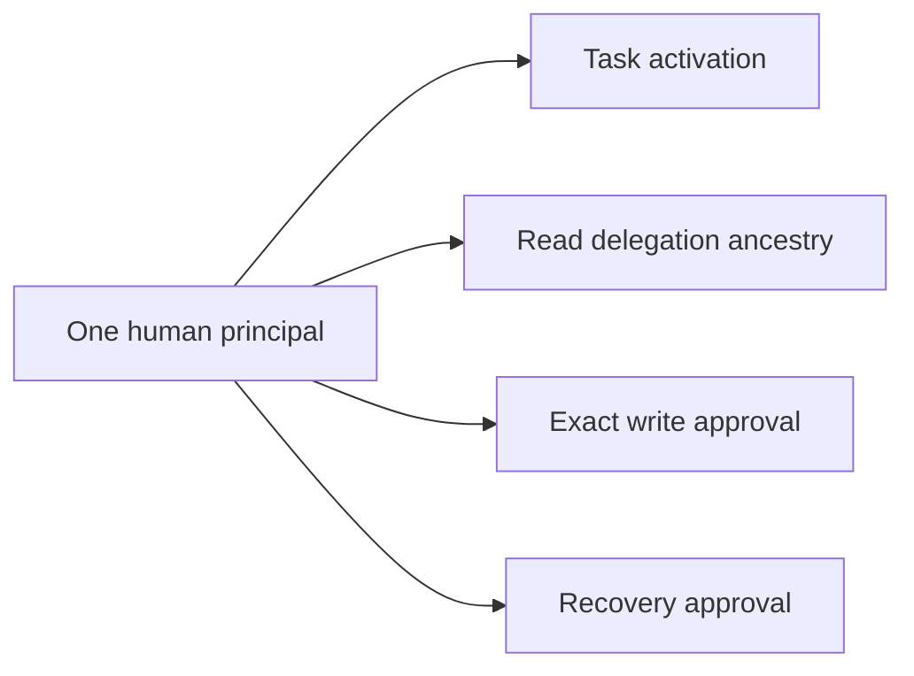
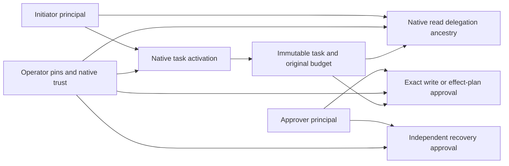

# AP073 task initiation and approval roles

**Status:** bounded implementation contract, 27 October 2026. No participant
selection, shared descendant allocation, or new production qualification is
established by this role cutover. See the
[participant contract](0073-engagement-participant-contract.md).

## Existing conflation

`AgentTaskDescriptor::human_principal` currently names the actor who activates
the task, the ancestor of a permitted read chain, the signer of exact write and
effect-plan approval, and the signer of recovery approval. `TaskActivationPins`
requires that same principal. The task still names one final agent and channel.
This prevents a machine from initiating bounded work while an independent human
approves its consequential effect.

## Direct schema cutover

Replace that overloaded task/pin field with required `initiator_principal` and
`approver_principal` fields. Both must parse as native principals and match
operator-installed pins. They may be equal, but neither may be the acting agent
in this initial independently approved task profile. Human or machine category
is not inferred from an identifier string; configured identity and assurance
policy determines who may fill a role.

The role cutover introduced task/card schema 3, installation schema 4 and
durable state schema 8. The subsequent signed delegation cutover in
[the participant contract, §13](0073-engagement-participant-contract.md#13-signed-task-delegation-envelope)
supersedes them with `auths.agent-task/4`, commitment domain
`auths.agent-task.v4`, `auths.gateway-task-installation/5` and
`auths.gateway-agent-task-state/10` (including journal enrollment in §14). Old cards and state are refused. There is no
fallback interpretation of `human_principal`, migration, default role, or
compatibility reader. The native proof encoding and attenuation rules do not
change.

The existing activation action name remains a versioned native tool contract;
its exact payload now commits schema 4. A name containing `approve` is not evidence
of a human ceremony. Documentation and result explanations must identify
activation by the initiator. Exact write/effect-plan/recovery actions retain the
separate approver gate.

## Required checks

- Activation requires the verified actor to equal the pinned initiator. Merely
  possessing the approver role cannot activate another principal's task.
- Managed reads require the initiator on the exact single native-authorized
  chain and retain final-agent, channel, account, recipe, task commitment,
  validity, revocation and original-budget checks. An unrelated initiator in
  the bundle is insufficient.
- Exact write, effect-plan and recovery confirmations require the pinned
  approver. An initiator signature cannot substitute when the two differ.
- Bounded-upfront writes remain permitted only when initiator and approver are
  the same principal and the operator explicitly permits that mode. A machine
  activating a task cannot manufacture an independent upfront human approval.
- Root/card role fields remain immutable under the existing canonical task
  commitment. Swapping roles after activation fails the stored commitment.
- This step retains the explicitly named final agent. The later enrollment
  transaction must introduce descendants without copying this root budget or
  replacing a channel with agent-supplied connection details.

The Google employee demo continues choosing its enrolled employee for both roles
from owner-controlled records; its broker remains a human-initiated vertical.
Its authority-package `human_principal` describes that separate employee identity
and is not globally renamed. Only task cards/pins and their consumers cut over.
The Airtable installed conformance driver chooses both roles explicitly too.
Machine initiation needs a native regression with different initiator, approver
and agent keys before being claimed.

## Evidence obligations

Retain existing direct-human activation, read, exact-write and recovery cases.
Add distinct-key cases proving machine activation and rejecting initiator/approver
substitution, mutated committed roles, and independent-approver bounded-upfront
writes. Update demo card producers, native commitment consumers, private pin
validation, durable schema and source/compliance identities atomically. Hosted
Rust and Python integration coverage must pass on the resulting revision.

This is not proof of a human's presence, enrollment of a runtime-selected child,
or completion of the representative machine → A → B flow. Those remain separate
acceptance obligations. No identity assurance is upgraded by giving a principal
a role name.
