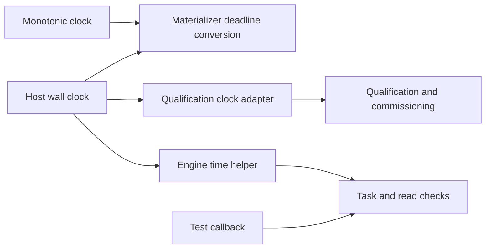
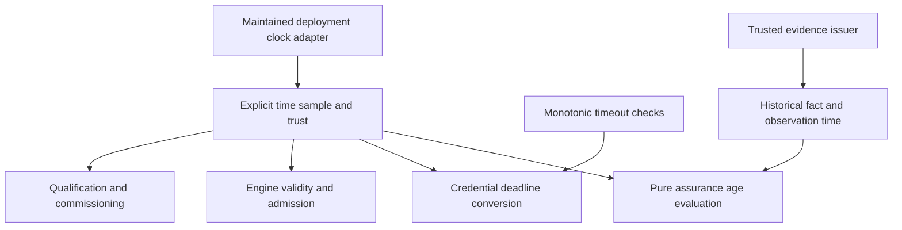

# AP073 time ownership and provenance

**Status:** gateway source cutover and WebAuthn provenance correction
implemented, 27 October 2026; hosted acceptance is pending. See the
[assessment](0073-foundation-assessment.md) and
[foundation spec](../specs/0073-identity-authority-and-enforcement-foundation.md).

## Three distinct meanings

| Time | Authority | Permitted use |
| --- | --- | --- |
| Evaluation time | Deployment's maintained clock adapter, with explicit trust state | Evaluate grant/task validity and evidence age at a particular boundary. |
| Historical observation/event time | The particular evidence issuer or trusted observation process | State when the named fact was established. Re-verification cannot renew it. |
| Monotonic deadline | Process-local monotonic clock and bounded duration | Limit credential exposure, I/O, drain and retry work. Never serialize it as a portable timestamp. |

One clock acquisition port cannot make these meanings interchangeable. The
kernel continues accepting explicit time and immutable evidence; it must not
read the host clock. Provider-specific freshness meaning remains in its profile.

## Source-backed baseline boundary

Before this cutover, `GatewayEngine` used `wall_clock_seconds` directly across activation, proof
verification, observation, reservation and recovery. `QualificationGate` owned a
separate sealed `DeploymentClock`; commissioning read that clock, while ordinary
submission read the engine helper. Managed reads added a private test-only clock
callback. `materializer::task_lease_deadline` independently read wall and
monotonic time. Process-local `Instant::now` calls enforce exposure and drain
deadlines and remain appropriate for those purposes.

Separate reads do not inherently create a vulnerability: these stages often
need fresh samples. The architectural problem is different acquisition and
failure/trust rules, plus no single deterministic seam for the whole execution
path. Centralization should unify the authority and sampling contract, while
retaining fresh checks at each stage.

## Selected cutover

Extract the existing sealed deployment clock into a gateway-owned module rather
than invent a parallel cross-workspace clock framework. Qualification and engine
use the same installed clock instance. Samples carry the wall observation,
monotonic reference where needed, and clock trust together. No proof, recipe or
application can supply clock implementation, trust or timestamp overrides.

The adapter must not label the process clock synchronized merely because it can
read it. Retain the production synchronization-marker checks and explicit
development policy. Required-clock failure refuses authority-dependent work;
no zero timestamp or unchecked fallback is a usable sample. Qualification
status reporting may still describe a refusal without admitting an operation.

Deadline conversion consumes an explicit sample; materializers must not read a
second wall clock themselves. Preserve subsecond precision or apply a documented
conservative bound so truncation cannot extend a credential past task expiry.
The result is capped by the source lease deadline and checked after async work.
Monotonic references are process-local and must be reconstructed after restart.

Tests must exercise unreadable/untrusted time, exact expiry, expiry during
materialization, trust loss before entry, backward/forward wall jumps and
monotonic expiration independently. A deterministic test adapter must be confined
to test support and shared across the real execution path; injecting time only
into an isolated predicate is insufficient.

Do not claim that a central port establishes global trustworthy time. Detecting
rollback within a process, detecting restored durable state and enforcing a
cross-host epoch are separate contracts. Persistent rollback requires an anchor
outside the restored state's failure domain, as specified in the
[participant contract](0073-engagement-participant-contract.md).

## Adoption boundary

First complete the gateway path and delete its superseded acquisition helpers
and private read-clock callback after their tests run through the shared seam.
Keep operation-specific expiry codes and conservative accounting. Verify that
test qualification clocks and invocation contexts use the same authority before
cutting over; otherwise tests can accidentally compare unrelated timelines.

Only then compare other product consumers for promotion to a shared product
primitive under the repository's abstraction gate. Provider token expiry,
certificate validity and historical attestation age are not one common policy.
The current SPIFFE `workload-attested` evaluation timestamp needs its own semantic
review; changing it solely because WebAuthn changed would conflate different
evidence contracts.

## Implemented gateway boundary

`clock.rs` owns the sealed `DeploymentClock::sample` interface. A private-field
`DeploymentTime` binds the Unix duration, a preceding monotonic reference and
trust state in one observation. `QualificationGate` owns the installed adapter;
engine authority checks and credential deadline conversion consume it. Managed
reads consume their installed read qualification gate's clock, including when
read and write recipes have separately installed gates.

The direct engine host-clock helper remains only under `cfg(test)` to bootstrap
fixtures. The materializer host-clock helper and private managed-read callback
are deleted. `FixedClock` exposes unavailable and untrusted states under test
support, with one coherent sample. Qualification reporting can describe clock
failure; its diagnostic fallback timestamps cannot enter execution. Optional
recipe qualification does not permit an untrusted installed execution clock.
Administrative bookkeeping can use a readable untrusted timestamp so disabling a
connection remains possible after synchronization is lost; subsequent execution
still requires trusted time.

Credential deadline conversion keeps fractional seconds and caps the result by
the source lease deadline. Write entry checks both monotonic elapsed time and
wall time within the evaluation window; a backward step below the operation's
evaluation time refuses. This is not a durable or general rollback detector.

Prepared regressions cover fractional and exact expiry, source deadline caps,
unavailable/untrusted samples, wall rollback/forward jumps versus independent
monotonic expiry, custody refusal, disabling while untrusted, and clock or trust
loss during a read lease before provider I/O/disclosure. Existing expiry and
revocation read races now traverse the installed clock path. Required full CI
runs gateway tests with all features, including the loopback read regressions.
Source-closure generation and a compilation/lint result are not behavioral or
hosted acceptance evidence; see the assessment's run log for current status.
