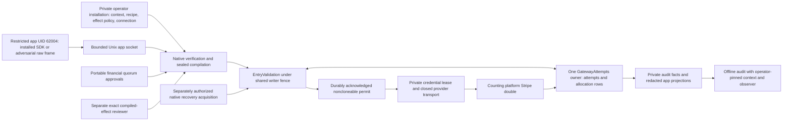

# Actual assessed boundary

Target: main `ac5fcabe9c6300e46789b4e847bb1991f9f9d66f`. Investigation remains
open; this map is a source/observed-deployment inventory, not a closure verdict.

## Source trace

| Edge | Source at the target | Security meaning and premise |
| --- | --- | --- |
| App bytes → typed envelope | `product/runtime/auths-gateway/src/app.rs`, `AppSubmission::decode`, `SessionClock`, `AppFrame` | Eight closed frame families; advertised length bounded before allocation; unknown submission fields rejected. JSON transport is not authority. |
| Proof/action → native result | `core/crates/auths-verifier/src/lib.rs:966`, `verify_v1`; gateway `engine.rs`, `verify_detailed` | The supplied proof is checked under independently installed context. Decoding and signatures alone do not authorize. |
| Native result → effect | `product/runtime/auths-gateway/src/effect.rs`, `BoundEffect`, `EffectBinding`, `ApprovedEffect` | Canonical private binding pins command, selected authority, recipe/connection/configuration, partition/epoch and charge declarations. Decoded binding bytes are data, not a permit. |
| Participant path → allocations | `effect/engagement.rs:360`, `capacity_origin`; `store/engagement.rs:266`, `insert` | Original successor origin and actor/recipient ancestor paths feed declared allocations. Rows and operation are admitted together; permanent allocations do not reset on ordinary withdrawal/recovery. |
| Current dependencies → grant | `entry.rs:221`, `EntryValidation::validate`; `store.rs:2991`, `ClaimedGatewayAttempt::grant_entry` | Snapshot identity, connection/configuration, current native authority/approval, time, existing reservations and prerequisites are rechecked under the shared fence. Durable acknowledgement precedes permit construction. |
| Grant → provider entry | `submit.rs:861`, `Run::grant_entry`; `submit.rs:891`, `Run::send` | An in-memory consumed capability carries the closed request. A stored fact or missing acknowledgement cannot reconstruct it. Host/process and adapter correctness remain premises. |
| Provider response → report | `submit.rs`, response recording and `GatewayRecoveryReport`; gateway-kernel outcome/transition predicates | A response, a state match, linkage and causation are distinct statements. Unknown retains conservative accounting and forbids blind repeat entry. |
| Review/approvals | `effect.rs`, review/approval types; `effect_review_approval_tests.rs`; core approval classification | Portable financial quorum and compiled-effect reviewer are distinct authorities. Scripted reviewer consent is not human-presence evidence. |
| Clock → fence/deadline | `qualification.rs:135`, synchronization marker trust; `entry.rs:221`; `transport.rs` | Wall time is sampled after lock acquisition; monotonic elapsed deadlines constrain waiting/transport. Host clock correctness is trusted, not proved by a timestamp. |
| Transport → origin | `transport.rs:299`, `GatewayHttpTransport::prepare` | HTTPS origin and public IPv4 resolution are pinned. The lab loopback build is explicitly different from shipping provider transport. |

Read those anchors against the pinned revision, not a later moving branch.
Applicable native regressions and additional attack evidence are linked through
the plan/results; the table is not itself execution evidence.

## Effective laboratory

The new transport campaign uses a source-free GitHub-produced main package.
Acquisition verifies the archive, package, complete payload inventory and source
commit. Trust in the GitHub producer is an explicit supply-chain premise; hashes
alone are not origin authentication or a signed release.

The observed controller runs as root in an assessment-owned Linux container.
The attacker child is UID 62004, has zero effective capabilities and
`NoNewPrivs=1`. Its allowlisted environment has no provider/operator credentials.
The app uses Unix IPC. A per-UID OUTPUT rule rejects its INET egress. The enclosing
container has `--network none`, no Docker socket and no host credential/state
mount. Recorded cgroup limits are two CPUs and 1 GiB. Protected working state is
inside the container; the shared host mount receives sanitized evidence only.

The controller's `NET_ADMIN` capability only establishes lab firewall rules.
It is not inherited by the app and does not establish a production firewall
deployment. Linux executes inside Docker Desktop's VM on this workstation;
the VM/runtime and trusted host remain in the TCB.

The 33-case campaign independently observed bounded refusal without credential/
provider counter changes, a valid provider-reaching control, one write from 24
duplicate contenders, and one write within the final 1000-unit sum capacity from
16 contenders. The provider is a double, development signing/custody is used,
and process restart is not power-loss durability.

The existing reference initially failed because a networkless container could
not resolve the reviewed HTTPS origin for readiness construction. A declared
public-address hosts stub restores only that constructor prerequisite; neither
external DNS/TLS nor real Stripe is exercised. The corrected 23-case reference
passes. No production readiness requirement was disabled.

## Alternate boundaries and assumptions

- Private admin commands and review/consent channels have different principals
  and permissions from the app socket. A root controller possessing all lab
  keys cannot establish protection from a malicious trusted host.
- A caller possessing another usable provider credential is outside the one-
  credential containment claim. This must remain explicit in product wording.
- Application-owned SDK integrations can bypass their voluntarily called SDK;
  they cannot inherit managed-gateway containment claims.
- AP070/old AP071 are not alternate managed execution owners on this candidate.
- TLS PostgreSQL server identity must equal the connection's DNS host. The first
  lab mistakenly paired host IP 127.0.0.1 with identity localhost and was refused
  by `validate_server_identity`; its attempted backend results are setup failures,
  not evidence of allocator defects or successful backend coverage.
- Whole-store rollback needs independently trusted checkpoint/floor and operator
  quarantine. An internally coherent old store cannot attest to its own freshness.
- Production custody, real provider semantics, independently administered hosts,
  human attention and external security review remain outside the lab evidence.
