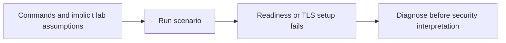
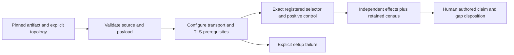

# Remediation, retesting and bounded architectural proposals

No shipping product vulnerability was established and no shipping fix is claimed.
The code changes are the assessment lab, evidence validation and hosted wiring.

## Preserved failures and corrected experiments

| Failure | Preserved initial evidence | Corrected evidence |
| --- | --- | --- |
| Reference transport readiness without DNS | `target/ap075-reference.log`; hosted Stripe job 128696627033, run 42468637050 | `target/ap075-reference-corrected.log`; retained 23-case reference census |
| TLS identity mismatch in lab DSN | `target/security-assessment/evidence/native-invalid-tls-initial/`; `target/ap075-native-results.log` | Retained native census: 452 exact selectors, including 85 actual configured TLS PostgreSQL scenarios |
| Intact corruption-control rejected through macOS temporary-root ancestry | `target/security-assessment/evidence/artifact-controls-macos-root-initial.json`; `target/ap075-artifact-controls.log` | Retained nine-case artifact controls; no mutant executed |
| Two successful no-op native support cases overcounted | Retained `evidence/native-before-support-audit.json`; source `scenario_tests.rs:2409` and `qualification_tests.rs:145` | Central explicit support inventory; retained corrected census keeps the two original observations as `not-run`. Remaining 452 substantive results are unchanged, not invented reruns. |

Initial logs are private local evidence, not guaranteed permanent hosted artifacts.
Their absence elsewhere must not be concealed. Public corrected results and
commands are retained in this directory. A fresh run should retain its own raw
logs and hashes before cleanup.

The acquisition path now checks parent links before creating extraction
directories. The census validator checks its inventory schema, duplicate
requirements and integer positive-effect counts. Five unit-test methods exercise
missing/duplicate/wrong-source/backend cases, absent positive effects and invented
production/customer claims. Four further retained-report controls detect altered
bytes, missing/duplicate result rows and wrong-source/missing-family claims.
One additional selection-control method rejects unsupported inventory kinds,
duplicate support entries and missing registered helpers. Operational-census
mutation controls reject missing/duplicated/failed drills, extra effects and
wrong source/binary identities. These eleven test methods
are controls on evidence quality, not eleven security
properties of the product.

## Keep the security owners centralized

The three invariant traces in `composed-invariants.md` support retaining one
bound effect, one final dependency fence and one authoritative execution journal.
No evidence here justifies introducing a second provider executor, a protocol
rewrite or a provider-name branch in the shared gateway. The generic mechanism
cannot independently establish Stripe business meaning; reviewed recipe data
and provider qualification remain necessary.

The useful architectural improvement is narrower: make lab preconditions
explicit before counting tests. The corrections remain within the existing
acquirer/runner/workflow, rather than adding a competing assurance framework.

`report.py` deliberately does not infer a security gate from a coverage count.
It retains original records, maps candidate evidence and rejects missing or
misattributed records. The claim ledger owns conclusions and limitations.

## Deferred changes require evidence

One operator presentation could show the financial quorum and compiled-effect
approval together, but they authenticate different facts. Do not collapse their
signatures or authorization roles merely to reduce prompts. Validate any UX
proposal with actual operators first.

Time sampling belongs in the existing centralized deployment-clock and final
entry validation. Wall time, monotonic deadlines and an independently protected
freshness checkpoint solve different problems; replacing all three with one
timestamp would remove guarantees. Additional formal work should target the
specific remaining composition premise, not a percentage.

No production restore, credential provisioning or human recovery fix can be
declared retested using only this simulation. AG01–AG04 remain visible in the
final gate verdict.

## Hosted qualification setup follow-up

The `9ba04192` and `cb267735` cohorts fail before any Kani harness runs: upstream
`cargo kani setup` invokes a single curl that received HTTP 504 and 503. The
prepared repair keeps Kani 0.67.0, downloads its same Linux bundle with bounded
retries, verifies SHA-256
`3b5f7afd3b51603ee720db7bc1bc4fe46b5a4f5d36daad9939c4b4c658b51ac0`, then
uses upstream's supported local-bundle setup. That checksum is published on the
[pinned upstream release asset](https://github.com/model-checking/kani/releases/tag/kani-0.67.0).
The proof command and every gated harness remain unchanged. This change is
pending its hosted result; a retried download is not proof evidence.

The repeated OpenTofu 503 has not been attributed to a product security defect.
The native reference maps several planning failures to `EvidenceUnavailable`.
Its cached image locks the local provider but removes the installed provider
directory, so runtime initialization has an external dependency. The workflow
adds a failure-only diagnostic in a disposable container from the exact built
image: initialize the public local-provider fixture with `-backend=false` and
the unchanged read-only lockfile. It performs no apply or credential dump.
This probe can clarify dependency availability, but is not itself evidence of
the original failure's cause or a repaired execution workflow.

The `e20e59be` preflight rejects that workflow change because the release
evolution contract's frozen owner includes `.github/workflows/ci.yml`. The setup
change deliberately strengthens release-tool artifact integrity and adds bounded
diagnostics, so `auths.release.evolution-contract` advances 87 → 88, the inventory
freeze 437 → 438 and its release-metadata public-surface identity 437 → 438.
The canonical generator updates the coupled inventory. This is a reviewed
release-tooling identity change, not a protocol/provider semantic change or a
waiver of the freeze gate. This failure prevented the new Kani setup from running
in that cohort.

At `c459b53c`, preflight and the checksum-verified Kani installer pass. The OpenTofu
diagnostic independently reproduces a timeout obtaining `hashicorp/local 2.9.0`
authentication checksums from GitHub in the exact built image. This supports the
runtime dependency-availability explanation; it does not establish a gateway
authorization defect.

The prepared repair assembles the configuration's pinned provider packages in
the demo image's `terraform.d/plugins` filesystem mirror. Build-time lock and
mirror commands retain provider checksum verification and use bounded retries.
The original version constraints, lockfile, native environment clearing and real
fault/recovery tests remain. The CI positive control runs initialization with no
network and an empty inherited environment, in the same working directory as the
native process. This matters because `-chdir` does not relocate OpenTofu's
implicit mirror search from its launch directory. A plugin cache alone would
still permit registry metadata queries.

Primary behavior references are OpenTofu's
[filesystem mirror rules](https://opentofu.org/docs/cli/config/config-file/#implied-local-mirror-directories)
and [mirror command](https://opentofu.org/docs/cli/commands/providers/mirror/),
corroborated against `cmd/tofu/provider_source.go` at upstream `v1.12.5`.
The gateway and reference Rust executor do not gain an environment/configuration
override. This additional CI qualification condition advances only the release
evolution identity 88 → 89 and inventory/public-surface metadata 438 → 439.
The provider-image change is pending its actual offline and live-contract results.

The local dependency-stage image then builds successfully. On that actual
Linux/amd64 stage, `env -i` initialization with `--network none`, backend disabled
and the lockfile read-only succeeds in 1.441 seconds. The command, image ID and
log hash are retained in `evidence/opentofu-offline-provider.json`. This is the
root-owned dependency stage; it is not evidence of final service-UID isolation.
The filesystem installation reports `unauthenticated`; the result establishes
installation against the built lockfile, not a separate provider-signature or
production-qualification claim. Final application-image and live recovery
contracts remain required in hosted CI. The evidence validator authenticates
this supplemental artifact without counting it as another gateway security case.
