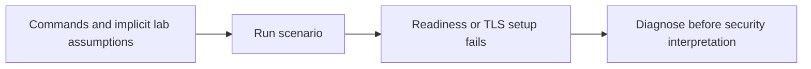
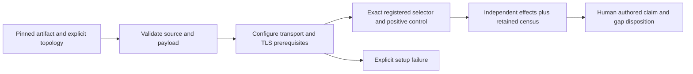

# Remediation, retesting and bounded architectural proposals

No shipping product vulnerability was established and no shipping fix is claimed.
The code changes are the assessment lab, evidence validation and hosted wiring.

## Preserved failures and corrected experiments

| Failure | Preserved initial evidence | Corrected evidence |
| --- | --- | --- |
| Reference transport readiness without DNS | `target/ap075-reference.log`; hosted Stripe job 128696627033, run 42468637050 | `target/ap075-reference-corrected.log`; retained 23-case reference census |
| TLS identity mismatch in lab DSN | `target/security-assessment/evidence/native-invalid-tls-initial/`; `target/ap075-native-results.log` | Retained native census: 454 exact selectors, including 85 actual configured TLS PostgreSQL scenarios |
| Intact corruption-control rejected through macOS temporary-root ancestry | `target/security-assessment/evidence/artifact-controls-macos-root-initial.json`; `target/ap075-artifact-controls.log` | Retained nine-case artifact controls; no mutant executed |

Initial logs are private local evidence, not guaranteed permanent hosted artifacts.
Their absence elsewhere must not be concealed. Public corrected results and
commands are retained in this directory. A fresh run should retain its own raw
logs and hashes before cleanup.

The acquisition path now checks parent links before creating extraction
directories. The census validator checks its inventory schema, duplicate
requirements and integer positive-effect counts. Five unit-test methods exercise
missing/duplicate/wrong-source/backend cases, absent positive effects and invented
production/customer claims. Four further retained-report controls detect altered
bytes, missing/duplicate result rows and wrong-source/missing-family claims.
These nine test methods are controls on evidence quality, not nine security
properties of the product.

## Keep the security owners centralized

The three invariant traces in `composed-invariants.md` support retaining one
bound effect, one final dependency fence and one authoritative execution journal.
No evidence here justifies introducing a second provider executor, a protocol
rewrite or a provider-name branch in the shared gateway. The generic mechanism
cannot independently establish Stripe business meaning; reviewed recipe data
and provider qualification remain necessary.

The useful architectural improvement is narrower: make lab preconditions
explicit before counting tests. The corrections remain within the existing
acquirer/runner/workflow, rather than adding a competing assurance framework.

`report.py` deliberately does not infer a security gate from a coverage count.
It retains original records, maps candidate evidence and rejects missing or
misattributed records. The claim ledger owns conclusions and limitations.

## Deferred changes require evidence

One operator presentation could show the financial quorum and compiled-effect
approval together, but they authenticate different facts. Do not collapse their
signatures or authorization roles merely to reduce prompts. Validate any UX
proposal with actual operators first.

Time sampling belongs in the existing centralized deployment-clock and final
entry validation. Wall time, monotonic deadlines and an independently protected
freshness checkpoint solve different problems; replacing all three with one
timestamp would remove guarantees. Additional formal work should target the
specific remaining composition premise, not a percentage.

No production restore, credential provisioning or human recovery fix can be
declared retested using only this simulation. AG01–AG04 remain visible in the
final gate verdict.
