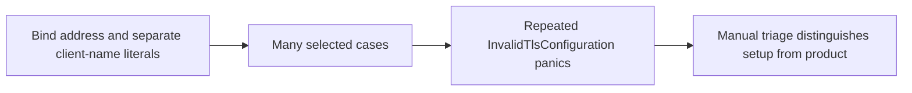
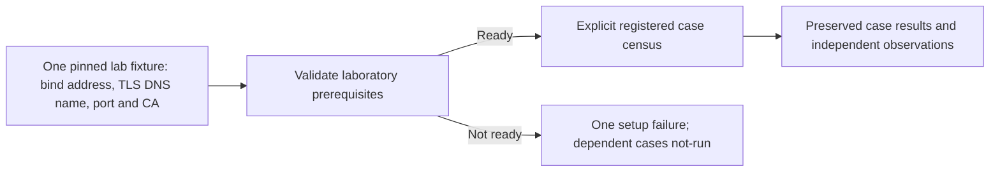

# Security semantics and ownership inventory

Target: `ac5fcabe9c6300e46789b4e847bb1991f9f9d66f`. Bounded source inventory.
These are semantic groups, not a count of all functions or a normalized score.

| Concept/representation | Authoritative owner and mutation boundary | Useful guarantee; necessity or avoidable burden |
| --- | --- | --- |
| Canonical proof/action, decoded/resolved/verified forms | `core/crates/auths-verifier`; sealed native verification stages | Necessary distinction between data, signatures and authority. Binding wrappers must not construct an alternate verified value. |
| Installed trust and verifier configuration | Operator installation and `SharedConfiguration`; current snapshot rechecked in `entry.rs` | Necessary independent choice of roots/policy. User-supplied context cannot choose a weaker verifier. |
| Portable financial approval quorum | Core approval classification and pinned approver requirements | Necessary for the advertised K-of-N decision. Distinct from the operator's compiled-effect approval. |
| Complete review and exact compiled-effect approval | `effect.rs`, policy approver pin, literal renderer and native approval codec | Binds recipe/configuration and closed execution semantics in addition to the portable action. The second ceremony adds real integration/UX burden that should be measured rather than hidden. |
| Bound effect, canonical wire and digest | `effect.rs`; native compiler; decoded wire has no entry power | Multiple representations are necessary for signatures, persistence and bindings, but their equality checks are security-critical composition. |
| Enrolled root/tree and current participant control | `participant_enrollment/`, native configuration records and participating writers | Necessary delegated scope and withdrawal. Human/org labels and transport identity cannot replace native paths. |
| Successor identity and original capacity origin | Enrollment recovery relation and `effect/engagement.rs` | Necessary to prevent recovery restoring allowance. Identity conversion, not arithmetic alone, is the dangerous edge. |
| Ordinary window counters and permanent ancestor allocations | `GatewayAttempts`, `store/capacity.rs`, `store/engagement.rs`, common fenced batch | Distinct limits, not two independent admission authorities. Source-lifetime charges must not be mistaken for refreshable daily counters. |
| Reserved fact, durable grant and in-memory permit | `store.rs`, native transition owner, `submit.rs` | Necessary separation of retained history from permission to enter. No second task ledger is justified. |
| Acquisition, recipient disclosure and mutation histories | Typed journal protocols under the same owner | Distinct external effects/acknowledgements and units; collapsing their meanings would introduce unsafe retries or release. |
| Credential reference, version, account and lease | Connection/custody owner; private operator generation; final dependencies | Necessary custody and substitution protection. A lease is not itself provider-entry authorization. |
| Wall time, synchronization trust and monotonic deadline | `DeploymentClock`, after-lock snapshot, transport/session clock | Distinct purposes are necessary; handler-specific replacement clocks or refreshed event timestamps would be avoidable risk. |
| Provider response, observation, linkage and causation | Closed recipe/reference semantics; native report projection | Necessary truthful uncertainty. No receipt signature establishes a provider fact beyond the signer's actual observation. |
| Private journal/audit and public hiding projection | Native report/export owner; independently pinned auditor context | Necessary privacy and audit separation. Export completeness requires an external premise and cannot be inferred from valid included entries. |
| Source package, runtime features and evidence census | Existing package manifest plus assessment's fixed inventory | Necessary provenance. Test-worker entrypoints and green no-op cases must not count as independently exercised security scenarios. |

## Concrete simplification opportunities

1. **Clarify the two approval roles in one user-facing workflow.** Financial
   quorum approves the portable action; the private reviewer approves the compiled
   effect. A single coherent presentation/interaction may produce the necessary
   existing statements, but removing a statement or merging keys without a
   contract analysis would weaken separation. This is a proposal, not a discovered
   authorization bypass or implemented protocol change.
2. **Make the execution census distinguish support workers.** The compiled
   gateway registry contains 20 dedicated child-worker entrypoints plus one unconfigured report consumer. Their normal
   no-environment return is not a property test. The assessment excludes them
   from scenario counts while parent process tests exercise them in context.
3. **Validate lab prerequisites once.** An incorrect TLS host/name pairing caused
   repeated test setup failures. The shared fixture metadata should supply the
   client host and TLS name coherently, retaining strict server-identity checks.
   Likewise a networkless readiness constructor needs an explicit DNS stub; do
   not weaken the shipping transport to satisfy a laboratory assertion.
4. **Reconcile historical status documents.** Stale pending/merged and managed/
   application-owned descriptions increase integration risk. Keep a concise
   current claim ledger, with historical evidence visibly dated. This does not
   establish a code defect by itself.

No new production owner or general-purpose framework is proposed. The inventory
does not justify a broad core replacement or a concepts/capabilities ratio.

## Proposal: assessment preconditions, before and after

This is a test-infrastructure proposal prompted by observed setup failures.
It changes no product authority or TLS policy.

Validate the change with mismatched-name and missing-CA negative controls plus
the real configured positive run. Keep other independent batches running when a
backend prerequisite fails; do not fabricate product findings from setup panics.
