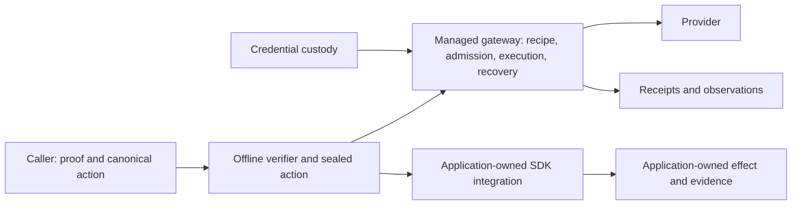
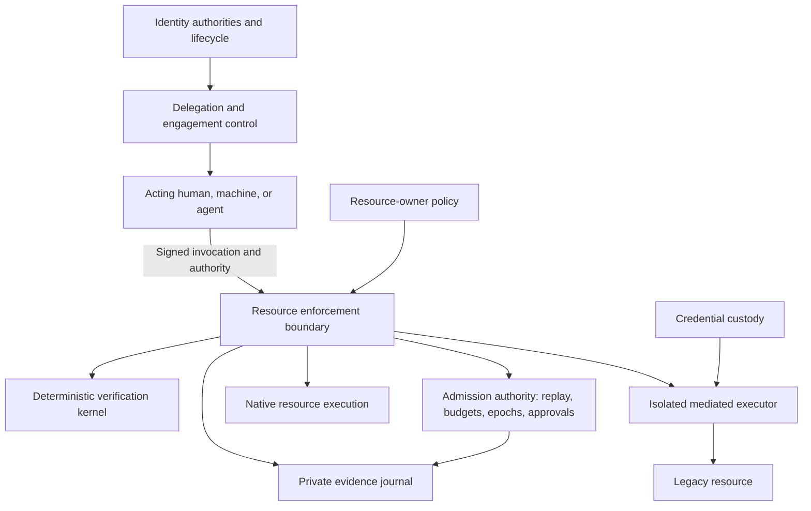

# AP-SPEC-073: Identity, delegated authority, and enforcement foundation

- **Status:** Implementation program in progress on merged AP074; no AP073 acceptance criterion is closed.
- **Date:** 26 October 2026.
- **Updated:** 6 November 2026. The preserved AP073 checkpoint is `97163513`. The continuation baseline is merged AP074, `68987975`. Earlier task-ledger implementation claims do not apply to this branch. Full M0–M4 and F01–F16 remain required.
- **Mission:** Build an authorization and identity layer for human–agent, machine–agent, and agent–agent work.
- **Repository decision:** Evolve this monorepo through direct subsystem replacements. Compatibility with disposable prelaunch state is not a requirement.
- **Starting revision:** `9b1fe3c202a202750704730aebc47e0585a24470` on `codex/ap-spec-071`.
- **Working branch:** `codex/ap073-native-delegation`; preserved work: `codex/identity-authority-foundation`.
- **Companion:** [Initial implementation assessment](../plans/0073-foundation-assessment.md).
- **Terms:** MUST/MUST NOT describe proposed acceptance requirements. They do not claim existing implementation or silently override current repository policy.

## 1. Purpose and authority of this document

For every operation, Auths must establish **who acts, on whose authority, against which resource, under what constraints, and what evidence supports the resulting claims**.

The user has established the mission, permitted substantial replacement, and requested a durable specification and isolated worktree. The mechanisms below are proposed design decisions. Naming a mechanism here is not evidence that it is required, implemented, or safe. The implementation program must first distinguish existing foundations worth retaining from gaps requiring replacement.

This specification supplements the existing contracts while it is a draft. `AGENTS.md`, `architecture.toml`, `compliance.toml`, workspace metadata, and `xtask` retain their authority. Changes to those contracts must accompany the bounded implementation that needs them. Historical material in `docs/target-state/` is context, except where the repository contract explicitly requires following a boundary plan.

Relevant existing work:

- [AP-SPEC-061: machine-checked verifier](0061-end-to-end-machine-checked-verifier.md).
- [AP-SPEC-063: generalized gateway](0063-generalized-gateway.md).
- [AP-SPEC-065: k-of-n approvals](0065-native-k-of-n-approvals.md).
- [AP-SPEC-066: gateway qualification](0066-production-gateway-polish-and-recipe-qualification.md).
- [AP-SPEC-071: human-agent read/write delegation](0071-human-agent-read-write-delegation-demo.md).
- [AP-SPEC-072: adapter proposals and qualification](0072-agent-authored-adapter-studio-and-qualification.md).
- [Domain abstraction boundary plan](../target-state/PROFILE_AND_DOMAIN_ABSTRACTION_BOUNDARY_PLAN.md).
- [ADR 0012: credential-isolated gateway](../adr/0012-declarative-credential-isolated-gateway-boundary.md) and [ADR 0013: recipe capabilities and budgets](../adr/0013-recipe-capabilities-and-sum-budget.md).

## 2. Scope, threat model, and limits

The system covers identity establishment and lifecycle; holder-bound delegation; bounded authority composition; current resource policy; live admission; controlled disclosure and effects; and evidence sufficient to explain those stages separately.

Assume compromised agents, hostile inputs, independently administered trust domains, concurrent workers, stale evidence, clock uncertainty, key compromise, process crashes, and ambiguous provider responses. Transport authentication and organizational affiliation confer no implicit authority. Provider permissions remain an independent ceiling.

The system does not promise that a correctly identified agent is honest, that an authorized action is wise, or that a model follows natural-language intentions. It cannot retract plaintext from an uncontrolled recipient, obtain immediate revocation while disconnected, or guarantee exactly-once effects at a provider lacking the necessary protocol. A workflow spanning providers is not an atomic distributed transaction merely because it shares an Auths task.

Unbounded work and input sizes remain unacceptable even when development time and resources are unconstrained. Every public protocol and verification boundary needs finite, testable limits.

## 3. Identity model

| Concept | Contract |
| --- | --- |
| Principal | Enduring identifier within an explicit identity method and trust domain; never equated by display name or email alone. |
| Controller | Entity authorized to administer identity lifecycle. Control does not transfer the controller's resource permissions. |
| Workload | Identified software deployment and configuration. A workload claim has an issuer, scope, and validity. |
| Instance | Particular executing process or runtime with a bound credential; shared workload identity does not establish instance uniqueness. |
| Session | Bounded authenticated interaction, with channel and audience bindings where required. |
| Delegation | Explicit authority granted to a holder; independent of identity administration. |

Humans, agents, services, and devices use the same authority rules. Their authentication and assurance methods may differ. External identity adapters produce bounded evidence for a canonical principal-control contract. They MUST NOT infer authority from authentication success.

Lifecycle contracts must cover enrollment, rotation, suspension, compromise, recovery, and federation. Recovery MUST specify the status of old keys, sessions, grants, and descendants. It MUST NOT revive compromised authority implicitly. Historical verification and eligibility for a new operation are separate questions.

An attestation proves only the claims its trusted issuer makes. Software measurements and deployment evidence are policy inputs; they do not establish model honesty or complete isolation. A verifier selects trust roots and assurance requirements out of band. A proof cannot select its own trusted issuer.

## 4. Authority, delegation, and composition

A conceptual delegation binds issuer, holder, parent authority, engagement scope, resources, operations, typed argument restrictions, permitted recipients, validity, delegation permission/depth, approval requirements, enforcement audience, revocation dependencies, and budget references. This is a semantic inventory, not a proposed universal struct with optional fields.

The first implementation SHOULD retain the existing canonical model wherever it represents these meanings correctly. Wire changes require explicit schema, fixture, binding, and formal updates.

The authority kernel MUST establish:

1. Every parent link is valid and authorizes the issuer's delegation.
2. Each child preserves or narrows each applicable authority dimension.
3. A holder demonstrates control of an accepted verification method for the invocation.
4. Delegation permission is explicit; permission to act does not imply permission to delegate.
5. Cycles, excessive depth, unsupported constraints, and ambiguous composition fail closed.
6. Trust anchors bound initial authority; a valid signature is insufficient.

An **engagement** is the explicit scope within which authority and information may be combined. Existing task identity is a candidate representation, not automatically a new type. A read authorized under engagement A and a send under engagement B MUST NOT authorize a combined read-and-send workflow. Crossing that boundary needs explicit authority and resource-side acceptance.

Within an engagement, several branches may satisfy a deliberately declared authorization plan. Arbitrary union of grants is prohibited. The plan must bind which branches satisfy which requirements, common resource/recipient constraints, and budget attribution. Existing multi-party approval and proof-plan semantics must be assessed before introducing new composition semantics.

The narrowing calculus should use decidable, bounded relations over explicitly supported types. General implication checking over arbitrary user policy programs is outside the kernel. Organizational policy may decide issuance and acceptance, but cannot redefine the grant attenuation relation.

### 4.1 Managed owner after AP074

AP074's immutable `effect::BoundEffect`, selected native authority, exact human
approval, typed operation journal and consumed entry permits are authoritative.
Participant enrollment is a bounded native control relation; it is not another
execution or approval authority. Do not restore `release_state`, `task_write`,
AP071 Google custody, or an independent task budget journal from the preserved
branch. AP070 remains an independent application-owned reference.

An authenticated engagement installation separates the initiating machine,
resource-owner authority, exact human approver, and operator administration.
Initiation grants no resource rights. The resource owner's native grant chain
must independently authorize the exact operation. Parent authorization, child
acceptance and resource authority are separately verified for enrollment.

### 4.2 Scope, participant and capacity binding

Bind engagement commitment, partition/epoch, exact enrollment, principal and
instance generation, executor audience, accepted resource grant ancestry and
registered recipient/channel to the same native effect. A parent ceiling is
shared by all descendants; enrollment cannot mint fresh capacity. Admission
atomically reserves every applicable typed ancestor/task charge together with
the operation, using the existing gateway store. It must refuse an unsupported
combined transaction or read/write set before custody or transport.

The final native entry fence rechecks participant and ancestor eligibility,
full native evidence and selection, exact approval, connection, configuration,
retained charges and time before acknowledging a new grant. Revocation writers
participate in this fence. Earlier grants retain AP074's conservative semantics;
recorded state or restart cannot reconstruct a permit.

The current signed root schema is `auths.engagement-root/3`, with tree schema
`auths.engagement-enrollment-tree/3`. It pins the shared authority namespace and
partition, exact resource connection commitments and registered native channel
commitments. The native configuration owner persists enrollment/withdrawal under
the existing gateway adapter fence and installed-configuration dependency.
These control facts never constitute operation admission. Direct mutation,
literal-resource information/source/channel binding and typed prerequisite
accounting now join the common journal owner in source. Bound-effect 6/compiler
11 declares exact prerequisite indices, byte ceilings and ancestor read charges;
the typed child journal selects these instead of the parent's write charges.
Required native file artifacts exercise bounded admission/replay/withdrawal
histories with synthetic response facts and dropped permits. Installed scoped
transport/containment, cross-recipe process schedules and complete exact-revision
assurance remain required.

The separate native `engagement/live-information.json` corpus additionally
exercises actual local Unix UID/key authentication, native fenced scoped grants,
captured content frames and exact ACKs. Its retained source response is synthetic;
UIDs belong to the same test process. It covers reply/ACK loss, late historical
ACK refinement, competing live channels, and sender/recipient withdrawal ordering,
with permanent ancestor/source charges and no content on replay or refusal.
The portable artifact is a named projection of actual facts and excludes host
UIDs, private identities and randomized authentication material. It does not
establish provider HTTPS, separate-process isolation, process crashes or the
installed multi-hop/binding journey.

Enrollment configuration uses `auths.engagement-configuration/2`. Every changed
revision binds its original native control/resource inputs, exact canonical
trusted context, fenced clock sample, and before/after tree commitments. These
private inputs are staged as immutable content-addressed records in the same
store; acknowledged manifests precede the final publication fence. A preparation
failure may leave inert records but cannot publish authority. Existing permanent
store durability and integrity assumptions apply; this is not a second operation
journal or authority path. An independent private auditor replays the maintained
native verifier for the complete root/enrollment/withdrawal sequence using
independently supplied root pins, original contexts and a trusted checkpoint.
Missing evidence is an explicit failure. A bundle cannot select its own trust.
This verifies authorization at retained times, not timestamp truth, current
eligibility or a transport grant. Checkpoint authentication and external rollback
floors remain deployment obligations, not consequences of a content digest.

### 4.3 Evidence and implementation boundaries

The preserved checkpoint contains candidate native enrollment and attenuation
contracts and historical tests. Reuse requires source review and adaptation to
AP074; their earlier CI or prose cannot close current acceptance. Historical
Google-created-child and task-journal recovery are comparison evidence only.
New managed recovery uses independently authorized read acquisitions and the
same native journal, preserving task lineage without another write or delivery.

[ADR 0018](../adr/0018-engagement-delegation-on-bound-effects.md) records the
ownership, finite bounds and direct cutover. The
[current assessment](../plans/0073-foundation-assessment.md) records exact-source
coverage, missing work and the verification batch. All original M0–M4 and
F01–F16 requirements below remain in scope.

## 5. Portable verification and live admission

Portable verification answers whether exact action bytes are covered by the supplied authority under explicit trust, evidence, time, and configuration inputs. It does not promise current global state.

Live admission answers whether the operation may enter execution now. An admission authority owns a declared consistency boundary for replay, budgets, revocation epochs, and approval consumption. Resource-owner policy and provider access remain separate ceilings.

An admission transaction MUST atomically establish the applicable current predicates and reserve capacity before issuing an execution permit. The permit binds the action/plan commitments, engagement, actor, resource, recipient where relevant, enforcement audience, policy/configuration versions, connection generation where relevant, and replay identity. Its expiration and consumption rules are explicit. A portable verification result is not an execution permit.

The revocation contract must name its linearization point. The initial design target is that revocation prevents later admissions in the same authority partition; already admitted operations follow explicit entry/cancellation rules. It must not imply that revocation undoes an entered effect. Any additional pre-entry revocation gate needs an atomic ordering contract with entry authorization, not a racy read followed by an unguarded send.

Distributed budgets use coordinated admission or disjoint escrow allocations. If a parent has 100 units, two children cannot each independently spend 100. Allocation, reservation, consumption, uncertain exposure, and provably releasable capacity must be distinguishable, with unit and scope identifiers preventing accidental mixing. The conservation equation and transition rules belong to each admitted budget mechanism.

Disconnected enforcement requires preallocated capacity, bounded validity, explicit evidence freshness, and a stated revocation delay. It cannot make the same fresh-state claim as coordinated online admission.

## 6. Architecture and enforcement modes

The baseline below describes contractual responsibilities, not a complete deployed topology or proof that each boundary is established.



The proposed responsibility split is:



These are responsibility boundaries, not a requirement for a microservice per box or a mandatory central Auths service. Each trust domain controls its accepted issuers, policies, resources, and admission partitions. Federation does not grant access automatically.

Two enforcement modes are proposed:

- **Native:** the resource participates in verification, admission, effect application, and truthful outcome reporting. Its conformance requirements include demonstrating that protected effects cannot bypass those gates within the claimed deployment boundary.
- **Mediated:** a credential-isolated executor translates an admitted operation into a closed provider request. Credentials and unrestricted authenticated clients never reach the agent.

Current policy admits managed production writes through the data-only gateway. Native managed execution or additional isolated execution families require an explicit ADR and executable policy updates before production implementation. Application-owned integration remains available with its existing, weaker claim. This draft does not admit arbitrary Rust, WASM, scripts, or callbacks inside the gateway.

Provider semantics remain profile-owned and version-pinned. Installation approval binds request construction, evidence interpretation, and recovery behavior. A provider name MUST NOT select a hidden branch in the shared authorization or gateway kernel.

## 7. Typed progression from intent to effect


Each transition has an owner, explicit inputs, errors, commitments, and a postcondition. Different stages have different information; one mutable record passed everywhere is not the target.

| Transition | Required invariant |
| --- | --- |
| Intent to action | User intent is translated into a bounded, reviewed contract; prose alone cannot authorize an effect. |
| Action to plan | Resource identity, recipients, provider mapping, relevant versions, and exact payload are bound without widening authority. |
| Plan to admission | Required approvals and current resource policy match the plan; capacity and replay state change atomically. |
| Admission to entry | Permit audience, generation, configuration, and exact request match; durable entry rules precede possible irreversible exposure. |
| Entry to outcome | Receipt claims follow actual observation and recovery evidence; missing response is not failure evidence. |

At managed provider and disclosure entry, the existing AP074 final fence must
revalidate full native evidence and exact human approval, preserving the selected
authority. AP073 adds participant/ancestor dependencies to that same fence.
Historical reconciliation never grants provider mutation or disclosure entry.

Exact approval binds the finalized plan. Bounded-upfront approval is a distinct contract whose later plans must satisfy its limits. Every security-relevant change invalidates affected approvals and permits. Sealed Rust values protect local call boundaries; remote permits additionally require authenticity, audience, freshness, and replay checks.

## 8. Recovery protocols and shared mechanisms

There is no proposed universal workflow state machine. Begin with concrete protocols and extract identical mechanisms only under the existing evidence gates.

| Protocol | Boundary | Required uncertain-outcome behavior |
| --- | --- | --- |
| Disclosure | First possible release to a recipient | Retain release accounting after lost acknowledgement; do not infer non-delivery. |
| External mutation | First possible provider entry | No blind retry after response loss; preserve capacity until sound reconciliation. |
| Resource creation | New resource may exist | Resolve exactly one authorized resource with adequate search evidence before dependent work. |
| Delegation issuance | A holder may possess usable authority | Issuance retry and descendant revocation have explicit identities and lifecycle semantics. |

Durable compare-and-swap, atomic claims, bounded journals, and checked arithmetic are candidates for shared implementation. Admission eligibility, capacity release, reconciliation, and receipt meaning remain concrete until semantic equivalence is established.

Lease expiry does not prove an external effect did not happen. Fencing works only where the recipient enforces the fence. Idempotency is a provider contract with scope and retention, not an assumption attached to an arbitrary header. An uncertain effect MUST NOT become retryable merely because a worker restarted.

## 9. Information flow and custody

Authority includes both access and permitted disclosure: source selection, projected fields, byte bounds, recipient identity, execution environment, onward recipients, and approved output channels. An external model API, memory store, log sink, and tool runner are potential recipients.

Controlled execution must demonstrate that protected content cannot escape through alternate storage or network paths within the deployment claim. Content already delivered to an uncontrolled principal cannot be recalled or reliably constrained by a subsequent token. Retention and purpose restrictions without technical enforcement must be labeled contractual.

Read authority and send authority cannot be combined across unrelated engagements. A resource-side policy must also validate permitted flow within one engagement. Labels supplied solely by the acting agent cannot establish provenance.

Provider custody binds account subject, connection identity and generation, approved endpoint, and permitted request. Provider credentials, human signing keys, and reusable authenticated clients never enter an agent's execution environment. Private evidence uses appropriate protected commitments; low-entropy private content must not be exposed through guessable public hashes.

## 10. Central contracts for time, evidence, and configuration

Centralization must remove repeated interpretation at security boundaries, not only repeated code.

- **Time:** distinguish authenticated event time, observation time, evidence validity, and evaluation time. Re-evaluation cannot refresh an old event. Production supplies time through an explicit contract; the kernel never reads a clock. Cross-host claims specify uncertainty/skew and freshness bounds. Clock rollback and unavailable trusted time have explicit denial/indeterminate behavior. Monotonic time is for local durations, not portable historical timestamps.
- **Canonicalization:** one authoritative encoding and commitment contract per protocol object. Bindings do not substitute hashes or invent alternative action identities.
- **Configuration:** required and executed verifier, policy, integration, and trust configuration are bound. Cache keys cover the actual semantic configuration, evidence freshness, and state dependencies, or cache only the immutable subset.
- **Persistence:** atomicity, ordering, process-crash behavior, power-loss durability, and backup/restore rollback detection are explicit contracts. Publishing an admission outcome must not outrun the durability on which it relies.
- **Evidence:** identity, grant, approval, reservation, release, entry, observation, and revocation records state different facts. Signatures authenticate assertions; they do not prove an external effect by themselves.

The implementation assessment must first locate the current owner of each contract. Existing implementations are retained where their semantics fit and their evidence is convincing.

## 11. UX and proposed APIs

Human controls render the canonical authority and plan that enforcement consumes. They show principal and instance identity, delegation ancestry, actual account/resource, onward delegation, recipients, expiry, budgets, approval mode, and revocation consequences. The interface distinguishes authorization, admission, release, acknowledgement, provider entry, observation, and unknown outcome.

```text
+----------------------------------------------------------------+
| Engagement: prepare and publish the approved project update      |
| Initiator: scheduled service  | Acting instance: agent B         |
| Authority: organization -> service -> agent A -> agent B         |
| Read: selected fields -> B only | Write: one exact update        |
| Shared remaining budget: ...   | Expires: ...                    |
| Proposed change: ...           | Required human approval: ...   |
| [Inspect authority] [Approve exact change] [Revoke future use]    |
| Timeline: admitted / released / acknowledged / entered / unknown |
+----------------------------------------------------------------+
```

Conceptual operations are `establish_identity`, `delegate`, `propose`, `approve`, `admit`, `execute`, `inspect`, `reconcile`, and `revoke`. Names are placeholders, not new public ABI commitments. Each privileged operation authenticates its own caller and checks its own authority. Receipt identifiers and engagement identifiers are not bearer credentials.

Public SDKs guide callers through typed stages. Native Rust owns security semantics. Python, TypeScript/WASM, and other bindings use bounded decoding, stable results, and the same canonical corpus. Diagnostic previews never produce an executable permit. An agent receiving work applies the same resource-side acceptance contract as any other service.

## 12. Package ownership and assurance

Keep the current five shipping layers. The conceptual component names in this proposal do not authorize new top-level directories or one crate per noun.

| Existing layer | Proposed responsibility |
| --- | --- |
| `core/` | Canonical model, identity-control verification, attenuation/composition, deterministic verification, portable evidence contracts, formal linkage. |
| `exchange/` | Bounded transport and authenticated delivery of protocol objects without authority amplification. |
| `product/` | Identity lifecycle services, issuance, policy/evidence acquisition, live admission, custody, enforcement, durable recovery, private evidence, operator controls. |
| `bindings/` | Thin ABI/language surfaces over authoritative implementations. |
| `demos/` | Complete representative flows, independent observers, hostile deployment scenarios. |

Formal targets include narrowing, explicit composition, budget conservation, entry/revocation ordering, replay, uncertain outcomes, and exact request derivation. A standalone Lean theorem is not a shipping-Rust proof. Claims require representation invariants and translation/refinement evidence following the existing formal program.

Every claim records its model, implementation boundary, trusted assumptions, canonical fixtures, hostile tests, and exact-revision CI evidence. Simulation proves only its modeled boundary. Live provider evidence and deployment-isolation evidence remain separate.

## 13. First complete implementation milestone

The representative flow is **machine → agent A → agent B, with a human approving one consequential effect**. It exercises all three relationships without changing the authorization rules based on actor category.

1. An organization authorizes a scheduled service to initiate a bounded engagement.
2. The service grants A a finite resource set, expiry, recipient set, and shared budget.
3. A delegates a strict subset to a distinct B instance; siblings consume the same parent capacity or explicit disjoint allocations.
4. B reads an approved projection through credential-isolated enforcement into its designated channel.
5. B proposes one exact write; a separately authorized human approves that plan.
6. Enforcement admits and enters the write, recording the distinction between entry and observed effect.
7. A sibling races for final capacity, revocation races with admission, and the executor loses the response or crashes at defined boundaries.
8. The user sees a truthful timeline; reconciliation cannot cause a duplicate effect or cross-engagement disclosure.

Use an already admitted provider family for the first mediated execution. A test-controlled provider can force failures; a separately observed live or sandbox effect supplies provider evidence. A native resource implementation follows only after its ADR and qualification contract. Do not block the first slice on every identity system, provider, or federated deployment.

Acceptance scenarios below are required evidence, **all pending at spec creation**:

| ID | Scenario and required result |
| --- | --- |
| F01 | Holder/instance substitution or audience mismatch: refusal before custody or disclosure. |
| F02 | Widen any grant dimension, use an invalid parent, or exceed delegation depth: deterministic refusal. |
| F03 | Combine read/send authority from different engagements: refusal without release or send. |
| F04 | Concurrent siblings race for final capacity: total allocation and consumption stay within the parent limit. |
| F05 | Replay a signed invocation or copy its permit to another executor: no second unaccounted entry. |
| F06 | Change payload, recipient, resource, recipe, connection generation, or required configuration after approval: refusal. |
| F07 | Re-evaluate stale human evidence at a fresh time: it remains stale; invalid time evidence cannot authorize. |
| F08 | Lose read acknowledgement after release: retained accounting and no automatic redelivery. |
| F09 | Crash before durable claim, after claim, and after possible provider entry: outcomes follow the respective protocol; unknown does not permit blind retry. |
| F10 | Create succeeds but response is lost: zero/multiple/incomplete matches remain unresolved; a uniquely proven resource can be used only within its bound scope. |
| F11 | Revoke an ancestor while admission races: histories match the stated linearization rule; descendants cannot bypass it. |
| F12 | Rotate or recover an identity: compromised credentials and invalid descendants cannot regain authority through recovery. |
| F13 | Attempt credential, log, error, model-call, and alternate-egress exfiltration: the claimed deployment boundary is exercised and limitations recorded. |
| F14 | Rust and bindings process canonical, malformed, oversized, and boundary inputs: decisions, commitments, and error classes agree within bounded work. |
| F15 | Stale cache, store rollback, or restored old epoch: no resurrection of spent or revoked authority under the declared recovery model. |
| F16 | Receipts and UI distinguish entered, observed, denied, and unknown; no signature or successful HTTP response alone creates an unsupported success claim. |

Each scenario needs a reproducible setup, expected state and external effects, actual result, artifact/revision, and remaining assumptions. An existing test may satisfy a requirement only after its exact coverage is demonstrated.

## 14. Delivery sequence and decision gates

| Milestone | Deliverable | Exit condition |
| --- | --- | --- |
| M0: baseline and contracts | Source-backed retain/strengthen/replace/remove assessment; gap-to-F01–F16 mapping; decision records. | Each proposed replacement names a concrete contract failure or missing capability and why smaller changes are insufficient. |
| M1: authority slice | Concrete identity/engagement/delegation semantics and bounded fixtures for the representative flow. | Canonical forms, tightening/composition rules, limits, failure classes, and formal obligations are explicit. |
| M2: admission and disclosure | Shared-capacity and revocation contracts plus controlled read boundary. | Concurrency, replay, stale evidence, and acknowledgement-loss evidence passes on the exact revision. |
| M3: exact effect and recovery | Human approval, mediated write, crash recovery, independent observation. | Applicable F01–F16 evidence and truthful UI close the representative flow. |
| M4: broader enforcement | Native resource ADR, another trust domain, additional identity/provider conformance. | Claims remain scoped; new integration paths have their own isolation and recovery evidence. |

M0 begins with the companion assessment. Production redesign is not considered complete because this document exists. No mass deletion, package reshuffle, new token format, or universal state machine is a prerequisite for M0.

Resolve these decisions at the stated gates rather than guessing:

- **Before M1:** retain or change existing task/plan identity; authority composition semantics; first identity lifecycle profile; canonical format and finite protocol limits.
- **Before M2:** admission partition and transaction boundary; budget units/allocation model; revocation versus entry ordering; clock/freshness and persistence guarantees.
- **Before M3:** exact provider and isolation deployment; approval presentation; observation/reconciliation contract and permitted retries.
- **Before M4:** native execution ADR and assurance contract; federation lifecycle; escrow/offline support and explicit revocation limitations.

These are deferred engineering decisions with gates, not requests to pause documentation work or re-ask permission for the accepted mission.

## 15. Replacement and completion discipline

Retain working boundaries unless evidence supports replacement. Preserve adversarial scenarios, canonical intent, and provider assumptions even when implementation tests must change. Each replacement is a bounded direct cutover; remove its superseded production path and reject obsolete disposable state. Test-only references can remain independent oracles. No dual runtime, compatibility reader, or migration framework is required by this program.

Changes that admit new shared semantics require the existing comparison/case-file process or an explicit ADR. Changes to production enforcement require policy and compliance updates in the same bounded change. The future architecture diagram is not an exception to those requirements.

Use hosted CI under the repository's GitHub-first policy. Record exactly what ran; documentation review does not establish runtime or formal correctness. The worktree began with planning changes only; subsequent implementation, publication, and verification status are recorded in the companion assessment.

The program is successful when independently identified humans, machines, and agents can delegate bounded work through one understandable authority contract, while resource owners enforce each admission, disclosure, and effect with truthful evidence and explicit limitations.

## 16. Installed native control surface on AP074

The installed `EffectPolicy` selects one immutable engagement root and executor.
Root provisioning, verifier context, registered channels, capacity and gateway
time are independent operator inputs. An application cannot replace any of them.
`auths.gateway-participant-control/1` carries only `evidence_b64`: the unpadded
base64url encoding of canonical `auths.engagement-control-evidence/1` bytes. That
is the original-evidence representation already retained by the configuration
audit owner, not another authorization format. Its native decoder checks bounded
representation; only current native control/resource verification under the
shared configuration writer fence can change enrollment or withdrawal state.

The application route accepts enrollment and subtree withdrawal only. Root
bootstrap is refused by both the envelope and engine entry points and is exposed
only by the trusted operator API/CLI. No control receipt leases credentials,
executes a provider request, consumes an effect approval or creates an entry
permit. Python and TypeScript forward native bytes and return native result bytes;
they do not compute enrollment commitments or infer current eligibility.

`Recorded { revision }` refers to the original retained evidence revision. Exact
evidence replay checks its immutable content reference and original bytes. A retry
after withdrawal or expiry returns that same historical revision without changing
state, refreshing time, allocating capacity or restoring authority. New entry
still requires current native verification. `Unchanged { revision }` records no
new control event. A persistence error returns `Indeterminate`; exact control
evidence can be resubmitted to locate its original event, but no external-effect
retry follows from that result. Changed evidence must pass native validation.

Native control bytes are bounded to 6 MiB minus 1 KiB. The reserved space ensures
base64 expansion plus the closed envelope fits the existing 8 MiB application
frame. Installation readers and writers use one native codec with the 64 KiB
effect-policy bound plus the original 4 KiB allowance for remaining metadata.
No alternate installation reader may bypass that codec.

The native CLI provides `engagement-root`, `participant-commitment` and
`participant-evidence` for authoring data only; `effect-policy --engagement-root`
pins reviewed root data; `engagement-bootstrap` is operator-only;
`participant-control` uses the app socket. Optional `engagement-root --state-dir`
fills only this recipe's connection bindings from actual installed native
connection metadata without leasing a credential. These commands do not mint
grants, child signatures or human approval. `engagement-audit-export` exports one
snapshot and its matching private checkpoint; `engagement-audit-verify` requires
independently trusted root, contexts and checkpoint. Successful replay establishes
historical control decisions conditional on recorded time and trusted inputs,
not current eligibility or authenticity of an unauthenticated exported head.

Root scopes pin the actual native connection commitment. Provisioning therefore
creates the connection in operator-private staging first, prepares root pins
against that connection, then reviews the complete scoped policy with
`effect-configuration-review --effect-policy`. Review changes neither policy nor
shared configuration. `effect-configuration-activate --effect-policy` requires
the exact candidate digest and previous shared revision. It uses the existing
native configuration CAS and preserves permanent qualification/revocation memory.
Changing admission partition through this update is refused. This is an operator
workflow; no application frame accepts a policy or installation path.

The shared configuration acknowledgement precedes local manifest publication.
A process crash or publication error between them leaves the old local candidate
ineligible; it must not silently restore the previous configuration. Recovery is
a fresh explicit review and activation of the intended policy. Local manifest
writers serialize through an owner-only lock; the existing qualification-state
writer uses the same checked lock-opening mechanism. Those lock files hold no
authority, budget or replay decisions. Kernels release their locks on process
exit. Independent host settings remain subject to the common shared fence.

Initial staging exposes no app socket and distributes no agent authority. Start
the app-facing daemon only after the scoped policy and native root activation
are complete. Candidate policy acceptance does not establish the validity of its
root/resource proofs; bootstrap and every later effect entry still verify them.

The source/fixture evidence and unestablished installed-process requirements are
tracked in the companion assessment. Shipping these surfaces does not by itself
complete M0–M4 or F01–F16.

## References

- [Nyxis handler model](https://github.com/NyxFoundation/nyxis/blob/785c11a628/Nyxis/Handler.lean), [proof boundary](https://github.com/NyxFoundation/nyxis/blob/785c11a628/ASSUMPTIONS.md), and [outbox semantics](https://github.com/NyxFoundation/nyxis/blob/785c11a628/Nyxis/Internal/Outbox.lean): design comparisons, not imported security guarantees.
- [SPIFFE concepts](https://spiffe.io/docs/latest/spiffe-about/spiffe-concepts/): workload identity, trust domains, and identity evidence.
- [RFC 9396](https://www.rfc-editor.org/rfc/rfc9396.html): structured OAuth authorization details.
- [RFC 9449](https://www.rfc-editor.org/rfc/rfc9449.html): sender-constrained OAuth tokens and replay considerations; not a complete exact-effect authorization protocol.

## Installed multi-hop process evidence on the native owner

`content_journey/delegation_process.rs` constructs the installed Python/npm
machine → A → B workflow with five fresh process-held keys, native control and
resource proofs, independent scripted exact-effect signing, a real local daemon,
a counting credential-checking provider double and native disclosure transport.
The canonical `engagement/installed-process.json` records a successful local
artifact construction, including historical control replay and no second write
on restart. Pre-activation resource witness construction is data-only; genuine
signed witnesses cannot obtain managed approval until the root is active.

The source-free package workflow runs the embedded constructor with separate
Linux UIDs and retains the exact-source package manifest with its result.
That hosted isolation result remains pending. The local artifact does not
establish human presence, live provider qualification, every crash boundary,
PostgreSQL, lifecycle/federation/native-resource conformance, formal refinement,
or complete M0–M4/F01–F16 acceptance. The full program remains required.

The installed process corpus now uses version 2 with independent retained-response
and post-write-crash installations. In each, actual authenticated receipt precedes
a gateway/recipient crash without an ACK. Reconnection yields historical facts
without content files; the original late ACK and its replay preserve accounting,
and a new independently signed/reviewed third release is refused. The second
installation kills the gateway after the double applies the exact write while
withholding all response bytes. The installed client's transport uncertainty and
restarted native Unknown cannot release the shared write allowance or trigger
another write. A distinct native read with independent exact approval supplies
declared provider linkage; historical replay performs no provider I/O. This is
bounded local process-failure evidence, not live provider qualification, human
presence, power-loss evidence or complete F01–F16 acceptance.

The cross-recipe process corpus uses one native root, two independently compiled
recipe/service/tool contracts, two connection records and two configuration
partitions on one maintained store. It exercises a two-gateway race for the final
root write, exact replay after reopen, wrong-recipe proof/approval refusal,
independent-engagement capacity and proof isolation, and native withdrawal
published by the other recipe after reservation or entry commit, with ordinary
release and actual SIGKILL. The file artifact records checked native/HTTP facts;
TLS PostgreSQL runs the same matrix only when explicitly invoked with its real
fixture. Public fixed test keys establish neither installed containment nor
human presence. Earlier durable entries retain their documented ordering;
crashed entries cannot reconstruct transport permission, and withdrawal never
refunds ancestor capacity. Whole-store rollback and power-loss claims require
separate evidence under the declared recovery assumptions.
