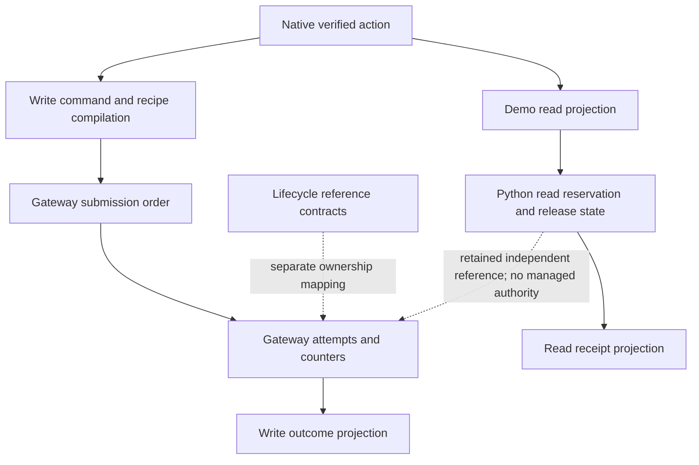
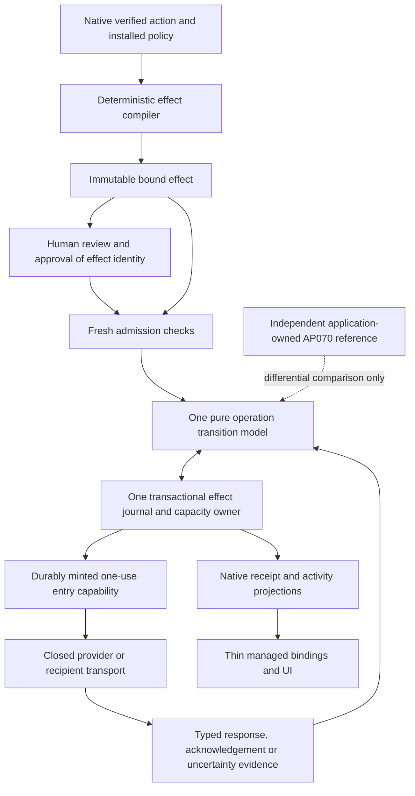
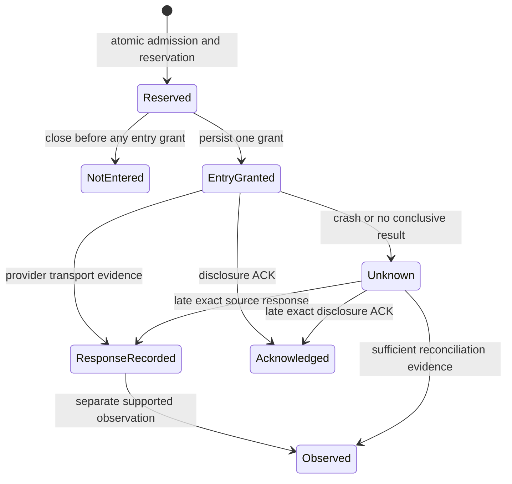

# AP-SPEC-074: Bound effects and one recovery state model

- **Status:** Implementation specification; no completion or qualification claim.
- **Date:** 28 October 2026.
- **Baseline:** `origin/main` at `e2d10a74fa0be5e6bfe2b9f698632c835cd7b11b`.
- **Branch:** `codex/effect-recovery-foundation`.
- **Priority:** Complete this foundation before expanding multi-agent delegation.
- **Handoff:** [Implementation prompt](../plans/0074-implementation-handoff.md).
- **Normative terms:** MUST and MUST NOT are acceptance requirements. Proposed type names below do not imply that those types already exist.

## 1. Objective and scope

Implement two architectural changes together:

1. **One bound effect description.** Authorization, request compilation, approval, admission, execution, recovery and reporting refer to the same immutable effect identity and its authoritative Rust representation.
2. **One recovery state owner.** Reservation, provider entry, disclosure, acknowledgement and uncertain outcomes are governed by one explicit transition model, with invariants preserved across concurrency, failure, retry and restart.

The first complete demonstration is one human authorizing one agent to acquire a bounded resource, receive an authorized disclosure, and perform one exactly approved mutation followed by independent observation. A deterministic provider fixture must exercise actual transport and restart boundaries. Expanding participant enrollment, delegation trees, federation, identity recovery or native resource enforcement is outside this specification.

### Managed boundary and retained AP070 reference

AP074 establishes one authorization, admission, execution and recovery authority
for each **managed gateway operation**. AP070 remains an independently
implemented, application-owned Google read demonstration with its existing
Python/SQLite decisions, credentials, routes and explicitly narrower claims.
Its migration is deferred until managed Google Drive access is intentionally
productized; it is not an AP074 completion requirement. Preserve the broker and
its independent reference value. Sharing offline native verification does not
make its application admission or receipts managed gateway facts.

One managed operation MUST NOT have two independently authoritative decision
systems. Consequently the gateway MUST NOT delegate a managed grant to AP070,
load its provider adapter as a runtime callback, give it gateway-managed
credentials/permits, or accept its SQLite decisions/receipts as native entry or
recovery evidence. Inventories and deployment policy must distinguish credentials,
channels, operation namespaces and receipt claims. Independent application-held
credentials or external writers remain outside managed containment; their
existence must not be hidden by a managed guarantee. If an application-owned
reference is reachable by a managed agent, the deployment must still prove that
it cannot exercise managed credentials or authorize the same managed effect.

Retain independent reference/differential tests and document semantic differences;
do not force an application-owned reference to use the implementation it tests.
A future managed Google integration must use native approved capabilities and one
native journal, with provider-specific metadata/custody evidence reviewed then.
No Google metadata capability, OAuth refresh integration or AP070 Python-owner
removal is required to establish the generic gateway foundation. Native bounded
acquisition/disclosure and all A01–A22 evidence remain mandatory.

This is a prerequisite foundation for those later features. Do not import the AP073 branch wholesale, copy its unfinished task protocol, or make this work depend on its merge. Its findings may inform adversarial cases after independent verification against this baseline.

The work must replace competing interpretations, not add another wrapper around them. Completion requires maintained consumers to use the new owner and superseded managed execution paths to be removed. It does not require replacing sound cryptography, the native verifier, established recipes or the whole repository.

## 2. Existing foundations and the actual gap

This inventory is based on source at the baseline, not a claim of exhaustive review.

| Existing surface | What is already present | Required disposition |
| --- | --- | --- |
| [`VerifiedAction`](../../core/crates/auths-verifier/src/lib.rs) | Sealed native action, selected branches and evidence satisfactions. | Retain native verification as the authority source. A signature, parsed proof or application principal must not replace it. |
| [`VerifiedCommand` and `verify_detailed`](../../product/runtime/auths-gateway/src/engine.rs) | Native verification, branch projection and closed request construction. | Consolidate downstream effect binding here; eliminate independently reconstructed security facts. |
| [`CompiledRecipe` and `ClosedProviderRequest`](../../product/runtime/auths-gateway/src/recipe.rs) | Bounded data-only request compiler, account/credential requirements, observation plan. | Retain reviewed compilation. Bind its exact result, recipe identity and installation to the effect. |
| [`submit.rs`](../../product/runtime/auths-gateway/src/submit.rs) and [`order.rs`](../../product/runtime/auths-gateway-kernel/src/order.rs) | A pure step machine already directs write admission and I/O ordering. | Extend or refactor this maintained owner. Do not create an unrelated executor alongside it. |
| [`transition.rs`](../../product/runtime/auths-gateway-kernel/src/transition.rs), [`recovery.rs`](../../product/runtime/auths-gateway-kernel/src/recovery.rs), [`outcome.rs`](../../product/runtime/auths-gateway-kernel/src/outcome.rs) | Attempt transition rules, recovery capability and truthful outcome predicates. | Preserve their invariants and formal links while making reservation, entry and disclosure explicit. |
| [`GatewayAttempts`](../../product/runtime/auths-gateway/src/store.rs) | Attempt records, atomic bounded claims, counters, file and PostgreSQL adapters. | Use one logical effect journal and one transaction contract. Do not add an independently authoritative task ledger. |
| [`auths-lifecycle`](../../product/runtime/auths-lifecycle/src/lib.rs), especially [`operation.rs`](../../product/runtime/auths-lifecycle/src/operation.rs) and [`sealed.rs`](../../product/runtime/auths-lifecycle/src/sealed.rs) | Versioned identities, preparation commitments, lifecycle relations and store acknowledgements used by reference consumers. | Compare and reuse exact mechanisms. Document why retained reference models are not a second production owner. Do not invent a third lifecycle framework. |
| AP070 [`admission.py`](../../demos/google-employee-delegation/broker/src/employee_read_demo/admission.py), [`read_executor.py`](../../demos/google-employee-delegation/broker/src/employee_read_demo/read_executor.py) and [`receipts.py`](../../demos/google-employee-delegation/broker/src/employee_read_demo/receipts.py) | Demo-owned SQLite read accounting, release decisions and receipt orchestration. | Retain as an independently application-owned reference with narrower claims. Compare shared contracts and document differences; do not use its decisions for managed gateway operations. Migration is deferred. |
| [`DeploymentClock`](../../product/runtime/auths-gateway/src/qualification.rs) | An existing deployment time/trust boundary. | Strengthen this contract where necessary. Do not introduce clocks in individual handlers or reinterpret signed event time. |

Main contains AP070, not the AP071/AP073 native task read/write implementation. This specification must be implementable without files that exist only on those branches.

Baseline managed and independent reference paths:



Target:



“One” means one semantic owner and one atomic admission authority per partition. It does not mean one global process, one physical database table, one mutable object passed everywhere or a single linear lifecycle for all effect kinds.

## 3. Architectural decisions

### 3.1 Ownership

- The offline core continues to own canonical actions, proof validity, attenuation, assurance and evidence verification. It acquires no I/O, clock reads, live budgets or recovery store.
- The existing `auths-gateway-kernel` is the default owner of pure managed-operation transition and outcome predicates. Preserve its bounded explicit-input and translation constraints. Consolidate its existing order/transition/recovery relationships; do not keep two predicates that can independently authorize the same transition.
- `auths-gateway` owns effect compilation, sealed stage types, live admission, custody, transport and journal orchestration. Store adapters implement atomic persistence, not independent lifecycle rules.
- `auths-stores` remains the durable adapter boundary. Existing `auths-lifecycle` identities and store acknowledgement mechanisms must be assessed for reuse before adding analogous types.
- Bindings expose Rust construction, verification, transition and projection APIs. They do not independently hash an effect, decide a recovery transition or infer success.

A different package placement requires a written ownership comparison and ADR before changing dependencies. Moving files is not an acceptance criterion. No new crate is required by this spec.

### 3.2 Shared model, concrete protocols

Use a closed protocol sum with typed data for **provider acquisition**, **recipient disclosure**, and **provider mutation**. These share effect identity, revision checks, accounting, durable entry and immutable evidence rules. Their specific observations and terminal claims remain distinct.

A provider name, arbitrary operation string, callback, runtime plugin or untyped map MUST NOT select hidden authorization or recovery behavior. Provider paths, mappings and supported observations remain reviewed, digest-bound recipe data. A new gateway capability must satisfy the repository abstraction process.

The implementation must write an abstraction case comparing at least the existing mutation path, the independently application-owned AP070 acquisition/release reference and lifecycle reference model, including divergent semantics and distinct claim boundaries. Retaining that independence is required; migration is not the comparison gate. Compare two maintained mutation recipes with different recovery capabilities. If the normal extraction threshold is not met, an ADR must justify the narrowly identical mechanism. This is an implementation deliverable, not permission to skip evidence gates.

### 3.3 Direct cutover

This is prelaunch. Replace affected formats and call sites directly, reject obsolete disposable state, and remove superseded production logic. Do not add migration readers, dual journals, compatibility flags or a runtime switch between old and new semantics. Retain independent test oracles and useful historical evidence with their original scope.

### 3.4 Managed deployment and non-bypassability

Every managed effect MUST pass through bound-effect admission and durable entry.
Inventory application sockets, SDKs, CLI/admin interfaces, credential-bearing
ancillary reads, transport adapters and retained reference paths. No interface
available to the agent may bypass these gates or substitute caller-controlled
transport bytes. An operator commissioning path must satisfy the same effect
binding, approval and entry protocol in addition to its commissioning authority.

The application protocol `auths.gateway-observe/3` accepts only local outcome
and pre-entry history queries. Obsolete observation schemas and the unapproved
`read-back` request are rejected. `auths.gateway-recover/1` supplies a source
operation and the bounded `auths.gateway-submit/2` proof/action/approval envelope
for an independently authorized recovery read. It invokes the same native
engine and returns only a redacted recovery report or native refusal. Neither
route authorizes disclosure of acquired provider content. The former raw read
helper is a test-only reference on the private synthetic harness control plane.

State the deployment threat model: an untrusted agent process is outside the
credential, private review, journal and operator boundaries. The trusted host,
gateway operator, custody service and configured transport enforce those
boundaries. Enumerate credential access, filesystem/process permissions,
authenticated channels and network restrictions needed for the claim. Possession
of unrelated provider credentials, a malicious host/operator, and independent
external writers are not contained by a Rust capability type. Application-owned
reference paths must not be reachable with managed credentials or presented as
managed execution.

Installed acceptance evidence must run a hostile agent in a separate restricted
process and exercise every inventoried application-facing route, including
malformed/obsolete frames and direct credential/provider access attempts. Record
the actual isolation and egress controls exercised; a negative test alone does
not prove non-bypassability under unspecified deployment conditions.

## 4. The bound effect contract

### 4.1 Immutable description and identity

Introduce one versioned canonical `EffectBinding` with an immutable `EffectId`. The concrete name may reuse an existing type after the ownership comparison. Each semantic field has exactly one authority and one encoding.

| Dimension | Bound facts and trusted source |
| --- | --- |
| Operation | Operator/admission namespace, partition epoch and logical operation ID. These determine the replay/conflict lookup key. |
| Authority | Native action commitment, selected actor/branch identities, authorization context/configuration identity, authority scope and the relevant grant/evidence dependencies. |
| Scope | Engagement/task scope when present, exact resource identity, acting recipient/executor audience and holder/channel restrictions. No task-free value may silently match a task-bound one. |
| Compilation | Profile identity, recipe digest, compiler semantic version and exact noncredential transport description. |
| Installation | Connection identity, account/subject binding, credential generation, installation/configuration version and required qualification policy. |
| Information flow | For acquisition: source/projection and response limits. For disclosure: exact recipient, channel binding, source-effect relationship, permitted projection and byte ceiling. |
| Accounting | Typed reservation set: partition, counter key, unit, amount, window and any conservation relation. Read calls, bytes and write count are not interchangeable units. |
| Evidence and recovery | Approval requirements, freshness dependencies, observation/reconciliation contract and its identity. A provider idempotency declaration includes scope and retention assumptions. |

Use tagged, versioned alternatives for protocol-specific facts. Do not represent validity with a large set of optional fields whose illegal combinations are interpreted differently by callers.

The concrete native encoding is `auths.bound-effect/3`, with effect compiler
`auths.gateway-effect-compiler/8`. Reservations use a closed window alternative:
fixed epoch-aligned windows or the retained source effect's lifetime. Mutation
count/sum reservations retain fixed windows; recovery acquisitions declare
separate acquisition-count and response-byte charges against one source. A
source-lifetime bound must survive operation-ID changes, replay and restart.
An encoded bound declares an obligation; only the journal's atomic admission
and entry transitions can discharge it. Decoding never grants authority.

The replay key MUST NOT include the action/effect digest as its only differentiator: the same logical operation ID with changed binding is a conflict, not a fresh operation. Exact replays return existing state; they never mint another capability. A newly chosen operation ID cannot evade a signed approval's binding or the shared budget.

Managed recovery policies use the same selected-branch tightening and fixed-window
count/sum arithmetic as mutation. Their argument is `maximum_response_bytes`;
read calls and full response ceilings have separate counter identities from
mutation counts and amounts. The mutation recipe's spend-sum requirement does
not apply to independently authorized read actions. Admission reserves these
slots atomically with the permanent source allowance, and final entry checks
all membership and window facts under the writer fence. Unknown outcomes retain
both charges. Prerequisites do not charge the parent policy a second time.
The existing sixteen-link and 34-reservation limits remain unchanged.

### 4.2 Compilation and approval without circular commitments

1. Verify the caller's canonical action under installed trust and policy.
2. Compile only that verified action and pinned installation/recipe into a candidate effect. All security-relevant provider bytes and recipient policy are now fixed.
3. Construct the canonical binding and `EffectId`, including the compiler output commitment.
4. Render review data from that same bound value. Obtain required approval over its exact identity and the approved scope/deadline.
5. Validate approval separately and construct `ApprovedEffect`. Do not include the approval signature in the value it signs.
6. Admit and execute only this approved value after fresh checks. Recompilation under changed recipe, account, configuration, recipient or payload yields a different binding and requires new authorization/approval as applicable.

The recipe compiler cannot literally consume its own completed output. “Same description” means one authoritative semantic input and a sealed deterministic compilation result, both bound by one identity. It does not require cyclic hashes or trusting a caller-supplied compiled request.

Broad delegated authority and exact human approval remain different facts. Approval can narrow an effect; it cannot create missing resource authority. A bounded-upfront approval is a separate typed mode with explicit scope and expiry.
For acquisition and disclosure it can approve the source/projection, recipient and
limits before the content is fetched; the exact disclosure binding is finalized
after acquisition and checked against that consent. It cannot be used to approve
a mutation that requires exact human confirmation. Its mere presence must not satisfy an exact-approval requirement.

Each approvable operation MUST declare a versioned review contract, bound through
the approved recipe/compiler semantics and effect identity. It names all
security-critical fields, their types/units and required presentation, including
the destination, action consequences, relevant limits and uncertainty. Domain
profiles define domain-specific fields: a financial profile may require amount,
currency, merchant identity, recurrence and settlement consequences. The shared
gateway must not infer such semantics from provider names or arbitrary prose.

Native code projects those fields from the same sealed effect. Unsupported
review versions, absent fields, truncation that hides meaning, or an incapable
renderer MUST prevent approval. Untrusted labels/content cannot replace trusted
field names or obscure destinations, units or consequences. The approval channel
must authenticate the approver and associate the displayed projection with the
exact signed effect; an agent's assertion that review occurred is insufficient.
Test rendering failures, substituted labels and changed review semantics. This
establishes faithful, complete presentation under the declared contract, not a
proof that the human understood it.

The concrete recipe declaration is `auths.effect-review-contract/1` in recipe
source `/3`: required consequences and one typed presentation for every
non-binding profile argument. Integer presentations require explicit units.
The operator supplies domain meaning; OpenAPI derivation produces an incomplete
draft and cannot authorize these facts. Native review always includes the three
binding arguments, destination, exact request, installation, reservation and
recovery facts independently of recipe labels. Private review `/2` supports the
complete literal renderer `auths.literal-complete-review/1`; control and bidi
characters are escaped data, and output is never truncated. An installed frontend
must preserve that contract and associate its displayed result with the exact
signing request. Native fixture parity alone does not close the installed
approval-channel or human-journey acceptance gate.

The managed Airtable demo now has an optional simulation-only owner interface
on a separate loopback origin. In this mode the application receives no exact
effect approvals at startup. A private operator login file authenticates the
owner to the installed approver boundary. One opaque pending-review identity
links the complete native literal projection and signing request to the owner's
approve/decline decision; unsupported, truncated or mismatched review envelopes
cannot enter that channel. Only the operator then signs the retained native
request. The application cannot supply review text, signing bytes or a consent
decision. Native proof, binding, approval, admission and recovery checks remain
the sole execution authority.

The owner page uses explicit same-origin bearer headers held only in page
memory. It uses no cookies or browser storage: cookies would cross localhost
ports and reach the application's origin. Host/origin, session and CSRF checks,
one pending review, eight handlers, 1,024-byte commands, the native 131,072-byte
review envelope, five-second HTTP I/O, fifteen-minute session and ten-minute
consent bounds are explicit. These UI limits never refresh native signed times
or evidence. Existing source-only review RPCs retain their 1,024-byte bound;
new proof/action proposals use a separate bounded operator socket.

Hosted tests are authored for authentication/refusal, complete unmodified
presentation, withheld approvals, declined effects with no native entry, a
substituted review, one exact write, separately approved recovery and replay
without new execution. The source-free installed browser journey simulates owner
actions and retains screenshots/provenance. It does not establish human
attention, live-provider qualification, the complete content acquisition/
disclosure UI or hostile-host containment. The default simulator and live
operator channel keep their existing narrower claims. A22 remains open until
the complete installed journey and required exact-head evidence pass.

### 4.3 Closed transport and custody

The private bound value contains the exact method, origin/path/query, noncredential headers, media type, body and closed observation plan. Transport accepts a stage-sealed effect capability, not a second set of URL/body/recipient parameters. Credential injection may fill only the approved credential slot for the bound connection/account/generation. Credentials themselves never enter effect serialization, public commitments, receipts, bindings or agent memory.

Redirects, automatic retries, endpoint substitution and middleware body/header mutation cannot silently change the bound send. Deny unsupported behavior. Idempotency and correlation values are generated by the native compiler and included in the binding. Byte equality means the application request after deterministic compilation, excluding explicitly specified transport framing and secret credential insertion; it is not equality of TLS packets.

Credential-bearing preflight, account checks, provider observations and recovery
reads must also be bound, bounded ancillary acquisition operations derived from
the approved recipe. Account for their entry and limits explicitly; they must not
be invisible I/O outside the model. Acquiring those bytes does not authorize
disclosing them to the agent.

Mutation compiler `/8` retains an ordered prerequisite acquisition plan beside
its verified command and commits the complete plan in the transport identity.
The plan names at most seven requests: one account check, up to four denied
capability checks, one pre-entry read and one relative-ceiling read. Each pins
its compiler-owned GET/HEAD, headers, response-byte ceiling (at most 65,536),
evaluation purpose and resolved values, one call, 15 transport seconds, at most
30 seconds of evidence age, and no disclosure. Tighter native evidence freshness
requirements still apply. Onboarding probes and later observations are separate
operations and cannot borrow this allowance. Private approval review renders
these declarations. The declaration alone is neither a capacity reservation nor
an entry permit; runtime must durably account and grant every constituent read
through the shared journal before contacting the provider.

Candidate onboarding/rotation compilation uses the reserved native tool
`auths_gateway_candidate_check_v1` and private contract
`auths.gateway-candidate-check/1`. It pins the complete proposed connection and
exact predecessor or first-install absence. Rotation preserves descriptor,
account, authorization and administrative state; changing those is not a
credential-only rotation. Native read authority and exact approval are required
separately from the operator installation attestation. Checks run in recipe order:
probe, account, then denied capabilities. The final declared read is the main
acquisition and earlier reads are its prerequisites; no synthetic aggregate
provider response is invented. A recipe without checks has no candidate network
operation. Each credential identity (connection ID, credential generation and
reference commitment) has a 16-attempt lifetime ceiling independent of operation
IDs and timestamps, with the full primary response ceiling and explicit child
allowances. Selected native managed limits also apply. This compilation alone
cannot establish predecessor freshness, enter transport or publish a credential;
the runtime must fence predecessor/absence and retain the checks through safe
publication in the same authoritative journal contract.

The private operator proposal format `auths.gateway-credential-candidate/1`
retains canonical connection/predecessor bytes and the exact recipe digest,
bounded to 65,536 bytes. Decode rejects duplicate, unknown, noncanonical,
obsolete-schema, wrong-recipe and invalid-relationship data and reconstructs
checks only from the installed recipe. The proposal contains no provider secret
and grants no native authority, custody lease, transport or publication. It is
private operator data suitable for preserving an exact target across approval
and restart; the journal and fresh fences remain authoritative.

First installation retains a private canonical connection draft before custody,
with fixed connection ID, account, descriptor and timestamps. For a read-bearing
recipe, `install` stages the secret and private proposal but leaves the shared
connection absent. Cleanup notes precede custody. The explicit operator staging
action binds the host generation floor to the exact unpublished generation-one
candidate; this does not authorize ordinary entry. Candidate compilation,
acquisition and publication check that floor without initializing it. Runtime
startup cannot repair a missing floor. Explicit installation staging can resume
from the retained draft and same secret after an ambiguous custody result; it
must not replace a conflicting staged secret or a substituted floor. Joining an
existing connection records cleanup obligations before custody confirmation.

Rotation staging stores a successor only after validating the live predecessor,
recipe, secret prefix, custody and generation and recording its durable cleanup
obligation. It performs no provider read or lease, never deletes an existing
successor, and returns the private proposal for native authorization. The CLI
exposes staging, native call authoring, candidate review, acquisition and operator
publication as separate steps. Read-bearing recipes cannot use commitment-only
rotation; recipes with no reads retain their offline operator path. A join of
an already-published connection confirms its exact credential binding without
re-running provider checks. Local file custody reloads state under a stable
cross-process lock for each operation; contention is bounded by immediate
refusal, and stale handles cannot overwrite a successor or serve a generation
already removed by a completed custody mutation.

Candidate journal admission uses the expected connection row as a source
rather than an invented source mutation. Both admission and every child/primary
entry must recheck predecessor/absence, exact native authority, configuration,
approval and qualification under the same fence. Root source and native checks
share one snapshot when they address the same row. Entry audit
`auths.effect-entry/3` records checked absence explicitly, separately from a
present record's digest. A candidate's source-lifetime byte ceiling cannot
change once its credential identity has an allocation. Candidate acquisition
returns retained response/unknown facts; publication remains a separate operator
action requiring the final purpose and complete fresh retained evidence.

The trusted operator publication API fences the exact candidate root, its
permanent allocation, every child response/allocation, native configuration
and expected predecessor (or absence) with the connection replacement/insertion.
It re-evaluates every actual check purpose, including the primary response,
and measures evidence age from the retained grant time. Missing, unknown,
failed or stale evidence cannot publish. Publication creates no transport permit,
changes no acquisition fact and resets no charge. `Published` means the store
acknowledged this transition. `AlreadyCurrent` means only that exact candidate
bytes were observed as current; it does not attribute causation or refresh
checks. This distinction permits explicit observation after acknowledgement
loss. The operator channel supplies publication authority separately from native
read proof/approval. Custody is checked for the exact staged reference before
publication; independently stored custody and connection state are not claimed
to be one atomic transaction.

The concrete journal encoding is `auths.gateway-attempt/16`. Each prerequisite
has a component replay key derived from the parent's logical operation key and
its compiler ordinal, a permanent one-call/maximum-response-byte allocation,
and a typed acquisition record retaining the parent's exact approval. A bounded
canonical parent transport witness proves membership; it cannot construct a
transport request. Granting a read requires a still-reserved parent under the
same fence as its allocation and current native dependencies. Final mutation
entry fences all required prerequisite records and allocations and requires
recorded, fresh responses. Receipt time is immutable, and evidence age uses the
earlier grant time conservatively. These requirements do not waive tighter
native evidence freshness or independently authorized later observation.

Independent recovery uses the same account/denied-capability subset, with at
most five child reads. Its complete request commitment authenticates these
declarations, and the native review renders their resolved requests and limits.
The installation-only probe remains separate. A prerequisite source may be a
reserved mutation or reserved independent recovery acquisition, never another
prerequisite. Recovery final entry fences all child records and allocations and
evaluates their account/capability predicates and freshness. The same consumed
permit and retained-response runtime helper serves both parent types. No child
recharges its parent's managed policy. The maximum recovery entry set is 48
records within the existing 64-record bound.

Final mutation entry must also evaluate each prerequisite's actual purpose against
those retained responses. Signed pre-entry observations must have valid canonical
signatures from the pinned observer and exactly match the retained subject,
projected facts and original conservative time. Reevaluate the selected native
requirements and anchor validity at the fenced entry time. Relative-ceiling
checkpoints must preserve the response's basis, digest and time, and satisfy the
original bound values and ratio. Extraneous checkpoint evidence cannot substitute
for a missing prerequisite. The selected gateway observer identity is part of the
installed configuration commitment. All JSON prerequisite interpretations reject
duplicate members through the shared bounded response decoder.

Independent recovery compilation uses the reserved native MCP tool
`auths_gateway_recovery_read_v1`; a mutation recipe cannot claim that name.
Its `auths.gateway-recovery-read/1` contract binds the retained source effect
and operation, exact GET and response limit, observation projection/expected
value and echo, count/time/freshness limits, and the absence of content
release. The read requires its own current native proof and exact approval;
the source writer's proof and historical approval are provenance only. The
same native binding, review renderer and approval machinery serve both types.
This compilation contract does not itself implement read admission, an entry
permit, observation evidence or disclosure.

A standalone read-only recipe uses source `/3` with no `write` declaration,
the reserved `auths_gateway_content_read_v1` tool and a required content capability.
It cannot declare mutation observation, echo, pre-entry, precondition,
relative-ceiling or spend-sum configuration. Its profile lock has only the
existing binding fields, exact resource field and optional account scope.
The native compiler lowers this to `ContentOnly`, which contains no mutation
plan. Mutation request construction fails before custody or transport. Candidate
credential reads, content acquisition and disclosure continue through the existing
native owners. Operator review has null mutation method/recovery, empty write path
and zero write-body allowance; its content GET declaration is rendered separately.
Rust review method/recovery APIs return explicit absence for this case. Existing
mutation source/review bytes remain unchanged. No GET write method, fake write
endpoint or separate read executor is introduced.

The native read-only corpus freezes source/lock/review and rejects mutation
adjuncts, missing content, custom tools and write injection under the reserved
read tool. A real CLI/daemon fixture installs it under read/release-only native
trust, refuses mutation submission/review and mutation recovery from acquired
content, and performs exactly one content GET plus authenticated disclosure.
This supports standalone native reads. Authenticated UI and installed language
evidence remain required. Google metadata, credential refresh and AP070 migration
are deferred provider-integration work outside AP074 completion.

Explicit content acquisition is a versioned opt-in recipe capability,
`content.schema = auths.gateway-content-read/1`, within recipe source `/3`.
It is included in the recipe digest and operator review; absence permits no
content acquisition. The declaration selects one string/enum resource field,
a fixed/verified-resource path (existing 16-segment bound), up to eight sorted
unique literal query pairs (64-byte ASCII names, 512-byte values), and either
exact UTF-8 content or a JSON-string pointer (128 bytes/eight tokens with valid
RFC 6901 escapes). The source origin, credential and registered version/account
headers remain the existing recipe owners. Dynamic URLs, response-derived
locators, operation-ID path parameters and arbitrary callbacks are refused.

`auths_gateway_content_read_v1` is a reserved native read tool. Its private
`auths.gateway-content-acquisition/1` contract binds the exact installed
connection, recipe, resource/account arguments, GET, projection, response and
content limits. Both byte limits are at most 65,536; the content ceiling cannot
exceed the response ceiling. A source allowance has sixteen attempts and the
full response ceiling per attempt, keyed by recipe, connection ID, credential
generation/reference and resource/account arguments. Changing logical operation
IDs or administrative timestamps/state cannot reset that allowance. Selected
native count/byte policy bounds also apply. Account/denied-capability
prerequisites use the existing compiled plan. Native exact approval and full
recompilation are separate from the resource proof. Credential-check and recovery
admission cannot be borrowed by a content effect.

Projection requires status 200 and the declared `text/plain` or
`application/json` media type, optionally with UTF-8 charset. It refuses lossy
UTF-8, duplicate-member JSON, missing/non-string selections and over-limit
responses/content instead of truncating. It returns private zeroizing bytes;
projection alone establishes no transport provenance, custody or release
permission. Stable native response errors distinguish status, media type, raw
response limit, malformed input, missing projection and projected-content limit.
Content acquisition now uses the shared journal admission, permanent source
allocations, prerequisite sequence and final native entry fence. The sealed
content permit selects a separate metadata-preserving HTTPS response path. Only
that compiler-owned GET may carry the reviewed fixed query; mutation, credential
and recovery transports continue to reject query overrides. The client requests
identity encoding, disables automatic decompression and retains bounded raw
bytes with status, required-version agreement, receipt time and typed media-type/
encoding facts. Each header is missing, one value of at most 128 bytes, or invalid
(including duplicate/oversized/non-text values). These facts cannot be stripped
by decoding a content record as ordinary prerequisite/recovery evidence.

The typed `content-response-recorded` phase projects to the existing acquisition
response stage under the sole reducer. Attempt schema `/15` atomically retains
one additional closed result: protected content or a typed projection refusal.
Obsolete `/14` records are rejected; no compatibility decoder or migration exists.
Required-version agreement, identity encoding, one valid media type and the exact
compiled projection must all hold before protected content is constructed.
Encoding may be absent or a single case-insensitive `identity` value; compressed
or ambiguous encodings refuse. Empty content is valid and distinct from absence.
The raw response and refusal remain durable even when projection fails; charges
are not refunded. Two additional stable codes distinguish response-version and
response-encoding failure.

The private `auths.gateway-protected-content/1` record contains a freshly sampled
32-byte key, a 32-byte HMAC-SHA256 commitment and the exact projected byte count.
The MAC message is the existing native domain commitment under that schema over
the canonical tuple `(source EffectId, acquisition projection commitment, byte
count, private content digest)`. The private content digest uses
`auths.gateway-content-bytes/1` over the exact projected bytes. The content digest
and key are never public identifiers; the key stays private with the journal.
This reuses the workspace HMAC primitive and native canonical/domain framing.
Every load reprojects the retained response and verifies the byte count and MAC
with constant-time verification. A refusal is also recomputed rather than trusted
as an arbitrary stored code. The projected bytes need not be duplicated in the
journal: immutable raw evidence and the bound projection reconstruct them exactly
without provider I/O. Key fields and decoded/projected buffers are zeroized on
drop where supported. Existing protected-journal access policy is required; this
mechanism is not encryption or defense against an attacker controlling that
journal and its keys.

Restart and post-grant replay return recorded facts without a credential lease
or new provider permit. Unknown/oversized responses retain their full charges.
The public acquisition projection reports only `ready { bytes }` or
`rejected { code }`, never the private key, content digest, hiding commitment or
plaintext. A ready result grants no disclosure authority. Standalone read-only
installation and installed managed CLI/binding journeys remain required. AP070
metadata and broker integration are separately deferred.

The journal's sealed `RetainedContent` is private provenance, with no public
plaintext accessor or deserializer. Loading requires the exact namespace,
operation and partition and revalidates the content response and MAC. It refuses
unknown, absent, projection-rejected, foreign-protocol or corrupt source state.
This historical load does not reuse the source proof or approval as release
authority, and never refetches content.

The reserved native `auths_gateway_disclosure_v1` action compiles a separate
`auths.gateway-disclosure/1` contract over that provenance. It binds the source,
protected commitment, exact projection/length, raw-key Ed25519 recipient,
channel and delivery instance. The byte ceiling is the exact projected length;
there is no caller plaintext or truncation override. Recipient/channel values
are proposed data until independently authenticated at entry. The full original
connection, recipe, partition and epoch must still match; credential replacement
is not implicitly accepted. Compilation verifies fresh native release authority,
selected dependencies and observer separation; native review, exact approval and
full entry-time recompilation are the existing shared owners. Disclosure has no
provider credential prerequisites and cannot enter acquisition/mutation APIs.

Disclosure adds the typed `disclosure-count` unit alongside `disclosure-bytes`.
The fixed source allowance is sixteen deliveries, shared across operation IDs,
recipients, channels and instances for the retained acquisition. Each declaration
charges one count and the exact content length; the byte ceiling is sixteen times
that length (one is used only for the nonzero ceiling representation of empty
content). Empty delivery charges zero bytes and one count. Selected native policy
bounds use `maximum_disclosure_bytes`, disjoint disclosure count/byte counter
domains and the existing bounded tightening/window arithmetic. The thirty-four
reservation bound is unchanged. These obligations are enforced by journal admission below; no admission
reservation itself authorizes a delivery. The separate final grant must recheck
the reservations before issuing any one-use delivery capability.

Disclosure admission now uses a third closed journal protocol under attempt
schema `/15`. Its immutable plan retains source-binding/projection provenance and
recipient/channel/instance data; it cannot reconstruct an executable capability.
The existing writer fence validates the source response/MAC, full current native
authority and configuration, exact approval and fixed-window predecessors before
atomically inserting the disclosure record, permanent source slot and selected
policy slots. Lifetime and policy exhaustion create a retained not-entered record
without a new allocation. Concurrent same-operation claims return one reservation;
changed binding conflicts. Admission itself authenticates no recipient and emits
no plaintext or delivery permit.

Public disclosure snapshots distinguish reserved, not-entered, unknown and
acknowledged, with explicit retained count/byte allocations and policy-counter
counts. No content, recipient/channel correlation or protected commitment is
public. The shared operation listing and support projection retain the disclosure
protocol distinction. Existing acquisition and mutation decoders refuse disclosure
state rather than interpreting its facts as provider evidence.

The journal ACK recorder authenticates against its retained binding and exact
content length, requires the sole reducer's original grant, and persists immutable
canonical ACK bytes. It accepts historical evidence after authority changes;
current permission is not required to record past facts. Exact replay returns the
same revision. A concurrent CAS loser reloads at most once to recognize identical
stored evidence, never to redeliver. The native engine exposes separate proposal,
compile and admission operations, all without credential lease or byte delivery.
The native Unix delivery API now authenticates an owned stream before the final
fenced grant. `auths.gateway-unix-disclosure-channel/1` binds gateway/recipient
UIDs and a private channel identifier into the approved channel value. Both peers
check their effective UID and the kernel peer UID. Under
`auths.gateway-disclosure-auth/1`, the recipient signs a fresh 32-byte challenge
bound to the complete native delivery statement. This proves key possession for
that handshake; it is distinct from an ACK and never asserts receipt.

The final writer fence rechecks the source/MAC, exact current native authority,
approval, configuration, allocation and managed counter memberships, plus the
live channel and its deadline. It persists the immutable authentication transcript
with the unique entry audit before returning a noncloneable delivery permit.
Only consuming that permit can send the exact reconstructed bytes. Attempt `/15`
requires authentication evidence whenever a disclosure has an entry grant;
obsolete `/14` is rejected. Decoding historical evidence cannot reconstruct a
socket or permit. ACK recording verifies the retained transcript and exact
original delivery even after current authority is lost.

The local protocol uses unsigned big-endian 32-bit frame lengths, bounded before
allocation: authentication and ACK frames at most 4,096 bytes, content at most
65,536 bytes and exactly the approved projected length, including zero. Native
canonical decoding rejects duplicate/unknown/noncanonical authentication fields.
Authentication has a five-second deadline; the entire authenticated session has a
fifteen-second monotonic deadline. Those transport deadlines do not replace the
native deployment clock or final fenced authority evaluation. A lost permit,
partial send, lost ACK or ambiguous durable acknowledgement stays charged and
cannot produce a replacement permit. The recipient explicitly ACKs only after
complete receipt; retaining that native ACK enables later history recording.

The recipient must obtain its expected effect and policy through its trusted
private authoring channel. This transport relies on host-enforced UID and socket
isolation; processes trusted under the gateway UID and a malicious host are
outside the containment guarantee. The existing synthetic-grant journal corpus
remains historical unit evidence. A separate real socket-pair/file fixture covers
actual send/ACK loss, reopening, one-winner concurrent grants, grant-before-send
loss and changes between authentication and grant. It is not independent-process,
PostgreSQL, hostile-agent or full installed A07/A08/A22 evidence. The application/CLI controls below do not close installed binding/UI integration
or those complete journeys.

The application now has closed `auths.gateway-content/1`,
`auths.gateway-disclose/1`, `auths.gateway-content-history/1` and
`auths.gateway-disclosure-acknowledge/1` frames. Acquisition carries only the
native proof/action/approval envelope. Its resource arguments are projected from
the verified action through the same acquisition compiler; no second caller map,
URL or transport override is accepted. The existing eight-MiB application frame,
four-MiB proof, 64-KiB action and native approval bounds remain in force.

Disclosure carries a closed source-operation/recipient-key/channel/instance
proposal and its independent native envelope. The application resolves protected
source provenance and invokes native admission. Terminal replay returns redacted
history; a reservation returns `ready` only to switch the owned socket to native
recipient authentication. Ready is not a grant. The engine then repeats current
compilation/admission and makes the existing final fenced decision. Changes after
Ready fail closed. Transport inherits the application session deadline as well as
its own tighter limits. No external send is cancelled into a false non-entry
claim, and the session retains capacity until the bounded native work ends.

The native recipient client checks gateway UID, expected binding/channel and its
key before sending the private request. It accepts at most 4,096 bytes of control
response, switches only on the typed Ready response, and exposes plaintext only
through the existing authenticated receipt value. The CLI saves content and
canonical late-ACK evidence to new owner-private files before sending its ACK;
`recipient-ack-sent` does not assert that the gateway persisted it. History and
late ACK use separate control calls and never request a fresh delivery. History
is restricted to the installed recipe, namespace, partition and epoch and uses
native redacted acquisition/disclosure projections.

`effect-review --content` and `--disclosure <private-proposal>` use native complete
review and approval requests. Optional `--binding-out` preserves the exact native
binding for the trusted recipient channel. Python/TypeScript content acquisition,
history and late-ACK methods carry native bytes unchanged; they implement no
content projection, commitment, signing, accounting or retry decision. Recipient
protocol execution stays in Rust. Native frame/CLI artifacts and socket-client
cases are narrower than installed authority/UI/binding/hostile-process evidence;
authenticated UI/installed managed binding integration remains required. AP070
remains an independent application-owned reference; its cutover is deferred.

Native `effect-content-call` accepts a private resource-argument file and uses
`ContentReadTarget` against the installed connection. It reuses the bounded
65,536-byte duplicate-rejecting JSON leaf; extra fields, nonobjects and invalid
resource values fail closed. `effect-disclosure-call` resolves the retained native
source from its private recipient proposal and uses `DisclosureTarget`. Both save
canonical native calls to new absolute 0600 files; neither creates authority,
approval, reservation, a custody lease or external entry.

`content-process-journey.json` now executes these commands, private native review,
exact approval, the real daemon dispatcher and recipient CLI. A counting local
HTTP double observes one content GET, one approved PATCH and one independently
authorized observation GET. Restart preserves acquisition/disclosure history and
refuses redelivery. In a second disclosure a separate native recipient process
saves content/ACK but sends no ACK; killing both peers leaves unknown charged
history after reopen, and exact late ACK refines it without another delivery.
A separate operator process disables the connection before a newly approved
release; the recipient receives no content. Public outputs exclude fixture
content/credential sentinels. These are local file/process observations with
public test keys simulating the reviewer, actor and recipient. They do not close
human approval UI, installed language packages, hostile UID/egress containment,
PostgreSQL, every crash boundary or live-provider qualification gates.

The AP070 concrete Drive metadata reference is frozen separately from native
acquisition in `google-metadata-reference.json`. It exercises exact file identity,
required download capability, document/plain-text selection, optional size and
trashed semantics, malformed input and the existing 16 KiB bound. The reference
reader uses one typed domain validator; malformed MIME/decimal inputs deny.
Historical duplicate, alternate-encoding, nonboolean-trash and Unicode-size
acceptance are explicitly marked for stricter native refusal. This corpus is an
optional input to future managed Google capability/differential extraction. The
existing broker and corpus are preserved; native Google metadata, token refresh
and Python journal migration are deferred rather than AP074 exit gates.

`content-process-capacity.json` adds a real two-daemon file-store history with
separate joined local custody. After fifteen source acquisitions, two new exact
approved reads contend for the final lifetime allocation. One grant/request wins;
the other native record is not-entered for exhaustion with no new charge. Sixteen
grant audits, allocations, provider calls and full response ceilings are retained.
Restart/replay changes neither journal bytes nor provider count. This is finite
source-lifetime count/byte evidence, not fixed-window count/sum or PostgreSQL
conformance; those acceptance requirements remain open.

The common `native-process-capacity-{file,postgres}.json` cases additionally use
full native engine entry validation in separate OS processes over both durable
adapters, with exact proofs/approvals, fixed test deployment time and separate
custody. They record one final winner and an exhausted non-entry while an actual
HTTP double counts sixteen total grants/GETs, and reopening cannot remint access.
These cases use no final-entry authorization oracle. They establish the stated
source-lifetime count/byte behavior; fixed-window count/sum, complete fault and
race schedules and deployed hostile-process containment remain separate gates.

`native-process-crash-{file,postgres}.json` records seven acquisition SIGKILL
schedules per adapter, covering reservation, entry, partial HTTP response and
response persistence. Reopening retains original charges and allocation; a lost
grant cannot be recreated, and a lost response cannot authorize another fetch.
These transaction-boundary process deaths do not establish actual sync/rename
failure, partial-batch failure, ambiguous database commit delivery or the complete
mutation/disclosure crash matrix.

`native-dependency-order-{file,postgres}.json` adds twelve independent worker/
operator histories per adapter. Connection revocation and configuration activation
race the actual grant fence in both orders. Separate positive/expired controls
advance the maintained test clock while entry waits behind a physically distinct
connection record's writer fence, independently checking human approval and
native resource authority. Four additional histories per adapter independently
age a signed observation and change the selected evidence in a real 1-of-2 proof.
At the inclusive five-second freshness boundary, both positive controls enter.
At six seconds, single-branch observation evidence is stale; the threshold proof
remains natively authorized through its longer-lived branch, but only its bound
native authority projection changes. The original exact approval remains current
and cannot approve that changed effect. Actual final fenced re-verification
refuses entry and retains the original reservation and charges. Signed proof,
action, observation and approval bytes and admission time remain unchanged;
valid entry records the time after waiting. The schedule occurs after initially
authorized admission and a custody lease; the final refusal prevents any HTTP
entry and does not claim to undo that prior lease. These cases establish native
acquisition ordering under the stated test deployment.

`native-mutation-entry-order-{file,postgres}.json` and
`native-disclosure-entry-order-{file,postgres}.json` extend the same schedules to
the typed native mutation and disclosure owners, with twelve histories per
protocol/adapter. Both preserve original admission and signed input bytes across
real independent worker/operator lock waits. Changed selected authority cannot
reuse the old exact approval even while the threshold proof remains Authorized.
Mutation captures the exact request compiled for its own signed proof, including
its declared echo. Disclosure separately authenticates a native recipient and
records an exact ACK only after a grant. An opaque socket relay inspects every
gateway byte after the authentication challenge: final-grant refusal produces
zero subsequent wire bytes, including incomplete frame prefixes. Gateway and
recipient are same-UID tasks within the worker, not hostile OS peers. The signed
observation fixtures use public test observer keys and do not qualify live-provider
evidence. Complete dependency/revocation scopes and installed language/human UI,
adverse durability and containment evidence remain separate requirements.

`native-independent-recovery-{file,postgres}.json` exercises four outcomes per
adapter using separate native writer and recovery-reader OS processes. A real
operator configuration activation withdraws the writer root while retaining an
independent reader root/actor. Previously valid, exactly approved new write and
recovery-read submissions from the writer then fail native `untrusted-root`
verification without admission, custody or provider entry. The original proof
and approval remain within their signed validity windows; this is authority
withdrawal rather than expiry. The current reader obtains its own native read
proof and exact approval bound to the original source effect. Source approval
cannot stand in for recovery approval.

Actual local PATCH/GET exchanges distinguish a recorded response, a lost response,
matching state and recipe-declared echo linkage. Matching state without that
link leaves a lost-response source Unknown and the recovery Inconclusive. A
supported echo link records provider-linked evidence with the original response
status still absent; it does not invent a write response. Recovery preserves
source identity, actor attribution, signed evidence, entry audit and charges.
Reopened replay preserves both journals and performs no new lease or HTTP call;
retained writer history remains readable after current authority is withdrawn.
These are native file/TLS PostgreSQL observations with public test keys, a
maintained clock and trusted host/operator/stores. Signed principal/grant status
service revocation, installed human UI/language paths, hostile-process isolation
and live-provider qualification remain separate evidence requirements.

`native-window-capacity-{file,postgres}.json` separately exercises native
bounded resource grants and exact approvals across independent worker processes.
After a prefix acquisition, two new operations contend for the last count slot,
byte-sum allowance or both within the same fixed window. The loser retains an
uncharged not-entered record; the winner retains the original full response
ceiling. Native slot witnesses and reopened history preserve window, cumulative
charges and exact record bytes without another lease or HTTP request. These
acquisition cases do not replace mutation/disclosure fixed-window evidence,
cross-window expiry, partial-batch faults or the other A04/A06 requirements.

The `native-file-io-faults.json` generator exercises fifteen injected file-adapter
failure schedules in independent native worker processes. A test-only call-site
hook returns an I/O failure at data sync, journal/target installation, record
replacement or directory acknowledgement after the preceding real operations.
The four-record bounded admission batch must recover all-or-none; a retained
reservation can resume only through fresh native entry checks; a retained grant
after a lost acknowledgement cannot mint another permit. Reopened terminal
history must preserve all charges and journal bytes without a new lease or HTTP
request. The failed I/O return is simulated, and production builds contain no
selector. Actual device faults/power loss, PostgreSQL commit delivery and the
complete mutation/disclosure fault matrix remain separate requirements.

`native-mutation-file-io-faults.json` adds fourteen native mutation schedules for
the three-row admission batch, grant and response persistence.
`native-disclosure-file-io-faults.json` adds eighteen release schedules for its
four-row admission batch, grant, exact ACK and Unknown persistence. Both use the
same actual file writer fence and syscall-error selector as acquisition, with
typed stage paths and operation keys. They cover batch data sync/publication,
each target install and all three admission directory-sync points, plus data
sync/replace/directory sync at the modeled grant/outcome boundaries. Error returns
are simulated; preceding writes, rollback/reopen, native decisions, transport
and recipient signatures execute unchanged. Existing source and charge bytes
remain intact. A lost grant acknowledgement sends nothing and never remints a
permit; absent/reserved work continues only through native reauthorization.
Separate native recipients and opaque Unix wire capture verify exact delivery
or zero content, and genuine historical ACKs refine retained uncertainty without
redelivery or new charging. These histories do not qualify actual kernel/device
EIO, power-loss/whole-store rollback, hostile OS containment or live providers.

`native-postgres-partial-batch.json` separately rejects each insert of a
four-record native admission transaction using a server trigger confined to an
owned test schema. A nontransactional sequence witnesses the reached row prefix,
including an explicit `is_called` check so an unused sequence's initial value
cannot masquerade as a rejected first insert;
actual gateway-table counts must show complete rollback before any credential
lease or HTTP entry. Removing the test fault permits explicit native
reauthorization of the unchanged operation, followed by no-I/O terminal replay.
This is real PostgreSQL transaction-abort evidence, not commit-acknowledgement
ambiguity, power loss or the complete mutation/disclosure fault matrix.

`native-mutation-postgres-partial-batch.json` extends row-prefix rejection to all
three rows of a real native Stripe mutation admission: attempt, count and amount
sum. `native-disclosure-postgres-partial-batch.json` covers all four release rows:
attempt, lifetime allocation, delivery count and byte sum, while preserving the
already acquired source and its charges byte-for-byte. The failure workers make
no custody or provider calls; failed release admission sends no authentication or
content bytes. After the trigger is removed, explicit full native reauthorization
of the unchanged signed inputs sends exactly one mutation or authenticates a
separate native recipient OS process and records its exact ACK. Replay preserves
all inspected rows and sends nothing. These are transaction-abort and ordinary
reopen histories over the maintained TLS adapter, not ambiguous commit delivery,
power loss, hostile OS containment or the complete A06 durability matrix.

`native-postgres-commit-reply-loss.json` separately exercises real lost COMMIT
replies for admission, entry and response persistence. A deferred fixture trigger
pauses the actual COMMIT; a direct TLS observer verifies the selected backend's
TLS session and distinguishes committed state from an aborted transaction. An
opaque TCP proxy withholds replies and disconnects the native client without
terminating TLS or manufacturing an adapter error. Reopening must inspect the
retained native history, continue only absent/pre-grant work through fresh native
checks and never recreate a lost grant. Charges and exact terminal rows remain
unchanged through replay. These acquisition histories do not replace the full
mutation/disclosure commit-fault matrix or establish power-loss/rollback safety.

`native-mutation-commit-reply-loss.json` extends those committed/aborted COMMIT
histories to native mutation admission, final entry and response persistence.
`native-disclosure-commit-reply-loss.json` covers release admission, entry, ACK
and Unknown persistence with gateway and recipient in separate OS processes.
Both use the same opaque end-to-end TLS proxy and independent server observer;
only typed native record paths/operation keys select the fixture barrier. The
observer addresses records by kind and key and snapshots every record family.
A grant whose transaction committed but whose reply was lost remains charged
Unknown even if no provider request or content frame was sent. Absent/pre-grant work continues only
through explicit native reauthorization. Recorded responses and recipient ACKs
remain distinct retained facts, and terminal replay emits no new frames or I/O.
An aborted ACK write can be followed by native Unknown persistence; an exact
historical ACK from the recipient may refine it later without any new delivery
or charge. These cases add fourteen transaction-outcome histories. Remaining
file/adverse schedules, server/power-loss and supported rollback assumptions and
hostile OS/provider qualification remain separate requirements.

A provider-derived locator is not authority. If a later action depends on a response-derived resource, establish its provenance under the declared observation contract and compile a new bound effect linked to that evidence. Do not mutate an already approved effect. This requirement does not expand scope into a full create/populate product workflow.

### 4.4 Stage types and serialization

The intended progression is:

```text
VerifiedAction -> BoundEffect -> ApprovedEffect -> ReservedEffect
              -> ProviderEntryPermit or DisclosureEntryPermit -> Evidence
```

Private constructors enforce the local boundary. Entry permits are neither cloneable nor deserializable. Persisted records are facts, not executable capabilities; restoring a record cannot reconstruct a lost send permit. A portable binding may be decoded as data but must pass native validation before obtaining any sealed type.

Remote permits and multi-executor dispatch are outside this milestone. Do not imply that a Rust type alone prevents a malicious process from bypassing a deployment boundary.

### 4.5 Canonicalization and privacy

Reuse repository canonical codecs and domain-separated commitments. Freeze the selected schema, ordering, optional/absent distinction, integer range, duplicate handling and semantic identities in native fixtures before cutting over callers. No Python/TypeScript hash implementation may become an alternate authority.

The complete effect contains private data. Its ordinary digest and correlation identifiers are not automatically safe for public receipts: low-entropy payloads can be guessed. Define separate private audit and redacted public projections. Use the existing protected-commitment mechanism where suitable; public content commitments must be hiding and scoped. Redact Debug/error output, zeroize retained sensitive buffers where supported, and put any persisted private payload/evidence behind the protected journal's access and retention policy.

## 5. One operation and recovery model

### 5.1 One transition owner

Specify a total bounded reducer conceptually equivalent to:

```text
transition(current_state, typed_command, verified_facts, transaction_time)
    -> refusal | proposed_state_and_accounting_delta
```

The reducer has no I/O, ambient clock, provider callbacks or arbitrary JSON interpretation. The store derives authoritative state and capacity inside its transaction. It persists the reducer result, revisions, accounting delta and required audit event atomically before acknowledging the transition. Only the runtime's validated durable acknowledgement can mint an external-entry capability.

`verified_facts` are stage-specific verified values, not caller assertions. Evidence acquisition can happen before a transaction; freshness and all relevant dependencies must still be checked at its linearization point. The operation's fixed identity and binding never change.

Use protocol-specific typed states beneath a shared operation header. An acquisition followed by disclosure consists of linked operations with distinct authority and charges. A provider GET is not content delivery. A provider response is not observed mutation success.

### 5.2 States and transitions

The following names define semantics, not mandatory wire spellings:

| Transition | Preconditions | Durable result and permission |
| --- | --- | --- |
| Admit | Exact approved effect; current authority/configuration/epoch; capacity; unused replay key. | Store binding, reservation and replay claim atomically. No external entry yet. |
| Refuse before entry | No entry grant exists; refusal is valid under the protocol. | Terminal not-entered fact. Preserve replay identity. Release only explicitly releasable capacity; spent invocation units may remain spent. |
| Grant provider entry | Reserved acquisition/mutation; fresh native authority and approval; unchanged installation; current revocation/version; exact transport binding. | Persist unique entry grant and required charge before returning one provider permit. |
| Record provider response | A matching provider entry grant exists; bounded authenticated transport evidence. | Add response fact. Never infer effect solely from HTTP status. |
| Record uncertain provider outcome | Entry grant exists but completion cannot be established. | Retain charges and unknown outcome. No automatic send retry. |
| Admit disclosure | Authorized source acquisition and protected content exist; current recipient/scope/channel and projection; disclosure capacity. | Reserve exact release bound to source, protected content commitment and recipient. No delivery yet. |
| Grant disclosure entry | Fresh release authority and authenticated recipient; exact bytes, channel and commitment; active reservation. | Persist irreversible release charge and unique grant before returning one delivery permit. |
| Record acknowledgement | Authenticated ACK matches effect, delivery instance, recipient/channel and exact protected bytes. | Add acknowledged fact; never create new delivery authority. Exact repeated ACK is idempotent. |
| Recover without ACK | Release entry may have occurred. | Retain delivery-unknown and all relevant charges. No automatic redelivery or refund. |
| Observe/reconcile | Separate current permission for bounded recovery read; exact operation/recipe/evidence binding. | Add supported evidence or leave unknown. Never issue a mutation permit. |
| Revoke | Authenticated revocation under the same ordered admission authority. | Prevent later grants; retain earlier grants, charges, identity and historical evidence. |

Entry-granted records mean permission was durably handed out and external entry may have happened. They do not prove that a socket send occurred. If the process dies after the grant but before send, the conservative result is still unknown. A missing response cannot be converted to not-entered.



This diagram is a projection of a typed state model. `ResponseRecorded` belongs to acquisition/mutation, `Acknowledged` to disclosure. `Observed` carries a typed claim such as matching state or linked provider evidence; it is not a universal success state. A matching observation may coexist with unresolved causal attribution; it must
not erase uncertainty, release charges or imply permission to retry. Invalid
cross-protocol transitions must be unrepresentable or refused by the sole reducer.

The native recipient evidence contract is `auths.gateway-disclosure-ack/1`,
bounded to 4,096 canonical bytes before decoding. It signs the exact effect,
source effect, protected content commitment, raw-key recipient and Ed25519 key,
channel, delivery instance, projection, byte ceiling and actual acknowledged
byte count. The key must derive the bound recipient through the existing
`raw-key-v1` principal mechanism; a key supplied by the envelope is not a new
trust anchor. The actual byte count is compared with protected content metadata
from the journal/content owner. Unknown fields, duplicates, alternate encodings,
obsolete schemas and noncanonical signatures are refused. All correlations stay
on the private channel; the ACK is not a public receipt.

ACK verification deliberately has no current permission, approval expiry or
clock input. Its authenticated historical assertion must still match a retained
delivery grant and pass the sole reducer. Only disclosure may carry immutable
ACK bytes and reach `Acknowledged`; provider protocols cannot reinterpret them
as response or observation evidence. Exact repeated canonical ACKs return the
existing revision without a state transition. The signature establishes the
recipient's assertion under the pinned identity, not human attention or proof
of the transport implementation. This evidence contract and pure predicate do
not themselves implement content acquisition, disclosure admission or delivery.

### 5.3 Retry and recovery contract

For this milestone, provider-entry and disclosure-entry permits are one-use, and replay never reissues them. The model distinguishes re-running pure verification, retrying an uncommitted transaction, retrieving existing state, repeating an authorized observation, and repeating an external effect.

- A transaction proven not committed may be attempted again under the same replay identity.
- An ambiguous commit requires loading the authoritative journal before doing anything else. Unavailable state fails closed.
- A durable reservation with no entry grant may progress only through fresh authorization and an atomic single-winner grant; reopening it does not bypass approval or capacity checks.
- Once an entry grant exists, restart must not reissue it, including when no response or ACK exists.
- The native submission projection names a retained pre-grant reservation as
  `reserved` with its exact JSON-safe journal revision. After an unacknowledged
  grant, loading that state does not issue a capability. A retained grant with
  no conclusive evidence projects `unknown`; unavailable or mismatched journal
  state projects `indeterminate` with `gateway.attempt.state-unavailable`.
  Identical admitted/terminal replay returns stored facts with no credential
  lease, provider read or new observation credit. Reservation continuation is
  the separate fresh-authorization rule above.
- Historical submission matching MUST use the retained native proof and action
  commitments plus a valid signature for the retained binding under its retained
  approval policy. Operation IDs or action bodies alone are insufficient. The
  private journal retains the bounded canonical native authority projection
  needed to validate those commitments; it is immutable under every protocol
  transition and grants no execution authority. Current authority, approval
  expiry, connection revocation or configuration replacement MUST NOT turn an
  already entered fact into `not-entered`. Extra API resource/source/recipient
  inputs remain bound to the historical signed action. The same retrieval rule
  applies to mutation, acquisition and disclosure. A fresh authorization failure
  for an unchanged pre-grant reservation returns the retained reservation without
  continuing it, refunding charges or modifying the journal.
- Provider idempotency may improve provider guarantees but does not override the default prohibition on Auths re-entry. Any future retry mode requires an explicit versioned protocol and evidence for key scope, retention, fencing and late requests.
- Late valid response/ACK evidence can refine an unknown outcome. Revocation or expiry must not erase legitimate history or prevent recording a previously authorized delivery's exact ACK. Recording history confers no current execution authority.
- Read-only recovery requires its own bounded authority and accounting. It cannot borrow a revoked writer's proof, use an expired approval as current authority, acquire broader credentials or change the original actor attribution.

Unresolved effects also have an operational contract. Declare finite observation
attempt/byte/time limits, evidence freshness, and escalation conditions. Expose
the uncertainty, retained charges, last evidence and permitted next actions in
native operator projections. Exhaustion or unavailable evidence leaves the
effect unresolved and charged; it does not schedule an implicit retry, redelivery
or refund. Recovery may remain unresolved indefinitely.

Administrative annotations must remain distinguishable from verified provider
evidence. Any administrative resolution that changes evidence or accounting must
be an explicit, separately authorized command accepted by the sole reducer under
a declared evidence rule. An operator assertion cannot establish non-entry after
a grant or override the conservation/no-retry rules. Measure bounded recovery
work and the cases actually resolvable, as well as refusal safety.

### 5.4 Accounting

At every committed revision, for each capacity key and unit:

```text
available + held + consumed = allocated
held >= 0; consumed >= 0; allocated <= authorized ceiling
```

If capacity windows or allocation semantics use a different existing algebra, provide the exact equivalent conservation relation and proof. Never mix units or double-count one operation in multiple categories. Unknown effects retain their held/consumed allocation. Read acquisition count, provider attempts, response-byte reservation, disclosure bytes and mutation units have explicit charging points.

The reducer owns reserve/consume/release transitions. Store adapters cannot silently release capacity on timeout, lease expiry, cancellation, garbage collection or process death. Only an explicit protocol transition with evidence of no entry may release a releasable reservation. Conservative over-accounting is permitted and must be visible; accidental refunds are not.

### 5.5 Revocation, time and configuration ordering

Entry grants and revocation must have one documented linearization order. A revocation committed first blocks the grant; a grant committed first may still be exercised. Do not promise recall of already released data or an unfenced remote request. Disclosure has a later, independent gate even after provider acquisition was granted.

Use the existing deployment clock boundary and sample transaction time after acquiring the relevant lock/transaction. Bound lock duration and native verification work. Distinguish signed event time, evidence observation time, verifier evaluation time and monotonic elapsed time. Re-evaluation does not refresh old evidence.

Re-run the full native verifier, or use a mechanically justified equivalent dependency check, at the final authorization boundary. Checking only action/grant expiry is insufficient when identity/status/assurance/approval/observation evidence can age independently. Bind the selected branches and evidence to the projected effect: another valid threshold subset cannot silently license previously derived facts.

Connection, trust, recipe, policy, qualification and admission epoch changes must be ordered with entry or fenced under a demonstrated version protocol. A mutable value checked before waiting for the lock is insufficient. Exact human approval must remain eligible at entry. If durable consent has a distinct validity/revocation contract, make that a separate mode with explicit evidence; never discard approval dependencies accidentally.

Each operator namespace/partition has one active configuration control across
epochs. Its key must not create a second authority when the epoch changes.
Explicit operator activation advances the epoch under the same writer fence;
a stale host or a fresh review token for a lower epoch cannot reactivate it.
Historical operation keys remain epoch-scoped, and retained facts can be read
without creating new entry authority. Advancing epochs must preserve permanent
revocation memory and source lifetime capacity. This monotonic control assumes
the declared trusted durable store; it is not an independent rollback anchor.

Initial admission also orders fresh native authority, approval, configuration,
connection and qualification with publication of the claim and its charges.
The file and PostgreSQL adapters use the common writer fence for one insert
batch plus bounded dependency reads. The decision can replace only the first
record's bytes; allocation keys, kinds, amounts and expiries remain fixed.
Persisted admission time is sampled inside that fence. A replay returns retained
history without a new admission decision or charge and confers no entry permit.

Count/sum frontiers may be selected outside the fence only as candidates. The
transaction checks every target's vacancy and validates immutable sum
predecessors against the proposed cumulative charges. Native recompilation must
refuse a changed window before publication. Acquisition admission additionally
checks its eligible source under the same fence. The combined insertion and
read set is at most 64 records (at most 55 for mutation admission); the existing
two-second lock-wait and decision bounds apply. Store failure or ambiguous
acknowledgement cannot publish an executable capability.

At the entry grant's serialization point, the atomic decision requires current
native authority, eligible approval, current configuration and revocation state,
an intact sufficient reservation with conserved accounting, and no previous
grant for that operation's external-entry boundary. Already reserved capacity
must not be charged again as a new allocation. The full check and durable grant
must observe one consistent authoritative state, or an explicitly justified
equivalent fencing protocol. One durable grant does not prove exactly-once
provider execution, settlement or exclusive causation.

## 6. Journal and persistence contract

There must be one logical journal owner for operation identity, reservation, entry grants, protocol outcomes and replay tombstones. Multiple physical records are acceptable only when their safety-critical changes commit atomically. An effect must not acquire two independent mutable truths in a task ledger and an attempt ledger.

For both file and PostgreSQL adapters, specify and exercise:

- lock/CAS scope, expected revision, epoch and conflict behavior;
- atomic operation creation plus all counter updates;
- atomic entry grant plus its audit event and consumed/held accounting;
- file/data/directory synchronization or database commit acknowledgement required before capability publication;
- torn-write, partial-batch, connection-loss and ambiguous-commit recovery;
- decoding bounds, illegal-state rejection and schema mismatch refusal;
- replay/tombstone retention through the full authority and late-evidence horizon;
- bounded garbage collection that cannot resurrect an expired claim or erase unresolved accounting.

Before P2's behavioral cutover, the ownership ADR must name each adapter's exact
lock/transaction scope, acquisition order, authoritative dependency versions,
configuration/revocation writers, isolation/CAS behavior, clock sampling point,
finite work/deadline bound and acknowledgement boundary. It must explain why a
writer in another process cannot change a checked dependency before the grant
without detection or ordered exclusion. Independently stored configuration or
credentials require an explicit fencing/version contract; an attempt-only CAS
or process-local in-flight counter is insufficient. Unsupported cross-store
atomicity must fail closed, not become an undocumented deployment assumption.

Existing file and PostgreSQL behavior must not regress. In-memory adapters are test tools and do not establish durability. File conformance establishes the stated local-filesystem assumptions, not distributed fencing or power-loss behavior on every platform.

Whole-store rollback is outside ordinary crash recovery. Keep existing commissioning/generation-floor defenses, bind operations to the admitted epoch, and fail closed when an installed anti-rollback check fails. Where an independent monotonic anchor is absent, explicitly state that restoring all protected state is outside the guarantee. Do not claim that a revision stored in the same restored database detects its own rollback. Building a new consensus service is outside this specification.

Persist sensitive reconstruction data only if necessary and protected. If private content is intentionally not retained, recovery may remain unresolved; it must not refetch or redeliver to manufacture certainty.

## 7. Central implementation surfaces

The implementation should expose a small set of Rust-owned operations, with exact names chosen during the source mapping:

| Surface | Contract |
| --- | --- |
| Compile/review | Produce canonical bound effect and human review projection from verified action and pinned installation. No reservation or I/O. |
| Approve/validate approval | Bind exact effect or explicit bounded consent. No entry permission. |
| Admit | Atomic binding/replay/reservation transaction; return existing state on exact replay. |
| Grant entry | Fresh ordered authorization and one durable provider/disclosure grant; return one-use capability only after acknowledgement validation. |
| Record evidence | Validate exact response, ACK or observation binding and apply the sole transition relation. |
| Recover/inspect | Return truthful current facts and permitted recovery actions. Never implicitly execute a write or deliver content. |
| Project receipt/activity | Native redacted projection of journal facts with evidence provenance and limitations. |

Centralize clocks, canonicalization, effect comparisons, charge transitions and receipt claims at these owners. Do not scatter fixes across Python presenters, HTTP routes, CLI handlers or recipe branches. UI and SDKs must consume the same native review and state projection, including unknown and not-entered distinctions.

Managed gateway consumers must call the native shared owner directly; remove
competing decisions for the same managed operation in that cutover. AP070 is a
retained independently application-owned reference, not such a managed consumer.
Keep its broker and narrower claims intact and use its independent behavior for
comparison where contracts overlap. Inventory retained application-owned paths,
credentials and claims, and prove they cannot bypass the managed deployment's
credential/channel boundary. Do not load a reference adapter into the gateway or
promote its decisions/receipts to managed authority. Future managed Google access
requires its own explicit integration decision and one native admission owner.

## 8. Hard limits and stable failures

Before the first behavioral cutover, commit a limit/encoding table naming the existing constant or new justified finite bound for every public collection and byte buffer. Preserve current tighter limits, including native proof/action bounds, 16,384-byte compiled write bodies, 34 counter entries and the 64-step gateway driver bound unless an explicitly reviewed requirement changes them.

Cover: effect metadata; payload/proof/context bytes; header/path sizes; resource and recipient counts; reservation keys; evidence dependencies; per-operation journal events; ACKs; observation attempts; lock/transaction deadlines; recovery scans; private retained bytes; and public receipt size. Decode and reject over-limit inputs before unbounded allocation. Do not solve exhaustion by silently deleting replay or unknown-outcome records.

Errors distinguish malformed/noncanonical input, unsupported schema/protocol, unauthorized effect, expired/stale evidence, changed binding, replay, conflicting operation, exhausted capacity, invalid transition, unavailable/corrupt store and unresolved outcome. Map them consistently across Rust and bindings without exposing proof bodies, provider content or credentials. Preserve existing codes where semantics are unchanged; version intentional changes.

## 9. Required invariants

| ID | Invariant |
| --- | --- |
| E01 | Every external request and disclosure derives exclusively from one native-verified, compiled and approved bound effect. |
| E02 | Changing any security-relevant binding dimension is rejected or creates a newly authorized effect; no stage reconstructs a weaker interpretation. |
| E03 | Same operation key plus same binding is replay; same key plus different binding is conflict. Neither creates another entry. |
| E04 | Human approval, native resource authority and live admission are separate required facts. |
| E05 | Bindings and UI consume native canonical identities and projections; public data does not disclose private content or reusable authority. |
| R01 | One reducer owns allowed state transitions and accounting; every maintained managed path calls it. |
| R02 | Durable reservation and the entry grant precede their corresponding external boundaries; failed/ambiguous persistence returns no capability. |
| R03 | At most one entry capability is issued per effect boundary; permit loss, replay and restart cannot mint another. |
| R04 | Accounting is conserved under concurrency, errors, revocation, restart and unknown outcomes. |
| R05 | Acquisition, disclosure, provider response, acknowledgement and observation remain distinct facts. |
| R06 | Unknown cannot become not-entered, refunded or retryable from elapsed time or missing evidence. |
| R07 | Revocation, configuration and entry follow the stated transaction/fencing order; time is evaluated at that boundary. |
| R08 | Evidence is immutable once recorded; late evidence may refine uncertainty only for the exact original operation. |
| R09 | Recovery has explicit current read-only authority and preserves original effect attribution. |
| R10 | Restored state and malformed/obsolete records cannot bypass the declared epoch, retention or durability assumptions. |

The implementation must map these invariants to six system properties:

| Property | Conditional guarantee |
| --- | --- |
| Authority preservation | Every external entry follows a grant with valid current native authority and eligible approval at its ordered grant point. |
| Effect preservation | Every request/disclosure is the exact compiled and approved effect, including its review contract and allowed credential insertion. |
| Single-grant safety | Each logical operation and external-entry boundary has at most one grant; persisted state cannot remint its permit. |
| Capacity conservation | Concurrent admission, crashes and recovery cannot create authorized capacity or silently refund unknown effects. |
| Revocation ordering | A committed revocation prevents every later grant within its defined scope; earlier grants retain the documented semantics. |
| Evidence soundness | Recorded and displayed claims imply no more than their authenticated evidence establishes. |

For each property, name the shipping pure predicates, runtime enforcement,
adapter assumptions and model-generated/integration histories that support it.
These are required proof/evidence obligations, not a claim of an already proved
whole-system theorem. Formal claims must state their assumptions and source link.

## 10. Executable acceptance matrix

All rows require reproducible artifacts, expected journal state, expected external calls, actual result, exact revision and limitations. Source code or a passing compilation alone is not behavioral evidence.

| Case | Required scenario and assertion |
| --- | --- |
| A01 | Compile/review/approve/execute the same mutation. Assert exact request bytes and one identity at every boundary. |
| A02 | Independently mutate action, actor, scope, recipient, resource, recipe, URL/body/header, account, credential generation, verifier configuration, epoch and approval. Refuse before the applicable custody/entry boundary. |
| A03 | Replay identical operation concurrently and after restart; alter its effect with the same ID; try a new ID with the old exact approval. At most one grant, explicit replay/conflict, conserved counters. |
| A04 | Race independent operations for the final count/byte/sum capacity. Exactly the permitted total succeeds on both durable adapters. |
| A05 | Crash before commit, after reservation, after entry persistence but before send, during send, after response/ACK receipt but before persistence, and after persistence but before returning to caller. Reopen and verify state, charges and no duplicate effect. |
| A06 | Inject file sync/rename failure, partial batch and database ambiguous commit/CAS conflicts. No unacknowledged capability; deterministic bounded recovery. |
| A07 | Acquire content then revoke before disclosure. Provider entry may be recorded; recipient receives no bytes. Charges reflect the separate boundaries. |
| A08 | Lose disclosure ACK after actual send; crash/reopen and retry. No automatic redelivery; bytes stay charged; exact late ACK refines history. |
| A09 | Replay/substitute ACK for another operation, channel, recipient, content, instance or source effect. Refuse without changing history/accounting. |
| A10 | Provider timeout, response loss, denied response, successful HTTP response and matching read-back produce different truthful claims. A match alone is not causal proof. |
| A11 | Reconciliation finds zero, multiple, unrelated or incomplete matches. Outcome remains unresolved. A supported exact link adds evidence without a new write. |
| A12 | Race revocation and connection/configuration changes with entry and disclosure. Histories match the documented linearization rule. |
| A13 | Advance time while waiting for the lock; independently expire human evidence, observer evidence and resource authority. Re-evaluation does not refresh signed event time. |
| A14 | A threshold proof remains authorized but its selected branches/evidence change. Earlier projected authority cannot be silently reused. |
| A15 | Recovery actor differs from original actor; original permission is expired/revoked. Only separately authorized bounded observation is possible; attribution remains unchanged. |
| A16 | Cross-task, cross-recipe and cross-partition substitutions use otherwise valid proofs and identical resource names. No mixed authority or shared-state aliasing. |
| A17 | Capture logs, errors, public receipts and binding output with sentinel secrets/private content. No sensitive bytes or guessable public content commitments escape. |
| A18 | Canonical valid, malformed, duplicate, noncanonical and limit/limit-plus-one cases agree across Rust and every affected public binding. |
| A19 | Differential corpus covers two mutation recipes with distinct recovery capabilities, plus acquisition/disclosure, against independent retained references. Preserve reference independence and document contract differences; AP070 may remain an application-owned reference without migration. No provider-specific branch enters the shared owner. |
| A20 | Model-generated event sequences and concurrent histories exercise every transition and illegal edge. Formal/refinement artifacts identify the actual shipping pure predicates and assumptions. |
| A21 | Replay retention, terminal tombstones, stale cache/configuration and supported rollback-floor failures cannot resurrect entry authority. Unsupported whole-store rollback is explicitly excluded. |
| A22 | Installed packages and native runtime execute the complete managed single-human/single-agent read, disclosure, exact write and observation journey; UI distinguishes grant, response, ACK, observation and unknown. Use an approved native recipe and real local transport; Google/AP070 integration is not required and an application-owned broker cannot substitute for managed evidence. |

The same rows additionally require the following hardening cases; these are
part of their exit gates, not optional follow-up work:

| Cases | Additional adversarial evidence |
| --- | --- |
| A01, A02, A18, A22 | Unsupported review contract, omitted/truncated mandatory field, misleading untrusted label, changed units/destination/consequences and substituted review/signing channel. No approval of an incomplete or mismatched review. |
| A04, A06, A12, A13 | Independent processes race dependency changes against the final grant on both adapters, including state in distinct physical records. Histories satisfy the named fencing mechanism; existing reservations are not charged twice. |
| A11, A15, A22 | Exhaust reconciliation attempts/bytes/time; age its evidence; make authority/store unavailable. Retained charges and escalation remain visible; administrative annotations cannot manufacture non-entry or retry authority. |
| A16, A20 | Scope/participant and charge inputs cannot create a second admission authority. Exercise the current unscoped/single-agent boundary and reject unsupported delegation representations; no AP073 implementation is required. |
| A17, A21, A22 | Hostile isolated agent exercises the complete managed interface inventory, obsolete endpoints and alternate credential/transport routes. Assert no unauthorized managed provider calls and document the actual isolation assumptions. Retained application-owned references must not expose managed credentials, permits or an alternate authority for the same managed effect; verify the applicable deployment separation. |

Use external call counters and process failpoints, not only mocked return values or tests asserting the implementation's own intermediate flags. Exercise real local sockets, process restart and the maintained PostgreSQL fixture. Provider-specific live qualification remains a separate claim; no cloud credential should be necessary for the local foundation journey.

## 11. Formal and performance evidence

Preserve current linked gateway order/transition/recovery evidence. Update translated/generated Rust-to-Lean obligations and Kani/property coverage when their source or semantics change. Required properties include exact-binding preservation, single grant, conservation, no unknown-to-retry transition, immutable evidence and revocation ordering. Do not label a separately handwritten model as a proof of shipping Rust.

Publish a bounded mapping from the pure transition proof to the runtime/store adapter assumptions. Filesystem durability, database isolation, authenticated recipient behavior and provider observations remain explicit assumptions tested through conformance/fault injection.

Measure native verification, compilation, transaction/lock duration, memory bounds and recovery scan costs for each representative path. Optimization must retain the same semantics and differential evidence. A second verification under a lock must have a finite work/deadline bound; do not replace full dependency validation with a partial expiry shortcut merely to improve latency.

## 12. Implementation order and exit gates

| Phase | Deliverable | Exit gate |
| --- | --- | --- |
| P0: map and decide | Baseline source/consumer inventory; ownership ADR and abstraction case; canonical field, limit and state tables; retain/replace list. | Every existing invariant and production/reference owner accounted for. No implementation built on an unresolved competing owner. |
| P1: bind one mutation | Native immutable effect, review/approval, deterministic request compilation and thin binding entry points. | E01–E05 on one maintained mutation path; adversarial binding corpus authored; direct cutover removes duplicate reconstruction. |
| P2: central durable mutation | Sole reducer/journal for reservations, entry, response, unknown and observation, with file/PostgreSQL adapters. | R01–R10 for mutation; restart/concurrency/fault evidence implemented; no dual task/attempt authority. |
| P3: acquisition and disclosure | Typed managed read/release protocol in the same native owner, explicit source/recipient binding and ACK handling; thin managed bindings. | Independent read/disclosure charges and permissions; ACK loss/revocation/replay cases implemented; no managed consumer independently decides shared transitions. AP070 remains an independent reference. |
| P4: close integration and evidence | Second recipe differential cases, installed bindings, full local journey, native projections, formal links and final hosted checks. | A01–A22 addressed with exact-revision evidence, documented assumptions and no unsupported claims. |

Commit coherent changes along the way. Keep a durable acceptance ledger separating implemented, source-tested, executed, externally qualified and blocked. Do not mark a phase complete merely because its types exist or the happy path works.

Follow the repository's GitHub-first policy: construct necessary generated artifacts locally and avoid duplicate broad local suites by default. The user has explicitly authorized early CI failure triage; this does not replace final verification. Once implementation, fixtures and documentation are complete, push the finished branch, inspect every required hosted workflow on that exact revision, repair failures, and repeat until the required evidence is resolved. Report external blockers rather than weakening checks or pretending a skipped job passed.

The foundation is not complete until required behavioral and hosted evidence passes. Delaying CI observation is not a waiver of verification. No merge or deployment is authorized by this spec.

## 13. Completion and handoff boundary

Done means both central contracts own the maintained managed paths, obsolete managed interpretations are removed, interfaces and bindings are updated, source-linked formal and operational evidence are current, and the acceptance ledger contains actual results. The result must be a reviewable implementation with a concise explanation of changed behavior, tests and remaining deployment assumptions.

Only after this foundation is closed should multi-agent delegation add participant trees and ancestor budget allocation on top. Those features must consume the established effect and recovery contracts instead of creating their own parallel journals, approval identities or retry rules.

Future AP073 composition must bind the exact participant/executor identity,
task partition/epoch, native authority chain and selected dependencies, scope and
typed ancestor/task charges into the effect. These are inputs to AP074's single
admission authority, never a second independent task approval or mutable effect
journal. Any cross-domain charge/admission update must commit atomically or use
an explicitly justified fencing protocol. Reject unsupported delegated scopes
until that integration is implemented. This contract neither imports AP073 code
nor authorizes work on its paused checkout.

## References

- [Repository contract](../../AGENTS.md).
- [Profile and domain abstraction boundary](../target-state/PROFILE_AND_DOMAIN_ABSTRACTION_BOUNDARY_PLAN.md).
- [AP-SPEC-026: reservation and execution semantics](0026-reservation-and-execution-state-semantics.md).
- [AP-SPEC-057: exact-action evidence program](0057-evidence-program-for-the-exact-action-boundary.md).
- [AP-SPEC-063: generalized gateway](0063-generalized-gateway.md).
- [AP-SPEC-066: gateway qualification](0066-production-gateway-polish-and-recipe-qualification.md).
- [AP-SPEC-070: employee read delegation](0070-google-employee-agent-delegation-demo.md).
- [ADR 0012: credential-isolated gateway](../adr/0012-declarative-credential-isolated-gateway-boundary.md).
- [ADR 0013: recipe capabilities and budgets](../adr/0013-recipe-capabilities-and-sum-budget.md).
- [Existing gateway abstraction case](../research/domains/abstraction-cases/0007-declarative-credential-isolated-request.md).
