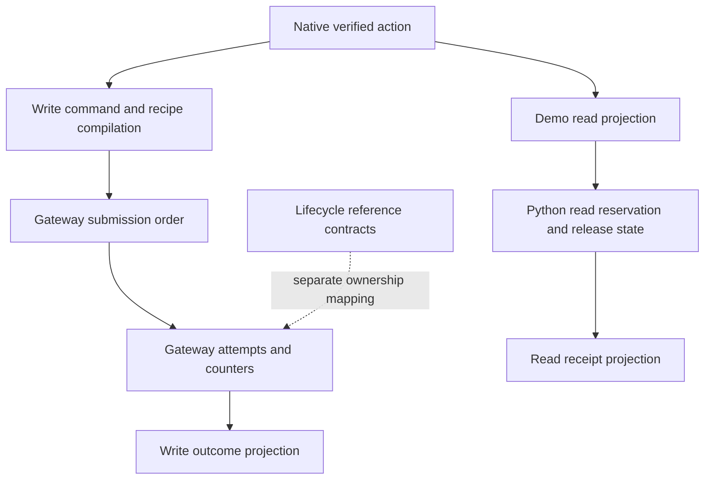
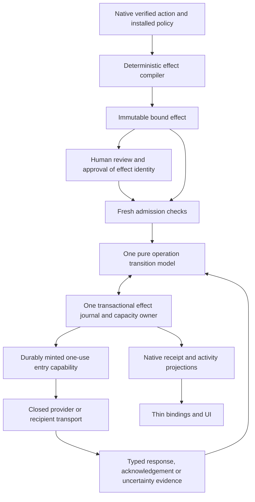
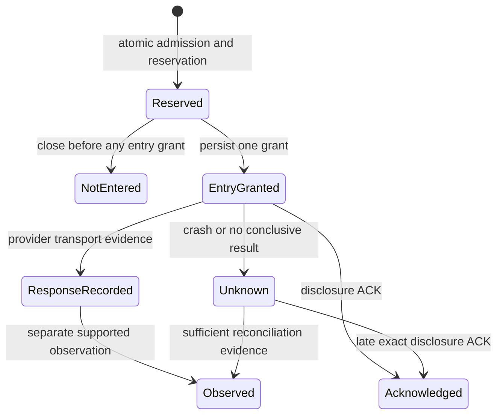

# AP-SPEC-074: Bound effects and one recovery state model

- **Status:** Implementation specification; no completion or qualification claim.
- **Date:** 28 October 2026.
- **Baseline:** `origin/main` at `e2d10a74fa0be5e6bfe2b9f698632c835cd7b11b`.
- **Branch:** `codex/effect-recovery-foundation`.
- **Priority:** Complete this foundation before expanding multi-agent delegation.
- **Handoff:** [Implementation prompt](../plans/0074-implementation-handoff.md).
- **Normative terms:** MUST and MUST NOT are acceptance requirements. Proposed type names below do not imply that those types already exist.

## 1. Objective and scope

Implement two architectural changes together:

1. **One bound effect description.** Authorization, request compilation, approval, admission, execution, recovery and reporting refer to the same immutable effect identity and its authoritative Rust representation.
2. **One recovery state owner.** Reservation, provider entry, disclosure, acknowledgement and uncertain outcomes are governed by one explicit transition model, with invariants preserved across concurrency, failure, retry and restart.

The first complete demonstration is one human authorizing one agent to acquire a bounded resource, receive an authorized disclosure, and perform one exactly approved mutation followed by independent observation. A deterministic provider fixture must exercise actual transport and restart boundaries. Expanding participant enrollment, delegation trees, federation, identity recovery or native resource enforcement is outside this specification.

This is a prerequisite foundation for those later features. Do not import the AP073 branch wholesale, copy its unfinished task protocol, or make this work depend on its merge. Its findings may inform adversarial cases after independent verification against this baseline.

The work must replace competing interpretations, not add another wrapper around them. Completion requires maintained consumers to use the new owner and superseded managed execution paths to be removed. It does not require replacing sound cryptography, the native verifier, established recipes or the whole repository.

## 2. Existing foundations and the actual gap

This inventory is based on source at the baseline, not a claim of exhaustive review.

| Existing surface | What is already present | Required disposition |
| --- | --- | --- |
| [`VerifiedAction`](../../core/crates/auths-verifier/src/lib.rs) | Sealed native action, selected branches and evidence satisfactions. | Retain native verification as the authority source. A signature, parsed proof or application principal must not replace it. |
| [`VerifiedCommand` and `verify_detailed`](../../product/runtime/auths-gateway/src/engine.rs) | Native verification, branch projection and closed request construction. | Consolidate downstream effect binding here; eliminate independently reconstructed security facts. |
| [`CompiledRecipe` and `ClosedProviderRequest`](../../product/runtime/auths-gateway/src/recipe.rs) | Bounded data-only request compiler, account/credential requirements, observation plan. | Retain reviewed compilation. Bind its exact result, recipe identity and installation to the effect. |
| [`submit.rs`](../../product/runtime/auths-gateway/src/submit.rs) and [`order.rs`](../../product/runtime/auths-gateway-kernel/src/order.rs) | A pure step machine already directs write admission and I/O ordering. | Extend or refactor this maintained owner. Do not create an unrelated executor alongside it. |
| [`transition.rs`](../../product/runtime/auths-gateway-kernel/src/transition.rs), [`recovery.rs`](../../product/runtime/auths-gateway-kernel/src/recovery.rs), [`outcome.rs`](../../product/runtime/auths-gateway-kernel/src/outcome.rs) | Attempt transition rules, recovery capability and truthful outcome predicates. | Preserve their invariants and formal links while making reservation, entry and disclosure explicit. |
| [`GatewayAttempts`](../../product/runtime/auths-gateway/src/store.rs) | Attempt records, atomic bounded claims, counters, file and PostgreSQL adapters. | Use one logical effect journal and one transaction contract. Do not add an independently authoritative task ledger. |
| [`auths-lifecycle`](../../product/runtime/auths-lifecycle/src/lib.rs), especially [`operation.rs`](../../product/runtime/auths-lifecycle/src/operation.rs) and [`sealed.rs`](../../product/runtime/auths-lifecycle/src/sealed.rs) | Versioned identities, preparation commitments, lifecycle relations and store acknowledgements used by reference consumers. | Compare and reuse exact mechanisms. Document why retained reference models are not a second production owner. Do not invent a third lifecycle framework. |
| AP070 [`admission.py`](../../demos/google-employee-delegation/broker/src/employee_read_demo/admission.py), [`read_executor.py`](../../demos/google-employee-delegation/broker/src/employee_read_demo/read_executor.py) and [`receipts.py`](../../demos/google-employee-delegation/broker/src/employee_read_demo/receipts.py) | Demo-owned SQLite read accounting, release decisions and receipt orchestration. | Move shared effect/recovery decisions into the Rust owner; retain presentation and provider-specific reference behavior at the appropriate boundary. |
| [`DeploymentClock`](../../product/runtime/auths-gateway/src/qualification.rs) | An existing deployment time/trust boundary. | Strengthen this contract where necessary. Do not introduce clocks in individual handlers or reinterpret signed event time. |

Main contains AP070, not the AP071/AP073 native task read/write implementation. This specification must be implementable without files that exist only on those branches.

Before consolidation:



Target:



“One” means one semantic owner and one atomic admission authority per partition. It does not mean one global process, one physical database table, one mutable object passed everywhere or a single linear lifecycle for all effect kinds.

## 3. Architectural decisions

### 3.1 Ownership

- The offline core continues to own canonical actions, proof validity, attenuation, assurance and evidence verification. It acquires no I/O, clock reads, live budgets or recovery store.
- The existing `auths-gateway-kernel` is the default owner of pure managed-operation transition and outcome predicates. Preserve its bounded explicit-input and translation constraints. Consolidate its existing order/transition/recovery relationships; do not keep two predicates that can independently authorize the same transition.
- `auths-gateway` owns effect compilation, sealed stage types, live admission, custody, transport and journal orchestration. Store adapters implement atomic persistence, not independent lifecycle rules.
- `auths-stores` remains the durable adapter boundary. Existing `auths-lifecycle` identities and store acknowledgement mechanisms must be assessed for reuse before adding analogous types.
- Bindings expose Rust construction, verification, transition and projection APIs. They do not independently hash an effect, decide a recovery transition or infer success.

A different package placement requires a written ownership comparison and ADR before changing dependencies. Moving files is not an acceptance criterion. No new crate is required by this spec.

### 3.2 Shared model, concrete protocols

Use a closed protocol sum with typed data for **provider acquisition**, **recipient disclosure**, and **provider mutation**. These share effect identity, revision checks, accounting, durable entry and immutable evidence rules. Their specific observations and terminal claims remain distinct.

A provider name, arbitrary operation string, callback, runtime plugin or untyped map MUST NOT select hidden authorization or recovery behavior. Provider paths, mappings and supported observations remain reviewed, digest-bound recipe data. A new gateway capability must satisfy the repository abstraction process.

The implementation must write an abstraction case comparing at least the existing mutation path, AP070 acquisition/release path and lifecycle reference model, including divergent semantics. Compare two maintained mutation recipes with different recovery capabilities. If the normal extraction threshold is not met, an ADR must justify the narrowly identical mechanism. This is an implementation deliverable, not permission to skip evidence gates.

### 3.3 Direct cutover

This is prelaunch. Replace affected formats and call sites directly, reject obsolete disposable state, and remove superseded production logic. Do not add migration readers, dual journals, compatibility flags or a runtime switch between old and new semantics. Retain independent test oracles and useful historical evidence with their original scope.

### 3.4 Managed deployment and non-bypassability

Every managed effect MUST pass through bound-effect admission and durable entry.
Inventory application sockets, SDKs, CLI/admin interfaces, credential-bearing
ancillary reads, transport adapters and retained reference paths. No interface
available to the agent may bypass these gates or substitute caller-controlled
transport bytes. An operator commissioning path must satisfy the same effect
binding, approval and entry protocol in addition to its commissioning authority.

The application protocol `auths.gateway-observe/3` accepts only local outcome
and pre-entry history queries. Obsolete observation schemas and the unapproved
`read-back` request are rejected. `auths.gateway-recover/1` supplies a source
operation and the bounded `auths.gateway-submit/2` proof/action/approval envelope
for an independently authorized recovery read. It invokes the same native
engine and returns only a redacted recovery report or native refusal. Neither
route authorizes disclosure of acquired provider content. The former raw read
helper is a test-only reference on the private synthetic harness control plane.

State the deployment threat model: an untrusted agent process is outside the
credential, private review, journal and operator boundaries. The trusted host,
gateway operator, custody service and configured transport enforce those
boundaries. Enumerate credential access, filesystem/process permissions,
authenticated channels and network restrictions needed for the claim. Possession
of unrelated provider credentials, a malicious host/operator, and independent
external writers are not contained by a Rust capability type. Application-owned
reference paths must not be reachable with managed credentials or presented as
managed execution.

Installed acceptance evidence must run a hostile agent in a separate restricted
process and exercise every inventoried application-facing route, including
malformed/obsolete frames and direct credential/provider access attempts. Record
the actual isolation and egress controls exercised; a negative test alone does
not prove non-bypassability under unspecified deployment conditions.

## 4. The bound effect contract

### 4.1 Immutable description and identity

Introduce one versioned canonical `EffectBinding` with an immutable `EffectId`. The concrete name may reuse an existing type after the ownership comparison. Each semantic field has exactly one authority and one encoding.

| Dimension | Bound facts and trusted source |
| --- | --- |
| Operation | Operator/admission namespace, partition epoch and logical operation ID. These determine the replay/conflict lookup key. |
| Authority | Native action commitment, selected actor/branch identities, authorization context/configuration identity, authority scope and the relevant grant/evidence dependencies. |
| Scope | Engagement/task scope when present, exact resource identity, acting recipient/executor audience and holder/channel restrictions. No task-free value may silently match a task-bound one. |
| Compilation | Profile identity, recipe digest, compiler semantic version and exact noncredential transport description. |
| Installation | Connection identity, account/subject binding, credential generation, installation/configuration version and required qualification policy. |
| Information flow | For acquisition: source/projection and response limits. For disclosure: exact recipient, channel binding, source-effect relationship, permitted projection and byte ceiling. |
| Accounting | Typed reservation set: partition, counter key, unit, amount, window and any conservation relation. Read calls, bytes and write count are not interchangeable units. |
| Evidence and recovery | Approval requirements, freshness dependencies, observation/reconciliation contract and its identity. A provider idempotency declaration includes scope and retention assumptions. |

Use tagged, versioned alternatives for protocol-specific facts. Do not represent validity with a large set of optional fields whose illegal combinations are interpreted differently by callers.

The concrete native encoding is `auths.bound-effect/3`, with effect compiler
`auths.gateway-effect-compiler/6`. Reservations use a closed window alternative:
fixed epoch-aligned windows or the retained source effect's lifetime. Mutation
count/sum reservations retain fixed windows; recovery acquisitions declare
separate acquisition-count and response-byte charges against one source. A
source-lifetime bound must survive operation-ID changes, replay and restart.
An encoded bound declares an obligation; only the journal's atomic admission
and entry transitions can discharge it. Decoding never grants authority.

The replay key MUST NOT include the action/effect digest as its only differentiator: the same logical operation ID with changed binding is a conflict, not a fresh operation. Exact replays return existing state; they never mint another capability. A newly chosen operation ID cannot evade a signed approval's binding or the shared budget.

Managed recovery policies use the same selected-branch tightening and fixed-window
count/sum arithmetic as mutation. Their argument is `maximum_response_bytes`;
read calls and full response ceilings have separate counter identities from
mutation counts and amounts. The mutation recipe's spend-sum requirement does
not apply to independently authorized read actions. Admission reserves these
slots atomically with the permanent source allowance, and final entry checks
all membership and window facts under the writer fence. Unknown outcomes retain
both charges. Prerequisites do not charge the parent policy a second time.
The existing sixteen-link and 34-reservation limits remain unchanged.

### 4.2 Compilation and approval without circular commitments

1. Verify the caller's canonical action under installed trust and policy.
2. Compile only that verified action and pinned installation/recipe into a candidate effect. All security-relevant provider bytes and recipient policy are now fixed.
3. Construct the canonical binding and `EffectId`, including the compiler output commitment.
4. Render review data from that same bound value. Obtain required approval over its exact identity and the approved scope/deadline.
5. Validate approval separately and construct `ApprovedEffect`. Do not include the approval signature in the value it signs.
6. Admit and execute only this approved value after fresh checks. Recompilation under changed recipe, account, configuration, recipient or payload yields a different binding and requires new authorization/approval as applicable.

The recipe compiler cannot literally consume its own completed output. “Same description” means one authoritative semantic input and a sealed deterministic compilation result, both bound by one identity. It does not require cyclic hashes or trusting a caller-supplied compiled request.

Broad delegated authority and exact human approval remain different facts. Approval can narrow an effect; it cannot create missing resource authority. A bounded-upfront approval is a separate typed mode with explicit scope and expiry.
For acquisition and disclosure it can approve the source/projection, recipient and
limits before the content is fetched; the exact disclosure binding is finalized
after acquisition and checked against that consent. It cannot be used to approve
a mutation that requires exact human confirmation. Its mere presence must not satisfy an exact-approval requirement.

Each approvable operation MUST declare a versioned review contract, bound through
the approved recipe/compiler semantics and effect identity. It names all
security-critical fields, their types/units and required presentation, including
the destination, action consequences, relevant limits and uncertainty. Domain
profiles define domain-specific fields: a financial profile may require amount,
currency, merchant identity, recurrence and settlement consequences. The shared
gateway must not infer such semantics from provider names or arbitrary prose.

Native code projects those fields from the same sealed effect. Unsupported
review versions, absent fields, truncation that hides meaning, or an incapable
renderer MUST prevent approval. Untrusted labels/content cannot replace trusted
field names or obscure destinations, units or consequences. The approval channel
must authenticate the approver and associate the displayed projection with the
exact signed effect; an agent's assertion that review occurred is insufficient.
Test rendering failures, substituted labels and changed review semantics. This
establishes faithful, complete presentation under the declared contract, not a
proof that the human understood it.

The concrete recipe declaration is `auths.effect-review-contract/1` in recipe
source `/3`: required consequences and one typed presentation for every
non-binding profile argument. Integer presentations require explicit units.
The operator supplies domain meaning; OpenAPI derivation produces an incomplete
draft and cannot authorize these facts. Native review always includes the three
binding arguments, destination, exact request, installation, reservation and
recovery facts independently of recipe labels. Private review `/2` supports the
complete literal renderer `auths.literal-complete-review/1`; control and bidi
characters are escaped data, and output is never truncated. An installed frontend
must preserve that contract and associate its displayed result with the exact
signing request. Native fixture parity alone does not close the installed
approval-channel or human-journey acceptance gate.

### 4.3 Closed transport and custody

The private bound value contains the exact method, origin/path/query, noncredential headers, media type, body and closed observation plan. Transport accepts a stage-sealed effect capability, not a second set of URL/body/recipient parameters. Credential injection may fill only the approved credential slot for the bound connection/account/generation. Credentials themselves never enter effect serialization, public commitments, receipts, bindings or agent memory.

Redirects, automatic retries, endpoint substitution and middleware body/header mutation cannot silently change the bound send. Deny unsupported behavior. Idempotency and correlation values are generated by the native compiler and included in the binding. Byte equality means the application request after deterministic compilation, excluding explicitly specified transport framing and secret credential insertion; it is not equality of TLS packets.

Credential-bearing preflight, account checks, provider observations and recovery
reads must also be bound, bounded ancillary acquisition operations derived from
the approved recipe. Account for their entry and limits explicitly; they must not
be invisible I/O outside the model. Acquiring those bytes does not authorize
disclosing them to the agent.

Mutation compiler `/5` retains an ordered prerequisite acquisition plan beside
its verified command and commits the complete plan in the transport identity.
The plan names at most seven requests: one account check, up to four denied
capability checks, one pre-entry read and one relative-ceiling read. Each pins
its compiler-owned GET/HEAD, headers, response-byte ceiling (at most 65,536),
evaluation purpose and resolved values, one call, 15 transport seconds, at most
30 seconds of evidence age, and no disclosure. Tighter native evidence freshness
requirements still apply. Onboarding probes and later observations are separate
operations and cannot borrow this allowance. Private approval review renders
these declarations. The declaration alone is neither a capacity reservation nor
an entry permit; runtime must durably account and grant every constituent read
through the shared journal before contacting the provider.

The concrete journal encoding is `auths.gateway-attempt/10`. Each prerequisite
has a component replay key derived from the parent's logical operation key and
its compiler ordinal, a permanent one-call/maximum-response-byte allocation,
and a typed acquisition record retaining the parent's exact approval. A bounded
canonical parent transport witness proves membership; it cannot construct a
transport request. Granting a read requires a still-reserved parent under the
same fence as its allocation and current native dependencies. Final mutation
entry fences all required prerequisite records and allocations and requires
recorded, fresh responses. Receipt time is immutable, and evidence age uses the
earlier grant time conservatively. These requirements do not waive tighter
native evidence freshness or independently authorized later observation.

Final mutation entry must also evaluate each prerequisite's actual purpose against
those retained responses. Signed pre-entry observations must have valid canonical
signatures from the pinned observer and exactly match the retained subject,
projected facts and original conservative time. Reevaluate the selected native
requirements and anchor validity at the fenced entry time. Relative-ceiling
checkpoints must preserve the response's basis, digest and time, and satisfy the
original bound values and ratio. Extraneous checkpoint evidence cannot substitute
for a missing prerequisite. The selected gateway observer identity is part of the
installed configuration commitment. All JSON prerequisite interpretations reject
duplicate members through the shared bounded response decoder.

Independent recovery compilation uses the reserved native MCP tool
`auths_gateway_recovery_read_v1`; a mutation recipe cannot claim that name.
Its `auths.gateway-recovery-read/1` contract binds the retained source effect
and operation, exact GET and response limit, observation projection/expected
value and echo, count/time/freshness limits, and the absence of content
release. The read requires its own current native proof and exact approval;
the source writer's proof and historical approval are provenance only. The
same native binding, review renderer and approval machinery serve both types.
This compilation contract does not itself implement read admission, an entry
permit, observation evidence or disclosure.

A provider-derived locator is not authority. If a later action depends on a response-derived resource, establish its provenance under the declared observation contract and compile a new bound effect linked to that evidence. Do not mutate an already approved effect. This requirement does not expand scope into a full create/populate product workflow.

### 4.4 Stage types and serialization

The intended progression is:

```text
VerifiedAction -> BoundEffect -> ApprovedEffect -> ReservedEffect
              -> ProviderEntryPermit or DisclosureEntryPermit -> Evidence
```

Private constructors enforce the local boundary. Entry permits are neither cloneable nor deserializable. Persisted records are facts, not executable capabilities; restoring a record cannot reconstruct a lost send permit. A portable binding may be decoded as data but must pass native validation before obtaining any sealed type.

Remote permits and multi-executor dispatch are outside this milestone. Do not imply that a Rust type alone prevents a malicious process from bypassing a deployment boundary.

### 4.5 Canonicalization and privacy

Reuse repository canonical codecs and domain-separated commitments. Freeze the selected schema, ordering, optional/absent distinction, integer range, duplicate handling and semantic identities in native fixtures before cutting over callers. No Python/TypeScript hash implementation may become an alternate authority.

The complete effect contains private data. Its ordinary digest and correlation identifiers are not automatically safe for public receipts: low-entropy payloads can be guessed. Define separate private audit and redacted public projections. Use the existing protected-commitment mechanism where suitable; public content commitments must be hiding and scoped. Redact Debug/error output, zeroize retained sensitive buffers where supported, and put any persisted private payload/evidence behind the protected journal's access and retention policy.

## 5. One operation and recovery model

### 5.1 One transition owner

Specify a total bounded reducer conceptually equivalent to:

```text
transition(current_state, typed_command, verified_facts, transaction_time)
    -> refusal | proposed_state_and_accounting_delta
```

The reducer has no I/O, ambient clock, provider callbacks or arbitrary JSON interpretation. The store derives authoritative state and capacity inside its transaction. It persists the reducer result, revisions, accounting delta and required audit event atomically before acknowledging the transition. Only the runtime's validated durable acknowledgement can mint an external-entry capability.

`verified_facts` are stage-specific verified values, not caller assertions. Evidence acquisition can happen before a transaction; freshness and all relevant dependencies must still be checked at its linearization point. The operation's fixed identity and binding never change.

Use protocol-specific typed states beneath a shared operation header. An acquisition followed by disclosure consists of linked operations with distinct authority and charges. A provider GET is not content delivery. A provider response is not observed mutation success.

### 5.2 States and transitions

The following names define semantics, not mandatory wire spellings:

| Transition | Preconditions | Durable result and permission |
| --- | --- | --- |
| Admit | Exact approved effect; current authority/configuration/epoch; capacity; unused replay key. | Store binding, reservation and replay claim atomically. No external entry yet. |
| Refuse before entry | No entry grant exists; refusal is valid under the protocol. | Terminal not-entered fact. Preserve replay identity. Release only explicitly releasable capacity; spent invocation units may remain spent. |
| Grant provider entry | Reserved acquisition/mutation; fresh native authority and approval; unchanged installation; current revocation/version; exact transport binding. | Persist unique entry grant and required charge before returning one provider permit. |
| Record provider response | A matching provider entry grant exists; bounded authenticated transport evidence. | Add response fact. Never infer effect solely from HTTP status. |
| Record uncertain provider outcome | Entry grant exists but completion cannot be established. | Retain charges and unknown outcome. No automatic send retry. |
| Admit disclosure | Authorized source acquisition and protected content exist; current recipient/scope/channel and projection; disclosure capacity. | Reserve exact release bound to source, protected content commitment and recipient. No delivery yet. |
| Grant disclosure entry | Fresh release authority and authenticated recipient; exact bytes, channel and commitment; active reservation. | Persist irreversible release charge and unique grant before returning one delivery permit. |
| Record acknowledgement | Authenticated ACK matches effect, delivery instance, recipient/channel and exact protected bytes. | Add acknowledged fact; never create new delivery authority. Exact repeated ACK is idempotent. |
| Recover without ACK | Release entry may have occurred. | Retain delivery-unknown and all relevant charges. No automatic redelivery or refund. |
| Observe/reconcile | Separate current permission for bounded recovery read; exact operation/recipe/evidence binding. | Add supported evidence or leave unknown. Never issue a mutation permit. |
| Revoke | Authenticated revocation under the same ordered admission authority. | Prevent later grants; retain earlier grants, charges, identity and historical evidence. |

Entry-granted records mean permission was durably handed out and external entry may have happened. They do not prove that a socket send occurred. If the process dies after the grant but before send, the conservative result is still unknown. A missing response cannot be converted to not-entered.



This diagram is a projection of a typed state model. `ResponseRecorded` belongs to acquisition/mutation, `Acknowledged` to disclosure. `Observed` carries a typed claim such as matching state or linked provider evidence; it is not a universal success state. A matching observation may coexist with unresolved causal attribution; it must
not erase uncertainty, release charges or imply permission to retry. Invalid
cross-protocol transitions must be unrepresentable or refused by the sole reducer.

### 5.3 Retry and recovery contract

For this milestone, provider-entry and disclosure-entry permits are one-use, and replay never reissues them. The model distinguishes re-running pure verification, retrying an uncommitted transaction, retrieving existing state, repeating an authorized observation, and repeating an external effect.

- A transaction proven not committed may be attempted again under the same replay identity.
- An ambiguous commit requires loading the authoritative journal before doing anything else. Unavailable state fails closed.
- A durable reservation with no entry grant may progress only through fresh authorization and an atomic single-winner grant; reopening it does not bypass approval or capacity checks.
- Once an entry grant exists, restart must not reissue it, including when no response or ACK exists.
- The native submission projection names a retained pre-grant reservation as
  `reserved` with its exact JSON-safe journal revision. After an unacknowledged
  grant, loading that state does not issue a capability. A retained grant with
  no conclusive evidence projects `unknown`; unavailable or mismatched journal
  state projects `indeterminate` with `gateway.attempt.state-unavailable`.
  Identical admitted/terminal replay returns stored facts with no credential
  lease, provider read or new observation credit. Reservation continuation is
  the separate fresh-authorization rule above.
- Provider idempotency may improve provider guarantees but does not override the default prohibition on Auths re-entry. Any future retry mode requires an explicit versioned protocol and evidence for key scope, retention, fencing and late requests.
- Late valid response/ACK evidence can refine an unknown outcome. Revocation or expiry must not erase legitimate history or prevent recording a previously authorized delivery's exact ACK. Recording history confers no current execution authority.
- Read-only recovery requires its own bounded authority and accounting. It cannot borrow a revoked writer's proof, use an expired approval as current authority, acquire broader credentials or change the original actor attribution.

Unresolved effects also have an operational contract. Declare finite observation
attempt/byte/time limits, evidence freshness, and escalation conditions. Expose
the uncertainty, retained charges, last evidence and permitted next actions in
native operator projections. Exhaustion or unavailable evidence leaves the
effect unresolved and charged; it does not schedule an implicit retry, redelivery
or refund. Recovery may remain unresolved indefinitely.

Administrative annotations must remain distinguishable from verified provider
evidence. Any administrative resolution that changes evidence or accounting must
be an explicit, separately authorized command accepted by the sole reducer under
a declared evidence rule. An operator assertion cannot establish non-entry after
a grant or override the conservation/no-retry rules. Measure bounded recovery
work and the cases actually resolvable, as well as refusal safety.

### 5.4 Accounting

At every committed revision, for each capacity key and unit:

```text
available + held + consumed = allocated
held >= 0; consumed >= 0; allocated <= authorized ceiling
```

If capacity windows or allocation semantics use a different existing algebra, provide the exact equivalent conservation relation and proof. Never mix units or double-count one operation in multiple categories. Unknown effects retain their held/consumed allocation. Read acquisition count, provider attempts, response-byte reservation, disclosure bytes and mutation units have explicit charging points.

The reducer owns reserve/consume/release transitions. Store adapters cannot silently release capacity on timeout, lease expiry, cancellation, garbage collection or process death. Only an explicit protocol transition with evidence of no entry may release a releasable reservation. Conservative over-accounting is permitted and must be visible; accidental refunds are not.

### 5.5 Revocation, time and configuration ordering

Entry grants and revocation must have one documented linearization order. A revocation committed first blocks the grant; a grant committed first may still be exercised. Do not promise recall of already released data or an unfenced remote request. Disclosure has a later, independent gate even after provider acquisition was granted.

Use the existing deployment clock boundary and sample transaction time after acquiring the relevant lock/transaction. Bound lock duration and native verification work. Distinguish signed event time, evidence observation time, verifier evaluation time and monotonic elapsed time. Re-evaluation does not refresh old evidence.

Re-run the full native verifier, or use a mechanically justified equivalent dependency check, at the final authorization boundary. Checking only action/grant expiry is insufficient when identity/status/assurance/approval/observation evidence can age independently. Bind the selected branches and evidence to the projected effect: another valid threshold subset cannot silently license previously derived facts.

Connection, trust, recipe, policy, qualification and admission epoch changes must be ordered with entry or fenced under a demonstrated version protocol. A mutable value checked before waiting for the lock is insufficient. Exact human approval must remain eligible at entry. If durable consent has a distinct validity/revocation contract, make that a separate mode with explicit evidence; never discard approval dependencies accidentally.

Initial admission also orders fresh native authority, approval, configuration,
connection and qualification with publication of the claim and its charges.
The file and PostgreSQL adapters use the common writer fence for one insert
batch plus bounded dependency reads. The decision can replace only the first
record's bytes; allocation keys, kinds, amounts and expiries remain fixed.
Persisted admission time is sampled inside that fence. A replay returns retained
history without a new admission decision or charge and confers no entry permit.

Count/sum frontiers may be selected outside the fence only as candidates. The
transaction checks every target's vacancy and validates immutable sum
predecessors against the proposed cumulative charges. Native recompilation must
refuse a changed window before publication. Acquisition admission additionally
checks its eligible source under the same fence. The combined insertion and
read set is at most 64 records (at most 55 for mutation admission); the existing
two-second lock-wait and decision bounds apply. Store failure or ambiguous
acknowledgement cannot publish an executable capability.

At the entry grant's serialization point, the atomic decision requires current
native authority, eligible approval, current configuration and revocation state,
an intact sufficient reservation with conserved accounting, and no previous
grant for that operation's external-entry boundary. Already reserved capacity
must not be charged again as a new allocation. The full check and durable grant
must observe one consistent authoritative state, or an explicitly justified
equivalent fencing protocol. One durable grant does not prove exactly-once
provider execution, settlement or exclusive causation.

## 6. Journal and persistence contract

There must be one logical journal owner for operation identity, reservation, entry grants, protocol outcomes and replay tombstones. Multiple physical records are acceptable only when their safety-critical changes commit atomically. An effect must not acquire two independent mutable truths in a task ledger and an attempt ledger.

For both file and PostgreSQL adapters, specify and exercise:

- lock/CAS scope, expected revision, epoch and conflict behavior;
- atomic operation creation plus all counter updates;
- atomic entry grant plus its audit event and consumed/held accounting;
- file/data/directory synchronization or database commit acknowledgement required before capability publication;
- torn-write, partial-batch, connection-loss and ambiguous-commit recovery;
- decoding bounds, illegal-state rejection and schema mismatch refusal;
- replay/tombstone retention through the full authority and late-evidence horizon;
- bounded garbage collection that cannot resurrect an expired claim or erase unresolved accounting.

Before P2's behavioral cutover, the ownership ADR must name each adapter's exact
lock/transaction scope, acquisition order, authoritative dependency versions,
configuration/revocation writers, isolation/CAS behavior, clock sampling point,
finite work/deadline bound and acknowledgement boundary. It must explain why a
writer in another process cannot change a checked dependency before the grant
without detection or ordered exclusion. Independently stored configuration or
credentials require an explicit fencing/version contract; an attempt-only CAS
or process-local in-flight counter is insufficient. Unsupported cross-store
atomicity must fail closed, not become an undocumented deployment assumption.

Existing file and PostgreSQL behavior must not regress. In-memory adapters are test tools and do not establish durability. File conformance establishes the stated local-filesystem assumptions, not distributed fencing or power-loss behavior on every platform.

Whole-store rollback is outside ordinary crash recovery. Keep existing commissioning/generation-floor defenses, bind operations to the admitted epoch, and fail closed when an installed anti-rollback check fails. Where an independent monotonic anchor is absent, explicitly state that restoring all protected state is outside the guarantee. Do not claim that a revision stored in the same restored database detects its own rollback. Building a new consensus service is outside this specification.

Persist sensitive reconstruction data only if necessary and protected. If private content is intentionally not retained, recovery may remain unresolved; it must not refetch or redeliver to manufacture certainty.

## 7. Central implementation surfaces

The implementation should expose a small set of Rust-owned operations, with exact names chosen during the source mapping:

| Surface | Contract |
| --- | --- |
| Compile/review | Produce canonical bound effect and human review projection from verified action and pinned installation. No reservation or I/O. |
| Approve/validate approval | Bind exact effect or explicit bounded consent. No entry permission. |
| Admit | Atomic binding/replay/reservation transaction; return existing state on exact replay. |
| Grant entry | Fresh ordered authorization and one durable provider/disclosure grant; return one-use capability only after acknowledgement validation. |
| Record evidence | Validate exact response, ACK or observation binding and apply the sole transition relation. |
| Recover/inspect | Return truthful current facts and permitted recovery actions. Never implicitly execute a write or deliver content. |
| Project receipt/activity | Native redacted projection of journal facts with evidence provenance and limitations. |

Centralize clocks, canonicalization, effect comparisons, charge transitions and receipt claims at these owners. Do not scatter fixes across Python presenters, HTTP routes, CLI handlers or recipe branches. UI and SDKs must consume the same native review and state projection, including unknown and not-entered distinctions.

For the AP070 read demonstration, remove independent Python decisions for the shared contract in the same cutover. Provider-specific reference code may remain outside the shared gateway; production managed I/O must use approved data-only capabilities. Inventory every retained weaker application-owned path and label its claim accurately. Do not turn a demo adapter into a runtime callback loaded by the gateway.

## 8. Hard limits and stable failures

Before the first behavioral cutover, commit a limit/encoding table naming the existing constant or new justified finite bound for every public collection and byte buffer. Preserve current tighter limits, including native proof/action bounds, 16,384-byte compiled write bodies, 34 counter entries and the 64-step gateway driver bound unless an explicitly reviewed requirement changes them.

Cover: effect metadata; payload/proof/context bytes; header/path sizes; resource and recipient counts; reservation keys; evidence dependencies; per-operation journal events; ACKs; observation attempts; lock/transaction deadlines; recovery scans; private retained bytes; and public receipt size. Decode and reject over-limit inputs before unbounded allocation. Do not solve exhaustion by silently deleting replay or unknown-outcome records.

Errors distinguish malformed/noncanonical input, unsupported schema/protocol, unauthorized effect, expired/stale evidence, changed binding, replay, conflicting operation, exhausted capacity, invalid transition, unavailable/corrupt store and unresolved outcome. Map them consistently across Rust and bindings without exposing proof bodies, provider content or credentials. Preserve existing codes where semantics are unchanged; version intentional changes.

## 9. Required invariants

| ID | Invariant |
| --- | --- |
| E01 | Every external request and disclosure derives exclusively from one native-verified, compiled and approved bound effect. |
| E02 | Changing any security-relevant binding dimension is rejected or creates a newly authorized effect; no stage reconstructs a weaker interpretation. |
| E03 | Same operation key plus same binding is replay; same key plus different binding is conflict. Neither creates another entry. |
| E04 | Human approval, native resource authority and live admission are separate required facts. |
| E05 | Bindings and UI consume native canonical identities and projections; public data does not disclose private content or reusable authority. |
| R01 | One reducer owns allowed state transitions and accounting; every maintained managed path calls it. |
| R02 | Durable reservation and the entry grant precede their corresponding external boundaries; failed/ambiguous persistence returns no capability. |
| R03 | At most one entry capability is issued per effect boundary; permit loss, replay and restart cannot mint another. |
| R04 | Accounting is conserved under concurrency, errors, revocation, restart and unknown outcomes. |
| R05 | Acquisition, disclosure, provider response, acknowledgement and observation remain distinct facts. |
| R06 | Unknown cannot become not-entered, refunded or retryable from elapsed time or missing evidence. |
| R07 | Revocation, configuration and entry follow the stated transaction/fencing order; time is evaluated at that boundary. |
| R08 | Evidence is immutable once recorded; late evidence may refine uncertainty only for the exact original operation. |
| R09 | Recovery has explicit current read-only authority and preserves original effect attribution. |
| R10 | Restored state and malformed/obsolete records cannot bypass the declared epoch, retention or durability assumptions. |

The implementation must map these invariants to six system properties:

| Property | Conditional guarantee |
| --- | --- |
| Authority preservation | Every external entry follows a grant with valid current native authority and eligible approval at its ordered grant point. |
| Effect preservation | Every request/disclosure is the exact compiled and approved effect, including its review contract and allowed credential insertion. |
| Single-grant safety | Each logical operation and external-entry boundary has at most one grant; persisted state cannot remint its permit. |
| Capacity conservation | Concurrent admission, crashes and recovery cannot create authorized capacity or silently refund unknown effects. |
| Revocation ordering | A committed revocation prevents every later grant within its defined scope; earlier grants retain the documented semantics. |
| Evidence soundness | Recorded and displayed claims imply no more than their authenticated evidence establishes. |

For each property, name the shipping pure predicates, runtime enforcement,
adapter assumptions and model-generated/integration histories that support it.
These are required proof/evidence obligations, not a claim of an already proved
whole-system theorem. Formal claims must state their assumptions and source link.

## 10. Executable acceptance matrix

All rows require reproducible artifacts, expected journal state, expected external calls, actual result, exact revision and limitations. Source code or a passing compilation alone is not behavioral evidence.

| Case | Required scenario and assertion |
| --- | --- |
| A01 | Compile/review/approve/execute the same mutation. Assert exact request bytes and one identity at every boundary. |
| A02 | Independently mutate action, actor, scope, recipient, resource, recipe, URL/body/header, account, credential generation, verifier configuration, epoch and approval. Refuse before the applicable custody/entry boundary. |
| A03 | Replay identical operation concurrently and after restart; alter its effect with the same ID; try a new ID with the old exact approval. At most one grant, explicit replay/conflict, conserved counters. |
| A04 | Race independent operations for the final count/byte/sum capacity. Exactly the permitted total succeeds on both durable adapters. |
| A05 | Crash before commit, after reservation, after entry persistence but before send, during send, after response/ACK receipt but before persistence, and after persistence but before returning to caller. Reopen and verify state, charges and no duplicate effect. |
| A06 | Inject file sync/rename failure, partial batch and database ambiguous commit/CAS conflicts. No unacknowledged capability; deterministic bounded recovery. |
| A07 | Acquire content then revoke before disclosure. Provider entry may be recorded; recipient receives no bytes. Charges reflect the separate boundaries. |
| A08 | Lose disclosure ACK after actual send; crash/reopen and retry. No automatic redelivery; bytes stay charged; exact late ACK refines history. |
| A09 | Replay/substitute ACK for another operation, channel, recipient, content, instance or source effect. Refuse without changing history/accounting. |
| A10 | Provider timeout, response loss, denied response, successful HTTP response and matching read-back produce different truthful claims. A match alone is not causal proof. |
| A11 | Reconciliation finds zero, multiple, unrelated or incomplete matches. Outcome remains unresolved. A supported exact link adds evidence without a new write. |
| A12 | Race revocation and connection/configuration changes with entry and disclosure. Histories match the documented linearization rule. |
| A13 | Advance time while waiting for the lock; independently expire human evidence, observer evidence and resource authority. Re-evaluation does not refresh signed event time. |
| A14 | A threshold proof remains authorized but its selected branches/evidence change. Earlier projected authority cannot be silently reused. |
| A15 | Recovery actor differs from original actor; original permission is expired/revoked. Only separately authorized bounded observation is possible; attribution remains unchanged. |
| A16 | Cross-task, cross-recipe and cross-partition substitutions use otherwise valid proofs and identical resource names. No mixed authority or shared-state aliasing. |
| A17 | Capture logs, errors, public receipts and binding output with sentinel secrets/private content. No sensitive bytes or guessable public content commitments escape. |
| A18 | Canonical valid, malformed, duplicate, noncanonical and limit/limit-plus-one cases agree across Rust and every affected public binding. |
| A19 | Differential corpus covers two mutation recipes with distinct recovery capabilities, plus acquisition/disclosure, against retained references. No provider-specific branch enters the shared owner. |
| A20 | Model-generated event sequences and concurrent histories exercise every transition and illegal edge. Formal/refinement artifacts identify the actual shipping pure predicates and assumptions. |
| A21 | Replay retention, terminal tombstones, stale cache/configuration and supported rollback-floor failures cannot resurrect entry authority. Unsupported whole-store rollback is explicitly excluded. |
| A22 | Installed packages and native runtime execute the complete single-human/single-agent read, disclosure, exact write and observation journey; UI distinguishes grant, response, ACK, observation and unknown. |

The same rows additionally require the following hardening cases; these are
part of their exit gates, not optional follow-up work:

| Cases | Additional adversarial evidence |
| --- | --- |
| A01, A02, A18, A22 | Unsupported review contract, omitted/truncated mandatory field, misleading untrusted label, changed units/destination/consequences and substituted review/signing channel. No approval of an incomplete or mismatched review. |
| A04, A06, A12, A13 | Independent processes race dependency changes against the final grant on both adapters, including state in distinct physical records. Histories satisfy the named fencing mechanism; existing reservations are not charged twice. |
| A11, A15, A22 | Exhaust reconciliation attempts/bytes/time; age its evidence; make authority/store unavailable. Retained charges and escalation remain visible; administrative annotations cannot manufacture non-entry or retry authority. |
| A16, A20 | Scope/participant and charge inputs cannot create a second admission authority. Exercise the current unscoped/single-agent boundary and reject unsupported delegation representations; no AP073 implementation is required. |
| A17, A21, A22 | Hostile isolated agent exercises the complete interface inventory, obsolete endpoints and alternate credential/transport routes. Assert no unauthorized managed provider calls and document the actual isolation assumptions. |

Use external call counters and process failpoints, not only mocked return values or tests asserting the implementation's own intermediate flags. Exercise real local sockets, process restart and the maintained PostgreSQL fixture. Provider-specific live qualification remains a separate claim; no cloud credential should be necessary for the local foundation journey.

## 11. Formal and performance evidence

Preserve current linked gateway order/transition/recovery evidence. Update translated/generated Rust-to-Lean obligations and Kani/property coverage when their source or semantics change. Required properties include exact-binding preservation, single grant, conservation, no unknown-to-retry transition, immutable evidence and revocation ordering. Do not label a separately handwritten model as a proof of shipping Rust.

Publish a bounded mapping from the pure transition proof to the runtime/store adapter assumptions. Filesystem durability, database isolation, authenticated recipient behavior and provider observations remain explicit assumptions tested through conformance/fault injection.

Measure native verification, compilation, transaction/lock duration, memory bounds and recovery scan costs for each representative path. Optimization must retain the same semantics and differential evidence. A second verification under a lock must have a finite work/deadline bound; do not replace full dependency validation with a partial expiry shortcut merely to improve latency.

## 12. Implementation order and exit gates

| Phase | Deliverable | Exit gate |
| --- | --- | --- |
| P0: map and decide | Baseline source/consumer inventory; ownership ADR and abstraction case; canonical field, limit and state tables; retain/replace list. | Every existing invariant and production/reference owner accounted for. No implementation built on an unresolved competing owner. |
| P1: bind one mutation | Native immutable effect, review/approval, deterministic request compilation and thin binding entry points. | E01–E05 on one maintained mutation path; adversarial binding corpus authored; direct cutover removes duplicate reconstruction. |
| P2: central durable mutation | Sole reducer/journal for reservations, entry, response, unknown and observation, with file/PostgreSQL adapters. | R01–R10 for mutation; restart/concurrency/fault evidence implemented; no dual task/attempt authority. |
| P3: acquisition and disclosure | Typed read/release protocol in the same owner, explicit source/recipient binding and ACK handling; thin AP070 consumer. | Independent read/disclosure charges and permissions; ACK loss/revocation/replay cases implemented; Python stops deciding shared transitions. |
| P4: close integration and evidence | Second recipe differential cases, installed bindings, full local journey, native projections, formal links and final hosted checks. | A01–A22 addressed with exact-revision evidence, documented assumptions and no unsupported claims. |

Commit coherent changes along the way. Keep a durable acceptance ledger separating implemented, source-tested, executed, externally qualified and blocked. Do not mark a phase complete merely because its types exist or the happy path works.

Observe CI only after the specification's implementation is complete, as requested by the user. Follow the repository's GitHub-first policy: construct necessary generated artifacts locally; do not run duplicate broad local suites by default. Once implementation, fixtures and documentation are complete, push the finished branch, inspect required hosted workflows on that exact revision, repair failures, and repeat until the required evidence is resolved. Report external blockers rather than weakening checks or pretending a skipped job passed.

The foundation is not complete until required behavioral and hosted evidence passes. Delaying CI observation is not a waiver of verification. No merge or deployment is authorized by this spec.

## 13. Completion and handoff boundary

Done means both central contracts own the maintained paths, obsolete managed interpretations are removed, interfaces and bindings are updated, source-linked formal and operational evidence are current, and the acceptance ledger contains actual results. The result must be a reviewable implementation with a concise explanation of changed behavior, tests and remaining deployment assumptions.

Only after this foundation is closed should multi-agent delegation add participant trees and ancestor budget allocation on top. Those features must consume the established effect and recovery contracts instead of creating their own parallel journals, approval identities or retry rules.

Future AP073 composition must bind the exact participant/executor identity,
task partition/epoch, native authority chain and selected dependencies, scope and
typed ancestor/task charges into the effect. These are inputs to AP074's single
admission authority, never a second independent task approval or mutable effect
journal. Any cross-domain charge/admission update must commit atomically or use
an explicitly justified fencing protocol. Reject unsupported delegated scopes
until that integration is implemented. This contract neither imports AP073 code
nor authorizes work on its paused checkout.

## References

- [Repository contract](../../AGENTS.md).
- [Profile and domain abstraction boundary](../target-state/PROFILE_AND_DOMAIN_ABSTRACTION_BOUNDARY_PLAN.md).
- [AP-SPEC-026: reservation and execution semantics](0026-reservation-and-execution-state-semantics.md).
- [AP-SPEC-057: exact-action evidence program](0057-evidence-program-for-the-exact-action-boundary.md).
- [AP-SPEC-063: generalized gateway](0063-generalized-gateway.md).
- [AP-SPEC-066: gateway qualification](0066-production-gateway-polish-and-recipe-qualification.md).
- [AP-SPEC-070: employee read delegation](0070-google-employee-agent-delegation-demo.md).
- [ADR 0012: credential-isolated gateway](../adr/0012-declarative-credential-isolated-gateway-boundary.md).
- [ADR 0013: recipe capabilities and budgets](../adr/0013-recipe-capabilities-and-sum-budget.md).
- [Existing gateway abstraction case](../research/domains/abstraction-cases/0007-declarative-credential-isolated-request.md).
