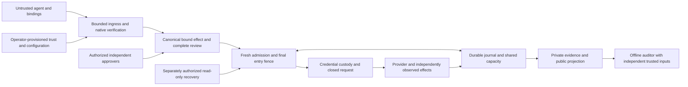

# AP-SPEC-075: Independent assessment of the complete security boundary

- **Status:** Proposed assessment and remediation contract; no assessment results are implied.
- **Date:** 8 November 2026.
- **Mission:** Establish what one complete Auths authorization workflow actually protects, independently challenge that boundary, resolve release-blocking defects, and reconcile the release claims with the evidence.
- **Primary workflow:** Agent-requested Stripe refund through the credential-isolated gateway, with exact authority, required approval quorum, applicable limits, durable recovery and offline audit.
- **Reference baseline:** `ac5fcabe9c6300e46789b4e847bb1991f9f9d66f`, the main revision containing merged AP074 and AP073. The assessor MUST pin the actual assessment revision; this reference is not permission to assess an obsolete release candidate.
- **Assessor:** A capable agent operating in a fresh assessment context, with adversarial testing and repository access. Agent assessment does not establish independent human review, organizational independence or production qualification.
- **Terms:** MUST and MUST NOT define acceptance requirements for this assessment. They are not claims that the implementation already satisfies them.
- **Amended:** 8 November 2026: explicit semantic-complexity inventory, composed-invariant analysis and measured operational recovery; bounded baseline comparison remains separate from customer validation.
- **Assessment record:** [Local investigation and unresolved gates](../reviews/0075-security-boundary-assessment/final-report.md). This record does not imply independent-assessment or production acceptance.

## 1. Objective and completion boundary

Follow a request from hostile application input through native verification,
review, approval, admission, credential use, provider execution, persistence,
recovery and exported evidence. Assess the shipping Rust and binding surfaces,
the deployment that enforces them, and the operational assumptions necessary
for the stated guarantees.

Success requires concrete, reproducible findings; fixes for important defects;
verification of those fixes against retained attack cases; and release claims
that accurately reflect the assessed revision and topology. A successful test
suite or mathematical proof is evidence about its actual scope, not a substitute
for this assessment.

This specification authorizes no work merely by existing. When the owner assigns
it to an assessment agent, the default execution envelope is the isolated,
disposable laboratory in §4. Writing this specification does not initiate the
assessment or authorize production access.

The assessor MUST distinguish:

1. **Assessment execution complete:** the required investigation, experiments,
   evidence and disposition report are delivered, including any failed gates.
2. **Engineering security closure:** every applicable mandatory gate in §14 is
   satisfied and no unresolved release-blocking defect remains.
3. **Production qualification:** separately approved provider, custody,
   deployment and external-review evidence permits a specific production claim.

The first designation does not imply the second or third. An agent MUST NOT
declare closure simply because further work requires credentials or a human
decision.

## 2. Scope and architectural authority

Read `AGENTS.md`, `architecture.toml`, `compliance.toml`, and
[the profile/domain boundary plan](../target-state/PROFILE_AND_DOMAIN_ABSTRACTION_BOUNDARY_PLAN.md)
before modifying repository material. Preserve those policies throughout.

The assessment includes:

- Native model, decoding, signatures, authority attenuation, composition,
  identity adapters, approval classification and verifier configuration.
- Rust-to-Python/TypeScript/WASM interfaces and independent verifier consumers
  reachable from the selected workflow; installed packages and public entrypoints.
- Bound-effect construction, complete review, exact approval, admission, native
  entry fences, all applicable counters and participant configuration.
- File and TLS PostgreSQL persistence, restart, acknowledgement, replay,
  configuration/revocation writers and restoration assumptions.
- Credential provisioning, connection/account binding, closed transport,
  provider preconditions, response interpretation and read-only recovery.
- Application/admin/reviewer/recipient channels, logs, errors, support exports,
  private content and independent audit inputs.
- Build features, packaged binaries, container/service configuration, identities,
  network policy, clocks, custody and artifact provenance used by the assessment.

The default supported deployment under assessment is one coordinated Linux host,
one authority store and an isolated untrusted application identity. The file
adapter is the simplest release topology. TLS PostgreSQL is a required backend
comparison for applicable shared-store invariants; a multi-host production claim
additionally requires real separate gateway processes/hosts and a reviewed
deployment. A single gateway talking to PostgreSQL cannot establish that claim.

AP073 delegation, ancestor accounting, information flow and commissioned
successors are assessed wherever exposed by the selected contract. Use existing
cross-recipe and native-records scenarios as secondary probes of shared owners.
Do not require a new provider integration to test a shared mechanism.

AP070's application-owned Google reference and the unmerged AP071 branch are
different implementations, not the target's execution path. They may supply
comparison evidence, but MUST NOT replace tests of current main. Inventory useful
unmerged material explicitly; do not merge those branches as assessment setup.

No new token system, provider, framework, universal policy engine, broad
performance program or formal-coverage target is part of this mandate.

This assessment supplements [AP057's evidence program](0057-evidence-program-for-the-exact-action-boundary.md)
and AP066's qualification work. Reuse their applicable infrastructure and
evidence; do not reopen historical epics wholesale or treat dated completion
statements as acceptance of the current candidate.

### 2.1 Bounded execution and product questions

Complete the applicable assessment matrix for the selected contract before
claiming closure. Do not quietly skip mandatory backend/interface cases to make
the project smaller. Equally, do not create a new provider, authority model or
assurance framework merely to complete this assessment. Scope changes require an
explicit contract revision and a visible disposition of affected release claims.

The assessment must answer whether this boundary holds. Customer interviews and
willingness to adopt answer whether the boundary is commercially valuable; they
cannot be fabricated by an assessment agent. Produce a short customer-validation
handoff if real participants are unavailable, without claiming a human trial.

## 3. Independence and assessment method

### 3.1 Independence that can actually be claimed

Start a fresh context from the pinned source and published contracts. Treat
implementation notes, existing reviews, CI, fixtures and generated reports as
claims to corroborate. Record assessor/model/tool versions, access granted,
prior involvement and whether the same agent also authors fixes.

Fresh context alone does not establish independent expertise or organizational
independence. Same-agent remediation and retesting MUST be disclosed. An external
human review remains an explicit release-claim boundary where required; the
agent MUST NOT present its work as that review.

### 3.2 Independent observations and oracles

Combine black-box attacks through actual installed/public interfaces with
white-box review of all reachable enforcement and bypass paths. Existing tests
can identify useful seeds and fixtures; rerunning them alone is not an
independent adversarial investigation.

Use maintained native SDKs to author real signed requests. Do not fabricate a
sealed verified value or inject an allow verdict. Assertions about authorization
MUST exercise the actual verifier and the applicable final entry path.

Derive expected policy results and external effects independently from the
written contract. Observe the provider double's received method, origin, path,
query, security-relevant headers, body and applied effects. Compare them with the
approved action and installed recipe. Gateway status strings alone are not an
execution oracle; raw HTTP counts and distinct applied effects are separate facts.

Observe durable state and recipient delivery independently where practical.
Record which observations still trust Auths code, a store adapter, the provider
double or the host. Do not copy the production decision function into a test and
call agreement independent evidence.

Every hostile test MUST have a positive control reaching the intended boundary
with the rejected dimension corrected. A request rejected earlier for malformed
setup does not establish a later approval, concurrency or credential property.
Check that missing evidence, mismatched commitments and deliberately invalid
sample results are detected by the assessment harness itself.

### 3.3 Freeze discovery before remediation

Preserve each finding's original revision, attack input, commands and observation
before patching. Keep the attack case's meaning fixed during remediation. Run it
against the vulnerable and repaired revisions where feasible; explain any
unavailable historical reproduction. Broader claims require broader evidence.

## 4. Execution envelope and laboratory

Proceed autonomously with repository reads, disposable local builds, packaged
consumer tests, synthetic keys, local provider doubles and isolated fault
injection. Keep an inventory of assessment-owned processes, namespaces, volumes,
ports and files so cleanup cannot affect other worktrees or host services.

The default lab MUST use:

- A real Linux environment with distinct application, gateway and, where
  relevant, reviewer/recipient identities. A same-UID development quickstart or
  host file-sharing arrangement is not isolation evidence.
- A restricted application with no Docker socket, host administration, gateway
  state mount, privileged capabilities, inherited secret descriptors or access
  to trusted controller credentials. The test controller's privileges MUST NOT
  silently be inherited by the attacker process.
- Private operator/custody state; explicit app/admin socket ownership; a reviewed
  allowlist for network access. Exercise the firewall from the attacker identity.
- Separate role-held signing keys. The attacker must not receive approver,
  operator or other participant private keys merely to simplify the harness.
  Disclose any trusted controller capable of accessing those lab keys.
- A deterministic Stripe double with independent operation/effect records and
  controllable preconditions, failures, timing, idempotency and response loss.
- Disposable file state and actual configured TLS PostgreSQL. Missing backend
  prerequisites produce `not-run` or an explicit setup failure, never a pass.
- Synthetic, uniquely recognizable credential/private-content canaries. Store
  raw sensitive evidence privately; public reports contain bounded redacted
  observations and references, not the canary secrets themselves.

Record binary/package/image digests, features, commands, OS/kernel, process IDs,
UIDs, mounts, namespaces, socket modes, capabilities, egress policy, store
settings, time source and custody implementation. Inspect effective runtime
configuration rather than only a compose file or service template.

Use the shipping binary for shipping-boundary claims. Clearly label any
loopback/testkit build used with doubles. Fault hooks may control schedules and
failure delivery; they MUST NOT replace authorization, persistence or custody
checks. Do not disable production-readiness checks and report that configuration
as production-ready.

Real Stripe test-mode calls are a separately gated supplement requiring owner
authorization and explicitly provided test-account access. The presence of an
`.env` file is not authorization. Live-mode financial operations, production
credentials, external scanning and modification of unrelated host resources are
outside the default envelope. Continue all independent local work when external
access is unavailable, and mark the affected claims unverified.

## 5. Reconnaissance and executable boundary map

Before changing product code, deliver a source-backed map of one accepted refund
and one refused refund. Inventory every public ingress and alternate route that
can reach the same credential, protected state or provider effect.

The following is the expected shape, not evidence that the target follows it:

For each edge, identify source symbols, serialization, authenticated identity,
trust inputs, size/work bounds, state writes, credential access and failure
behavior. Include startup, install, enable, admin, review, recovery, diagnostics,
backup/restore and shutdown paths. Map exactly which writers participate in the
configuration/revocation/entry ordering contract.

Starting points, to be verified rather than treated as an exhaustive inventory:

| Boundary | Existing sources |
| --- | --- |
| Product journey and Stripe double | `examples/stripe-refund-approval/`; `demos/stripe-gateway/`; `qualification/reference/stripe_platform.py` |
| Native trust and authorization | `core/crates/auths-verifier/`, `core/crates/auths-authority/`, `core/adapters/` |
| Effect, approval and execution | `product/runtime/auths-gateway/src/effect.rs`, `effect/`, `submit.rs`, `recipe/`, `participant_enrollment.rs`, `participant_control.rs` |
| Durable state and fence | `product/runtime/auths-gateway/src/store.rs`, `store/`, `product/stores/auths-stores/` |
| Pure transition/order predicates | `product/runtime/auths-gateway-kernel/src/` |
| Custody, transport and time | Gateway `qualification.rs`, `transport.rs`, `operator.rs`; relevant connection, custody and signing crates resolved from the dependency graph |
| Bindings and installed consumers | `bindings/python/`, `bindings/typescript/`, `bindings/independent/` |
| Deployment and operational claims | `deployment/gateway/`, `docs/operations/GATEWAY_PRODUCTION_RUNBOOK.md`, `docs/product/SELF_HOSTED_CLAIM_LEDGER.md` |
| Prior assurance and hosted gates | `docs/plans/0073-assurance-map.md`, `docs/plans/0074-assurance-map.md`, `.github/workflows/`, `formal/assurance-manifest-v1.toml` |

Correct stale paths in the assessment map when discovered. Record a trusted
computing base inventory, including the OS, runtime configuration, database,
clock, trust provisioning, cryptographic dependencies, custody and provider
assumptions. A compromised trusted host/operator is normally outside containment;
attacker access accidentally granted by the advertised deployment is not.

## 6. Security claim ledger

### 6.1 Semantic complexity inventory

Inventory security decision points, mutable state owners, representations of the
same authority/effect/identity fact, trusted inputs and cross-boundary conversions.
For each entry identify source symbols, the externally useful guarantee it serves,
its authoritative owner, who may mutate it and evidence preventing disagreement
with other representations. Separate production decisions from generated vectors,
test-only references and documentation; line counts are not a complexity verdict.

Flag avoidable duplicated authority, unchecked conversions, divergent clocks,
multiple mutable owners and assumptions that no component actually enforces.
Explain which complexity is necessary and which could be removed without changing
the accepted contract. Do not turn a subjective concepts/capabilities ratio into
a release metric. Proposals require a concrete risk and a bounded verification
plan; the inventory alone does not authorize a redesign.

### 6.2 Composed invariants

Trace these relations through shipping source and real histories:

1. **Authorization to entry:** each provider entry consumes a durably granted
   one-use capability for the exact compiled effect whose native authority,
   approval and installed dependencies were valid at the defined grant
   linearization point. A grant before withdrawal may finish; do not silently
   demand revocation of already granted execution or describe that as a bypass.
2. **Allocation identity and conservation:** every charged operation uses the
   correct immutable ancestor/capacity origin, units and applicable window; the
   whole concurrent history respects each ceiling. Correct arithmetic over a
   substituted identity does not establish this relation.
3. **Recovery without renewed entry:** stored history, acknowledgement loss,
   restart, successor identity and observation cannot recreate a consumed grant,
   erase an uncertain charge or authorize a second mutation/disclosure.

For each edge record the identity/bytes checked, trusted input, state/fence owner,
error path and existing evidence. Identify gaps between model predicates and their
callers, not only missing local theorems. Select any additional formalization by
the demonstrated risk and justified refinement relationship. No broad translation
or proof-coverage expansion is required merely to populate this artifact.

### 6.3 Measured operational recovery

For the reachable lost-response, crash, late-ACK, stale-evidence and restored-store
histories, execute the documented operator procedure against the actual retained
state. Record the responsible role, trusted evidence, exact commands, safe next
action, prohibited action, elapsed time, operator steps and escalation condition.
Include a case that remains legitimately unresolved; refusing blind retry is not
the same as successfully reconciling an effect.

Measure command execution and scripted interaction separately from human effort.
Do not infer real incident frequency, human comprehension or production recovery
times from injected faults. A missing safe procedure is an actionable operational
or assurance finding. Reuse the native journal/CLI and source-owned outcomes;
building a new recovery dashboard is not required.

Create a concise ledger with the following claim IDs. For each claim record its
precise invariant, supported mode, trusted assumptions, enforcement symbols,
attack cases, observations, remaining gaps and release-blocking disposition.

| Claim | Required assessment question |
| --- | --- |
| SC01 Authority | Can a participant widen authority, combine unrelated grants, substitute an identity or resource, escape scope, or reset an ancestor limit? |
| SC02 Trusted inputs | Can hostile input select weaker trust, policy, verifier configuration, evidence, clock or an obsolete installation? |
| SC03 Exact effect | Does the provider request follow only verified canonical inputs and the exact approved compiled effect? |
| SC04 Approval | Are quorum identities distinct, authorized, signature-valid, action-bound and fresh at the required boundary? Is presentation complete? |
| SC05 Confidentiality | Can the attacker obtain provider/signing credentials, protected content or unauthorized disclosure through any reachable interface? |
| SC06 Conservation | Do concurrency and failures preserve the applicable count, sum, ancestor, task and operation allocations without partial admission? |
| SC07 Revocation | Do all participating writers and entry paths obey the stated revocation/configuration linearization rule? |
| SC08 Replay | Can replay, aliasing, another executor, restart, a fresh challenge or retained history produce unauthorized new entry? |
| SC09 Recovery | Do uncertain outcomes retain conservative accounting and require separate current read authority, without blind write retry or redelivery? |
| SC10 Evidence | Can an auditor reproduce the authorization under independent trust and distinguish the actual strength of execution evidence? |
| SC11 Input and artifact integrity | Do malformed/bounded inputs and installed bindings preserve the native contract, and do assessed artifacts match their claimed source/features? |
| SC12 Deployment and operations | Do effective isolation, provisioning, time, storage, rotation and restoration satisfy the advertised trust model? |

Do not assert zero credential use or provider I/O for every refusal. Classify
refusals by stage: some provider-dependent checks legitimately require a lease
and bounded reads. A preauthorization refusal must not acquire execution power;
a failed provider precondition must not produce the prohibited mutation. Expected
side effects and retained charges must follow the documented transition contract.

## 7. Mandatory adversarial case matrix

Map the complete batch before execution. Each row below is a family of concrete
cases, not permission to satisfy several properties with one superficial test.
Record exact inputs, positive controls, schedules, independent oracles and the
backend/interface variants that apply.

| ID | Claims | Required attack or fault and acceptance oracle |
| --- | --- | --- |
| SB01 | SC01, SC04 | Exercise the real accepted refund with required independent approvers and bounded authority; independently observe its exact request and effect. This is the positive reference history. |
| SB02 | SC01 | Widen resource, audience, recipient, action, amount, time, delegation depth or composition; splice unrelated roots/engagements and substitute holder/instance identities. Refuse the invalid authority before prohibited effect or release. |
| SB03 | SC01, SC06 | Race siblings and recipes for the final shared capacity, including principal aliases and recovered successors. The retained original allowance cannot multiply. |
| SB04 | SC02 | Submit self-trusting contexts, permissive configuration, obsolete roots, stale generations, untrusted profile locks and attacker-chosen evidence/status. Installed trusted requirements remain authoritative. |
| SB05 | SC03 | Change amount, currency, payment/account, recipient, resource, namespace, recipe, connection generation or required configuration after review/signing. Refuse substitution; compare the full outgoing security-relevant request with the approved effect. |
| SB06 | SC03, SC04 | Exercise review omission, ambiguous rendering, alternate encodings and incomplete native presentations. A digest signature cannot stand in for required complete presentation. Record scripted consent separately from human presence. |
| SB07 | SC04 | Duplicate or alias approvers; forge signatures; use unauthorized, withdrawn, expired or wrong-action approvals; alter quorum selection and replay challenges. A corrected positive control must satisfy the same quorum path. |
| SB08 | SC02, SC04, SC07 | Hold an operation across expiry and lock contention; change time around acquisition; replay stale WebAuthn/human evidence. Fresh evaluation must not renew the original event's lifetime. |
| SB09 | SC05, SC12 | From the actual attacker UID, probe environment, command line, permitted process metadata/memory access, descriptors, mounts, files, sockets, diagnostic endpoints, logs and support exports for lab secret canaries. Report effective access, not configured intentions. |
| SB10 | SC05, SC12 | Attempt direct provider/custody/metadata access, alternate egress, proxying, redirects, alternate credentials, admin/reviewer impersonation and app-writable path/socket replacement. Exercise the documented containment boundary and identify alternate-token assumptions. |
| SB11 | SC03, SC05 | Substitute the credential or account, a stale credential version, an overprivileged key or a changed provider payment state. Legitimate preflight reads may occur; the prohibited refund must not. |
| SB12 | SC05 | Cross task, recipe, resource, recipient or disclosure-channel boundaries; request a wider projection; inspect public histories and errors. No unauthorized protected content is released. |
| SB13 | SC06, SC08 | Concurrent duplicate submissions and distinct operations at count/sum boundaries, including zero, maximum, overflow and per-currency/window cases. Independently count effects and inspect complete durable allocations. |
| SB14 | SC06, SC12 | Inject file write/fsync/rename errors, SQL rollback/deadlock/commit-reply loss and acknowledgement loss. Demonstrate atomic admission or documented fail-closed fencing; ambiguous durable outcomes are not safe refunds of capacity. |
| SB15 | SC07 | Use deterministic barriers to race ancestor withdrawal, recipe/connection/configuration change and final entry in both orders. Entry granted before withdrawal may finish; withdrawal committed before a later grant must block it. |
| SB16 | SC08 | Replay the identical request and variants with a fresh challenge/approval, another executor, altered operation identity or old epoch; reopen retained terminal history. History retrieval cannot mint an entry capability. |
| SB17 | SC06, SC08, SC09 | Kill the gateway before reservation, after durable reservation, after acknowledgement and after minting entry but before observed delivery. Reopen real state in a fresh process and evaluate the contract for each actual reachable crash point. |
| SB18 | SC09 | Let the provider apply a refund, then drop/truncate/delay its response and crash/restart the gateway. Independent provider evidence establishes the injected outcome; the gateway retains Unknown unless sufficient evidence supports a narrower statement, without a second mutation. |
| SB19 | SC08, SC09 | Retry while the original request is still running; deliver late responses and ACKs after timeout, withdrawal or restart. No second entry or unsafe release occurs. |
| SB20 | SC02, SC09 | Recover with missing, expired, wrong-resource or withdrawn read-only authority. Refuse unauthorized observation; valid observation does not authorize repeating the write. |
| SB21 | SC09, SC10 | Vary provider idempotency behavior/retention, overwrite observed state, and produce misleading matches. Separate request acceptance, observed state, linkage and exclusive causation; never infer non-effect from a missing match. |
| SB22 | SC01, SC05, SC09 | Using existing created-resource/read paths, exercise zero, multiple, incomplete and unique recovery matches plus lost disclosure ACK. Preserve original lineage, current authority and accounting; no blind create retry or automatic redelivery. |
| SB23 | SC01, SC06, SC07 | Withdraw/recover an instance, replay its descendants/approvals, and attempt capacity reset or old-key/grant translation. The supported successor contract retains original limits; unsupported lifecycle requests fail closed. |
| SB24 | SC02, SC07, SC12 | Restore a coherent old store/configuration/epoch, present an independently authenticated newer checkpoint and test missing/untrusted checkpoint handling. Verify required quarantine/refusal; do not credit a store with authenticating its own freshness. |
| SB25 | SC10 | Tamper, truncate, reorder, duplicate and splice exported evidence; substitute actions, outcomes, contexts and trusted roots; remove required records. The auditor refuses or reports inability to establish the claim, without adopting bundle-supplied trust. |
| SB26 | SC10 | Audit a known historical action after expiry/revocation with the required historical inputs. Historical validity cannot imply current eligibility. Test and document inability to prove export completeness where no independent anchor supplies it. |
| SB27 | SC10, SC11 | Compare UI, SDK responses, CLI output and signed/private evidence for denied, reserved, entered, response-recorded, observed and unknown histories. No projection silently strengthens a claim or leaks protected facts. |
| SB28 | SC02, SC11 | Send malformed/noncanonical/truncated/oversized proof, action, frame, JSON/CBOR and binding inputs; exercise duplicate fields, numeric/encoding boundaries and work/depth limits. Obtain bounded, stable refusal without a parser bypass or unchecked native value. |
| SB29 | SC03, SC11 | Run installed Python/TypeScript/WASM and applicable independent verifier vectors against canonical, mutated and boundary inputs. Verify verdict/commitment/error-class agreement within each surface's actual supported contract. |
| SB30 | SC05, SC11, SC12 | Tamper with package payloads, manifests, feature claims, executable pins or cached/generated evidence. Reject mismatched provenance; do not confuse a checksum with trusted origin or allow development/test features to justify shipping claims. |
| SB31 | SC02, SC07, SC12 | Exercise startup/enable without complete trust, custody, time or qualification; stale/future/writable sync markers; rotation/revocation; partial shutdown and restart. Verify the documented gate and retained dependency identities. |
| SB32 | SC05, SC11, SC12 | Bound request floods, slow/trickling provider responses, oversized bodies and diagnostic work. Check deadlines and that untrusted load cannot bypass enforcement or expose admin/custody state; distinguish bounded denial of service from an authorization break. |

At least one real signed, approved, provider-reaching workflow MUST traverse the
same selected interfaces used by the hostile cases. Isolated library failures
cannot substitute for complete-path tests. Use file and actual TLS PostgreSQL for
applicable persistence/concurrency cases, and installed artifacts for deployment
and language-interface claims.

SIGKILL demonstrates a process-crash boundary, not physical power-loss durability.
Finite race histories do not prove all schedules. Model checking or systematic
schedule exploration may strengthen the evidence; report bounds and assumptions.
An honest unproven property remains a gap, not a success by implication.

## 8. Evidence and execution census

Each case result MUST contain: case/claim IDs; target and remediation revisions;
artifact digests; backend and effective topology; exact command and selector;
seed/schedule/fault point; positive control; expected and actual observations;
credential-lease/read/write/delivery counts where observable; distinct provider
effects; durable state/accounting; evidence references; limitations; and status.

Allowed statuses are `pass`, `finding`, `inconclusive`, `not-run` and
`not-applicable`. A `not-applicable` decision needs a source-backed scope reason.
A required case cannot become optional because its environment is inconvenient.

List or otherwise resolve the actual registered tests before execution. Assert
that every required selector ran, that ignored cases were explicitly selected
with their fixture configured, and that no successful early return substitutes
for exercising the backend. Retain the selected execution census. A zero-test
result, absent fixture, filtered case or skipped job supplies no passing evidence.
Do not require all ignored tests to execute blindly; identify the applicable
required set and account for every member.

Use existing compliance/testkit/evidence mechanisms where they fit. Keep broad
suite logs separate from exact-selector transcripts when a verifier requires
exactly one occurrence. Missing, duplicate and mismatched evidence must be
detected without relaxing that verifier to accept the assessment's output.

Capture independent provider and durable-state evidence before teardown. Public
manifests contain digests and access-controlled references to private artifacts;
they MUST NOT expose credentials, real account data or private customer content.
Retain enough sanitized material for another assessor to reproduce the result.

## 9. Findings, severity and disposition

Every actionable finding MUST include:

- Stable ID, severity, affected claim and assessed revision/artifacts/topology.
- Verified file/symbol and narrow line references for the affected revision.
- Attacker capabilities and exact prerequisites, distinguishing trusted compromise
  from access unintentionally available in the advertised deployment.
- Concrete steps, signed/test inputs, schedule and commands to reproduce.
- Expected versus observed behavior, independent evidence and practical impact.
- Root cause, related entrypoints and the smallest coherent owning boundary for a
  remedy; regression and retest requirements; remaining uncertainty.

Rank by demonstrated impact and prerequisites, not theoretical reach or the
number of failing tests:

| Severity | Assessment treatment |
| --- | --- |
| Critical | Broad unauthorized effects, exposure of powerful credentials, or comparably systemic compromise under the release threat model. Blocks release. |
| High | Material unauthorized action/disclosure, authority amplification, approval bypass, hard-limit violation, revocation-order breach or unsafe replay/recovery with feasible prerequisites. Blocks release. |
| Medium | Bounded security impact or substantial additional prerequisites; also significant evidence/operational weaknesses. Blocks release when a mandatory invariant is violated; otherwise requires explicit owner disposition. |
| Low | Limited hardening or diagnostic/documentation weakness with no demonstrated mandatory-invariant violation. Record an owner and disposition. |
| Assurance gap | Missing/indirect evidence or untested assumption, without claiming an exploit. Independently mark whether it blocks a release claim. |

A flaw requiring malicious root does not automatically break an explicitly
trusted-host containment claim. A default deployment that unnecessarily grants
the agent root, another provider token or an admin mount cannot use that premise
to dismiss its own bypass. Availability failures and provider limitations MUST
be distinguished from authorization and confidentiality defects.

The assessor cannot accept risk on the owner's behalf. A narrowed product scope
may be proposed transparently, but MUST NOT silently redefine a mandatory claim
or relabel a known defect to make the assessment pass.

## 10. Remediation at the right owner

After freezing discovery evidence, remediate bounded release-blocking defects
within the assigned repository scope. Prefer a central correction when multiple
paths share the failed contract: explicit time/freshness, installed configuration,
native effect compilation, approval classification, entry fencing, allocation,
custody, transition validation, error projection or evidence validation.

Do not patch each binding or provider independently around a native defect. A
binding MUST remain a thin consumer of authoritative semantics. Conversely, do
not move provider meaning into the shared gateway to fix a provider-specific
assumption. Respect the data-only gateway and vertical-first boundary plan.

Preserve one bound effect and one authoritative journal/entry owner. No shadow
task ledger, second policy engine, cached allow decision, new clock per handler,
runtime callback interpreter or exception to conservative Unknown is an acceptable
shortcut. No compatibility reader for disposable prelaunch state is required.

Update affected specifications, canonical constructors/fixtures, semantic
identities, compliance and source-linked formal metadata together. Preserve the
original attack oracle; any necessary oracle correction needs a separately
explained contract error and retained before/after evidence. A changed expectation
alone is not a fix.

Retest all related entrypoints and both affected backends, not only the first
exploit. Include positive behavior and a meaningful regression that fails on the
vulnerable revision. Prefer fresh-context review of critical/high fixes and
disclose when retesting is by the same agent.

Architectural proposals belong in a separate section of the report. Each must
name a demonstrated risk, owning boundary, alternatives and verification plan,
with Mermaid diagrams of the actual before state and proposed after state.
Do not implement a broad redesign merely because an assessment could motivate it.

## 11. Verification and formal-assurance limits

Map and write each complete investigation/repair batch before running expensive
verification. Collect independent failures together. Follow the repository's
GitHub-first policy for qualification; local hostile experiments and artifact
construction are evidence-producing assessment work, not a reason to duplicate
the entire hosted suite on every edit.

For each repaired candidate, run the relevant registered regressions and obtain
the applicable hosted native, binding, configured backend, package, architecture,
compliance, secret and formal gates on its exact head. Do not push exploratory
revisions solely to discover one predictable failure at a time. Publish or push
only within the owner's assigned authorization; no merge, release or deployment
is implicit in this specification.

Check what formal claims actually cover. Record translated source, theorem
statements, refinement premises, trusted axioms, toolchain/input identities and
the unproved operational composition. Tests of concurrency, persistence and
provider behavior remain necessary. Model-only proofs, coverage percentages and
large test counts cannot establish the unexamined boundary. Validated reuse must
identify its authenticated producer and identical inputs, not relabel old results
as a fresh execution.

## 12. Deliverables

Create `docs/reviews/0075-security-boundary-assessment/` with:

| Artifact | Required content |
| --- | --- |
| `scope-and-threat-model.md` | Exact target, attacker powers, supported deployment, trusted computing base, assumptions, exclusions and assessor independence declaration. |
| `boundary-map.md` | Source-linked complete path, alternate entrypoints and Mermaid trust-boundary diagram; observed effective deployment. |
| `semantic-complexity.md` | §6.1 decision/state/representation inventory, useful guarantees, ownership, necessary versus avoidable complexity and bounded removal proposals. |
| `composed-invariants.md` | §6.2 authorization-to-entry, correct allocation identity/conservation and no-renewed-entry traces, with explicit proof/test/operational premises. |
| `recovery-exercise.json` | §6.3 actual fault histories, operator commands/roles, evidence, safe/prohibited next actions, timings, steps and unresolved/escalation cases. |
| `claim-ledger.json` | SC01–SC12 invariants, enforcement paths, assumptions, evidence, gaps, disposition and release-blocking status. |
| `test-plan.json` | Expanded SB01–SB32 cases, positive controls, independent oracles, backend/interface coverage and complete execution census. |
| `case-results.jsonl` | Per-case records required by §8, including inconclusive/not-run cases. |
| `findings.md` | Actionable severity-ranked findings with concrete failure scenarios and verified revision-specific file/line references; separate assurance gaps. |
| `remediation-and-retest.md` | Frozen vulnerable evidence, root-cause fixes, central owner rationale, regression/retest results, related-path checks and architectural proposals. |
| `evidence-manifest.json` | Run/source/artifact/tool identities, commands, digests and sanitized/private evidence references sufficient for reproduction. |
| `reproduce.md` | Lab setup, installed-artifact execution, deterministic attack/fault commands, prerequisites, cleanup and evidence verification. |
| `final-report.md` | Gate-by-gate verdict, changed release claims, unresolved defects/assumptions, external review requirements and recommended release designation. |
| `comparative-experiment.md` | §16 fair baseline contract, common scenarios, independently observed results and measured implementation/operational costs, including negative results for the Auths value hypothesis. |
| `customer-validation-handoff.md` | One concrete blocked action and interview/acceptance questions for real users; clearly unvalidated hypotheses when no participant evidence exists. |

Keep reusable assessment harnesses in an appropriate existing test/qualification
location and link them. Use private, assessment-owned storage for raw sensitive
artifacts; do not commit secrets or rely only on ephemeral terminal output.
Machine-readable artifacts MUST have a versioned schema and stable IDs, and
reject missing required results rather than count them as passes.

Reconcile current README/product/runbook claims with the final assessed contract.
Preserve dated historical evidence as history. Clearly distinguish managed
gateway, voluntary application-owned SDK and protected native-resource claims.
A production-ready label cannot be obtained by simply editing documentation.

## 13. Bounded execution sequence

1. **Pin and inventory:** freeze target/artifacts, independence declaration,
   deployment and public claims; preserve unrelated work.
2. **Map and challenge:** produce the boundary/TCB/claim map, expanded complete
   attack plan, independent oracles and actual registered execution census.
3. **Execute discovery:** run the positive reference and complete mapped hostile
   batches; retain failures before repairs; account for every required case.
4. **Repair:** fix evidenced blockers at the correct shared/domain owner, retain
   canonical attack cases, update coupled contracts and collect related failures.
5. **Retest and qualify:** run attacks on the repaired candidate and inspect the
   applicable exact-head hosted gates and retained package/backend evidence.
6. **Reconcile and conclude:** update claims, deliver the final verdict and stop
   when the assigned bounded assessment is complete. Report external requirements
   explicitly; do not invent follow-on epics or keep testing without a risk basis.

Missing live access or independent human review does not prevent completing
authorized local engineering and reporting. It does prevent making the claims
that depend on that access or review. Report the exact distinction.

## 14. Acceptance gates

| Gate | Evidence required for a pass |
| --- | --- |
| G01 Scope and provenance | Pinned actual candidate, verified artifacts/features, source-backed complete path, effective deployment and explicit independence/TCB declaration. |
| G02 Coverage | Every SC claim and mandatory SB family has concrete mapped cases and positive controls; §6 complexity/composition traces and their gaps are present; missing execution and unsupported claims are visible. |
| G03 Authority and approval | Complete-path evidence challenges attenuation, trusted configuration, exact effects, quorum and freshness without unresolved mandatory-invariant violations. |
| G04 Containment | Actual restricted Linux identity tests exercise credentials, private content, admin channels and egress; same-UID simulation is not credited as isolation. |
| G05 Concurrency and revocation | Independent effect/state observations support applicable hard limits, atomicity and stated writer/entry ordering on file and configured TLS PostgreSQL. |
| G06 Recovery and operations | Reachable crash/response/ACK-loss points, replay, time, rotation and restore behavior match the supported contract; actual operator recovery exercises record safe next actions, timings, steps and escalation; Unknown and external checkpoint premises remain truthful. |
| G07 Findings closure | No unresolved critical/high issue; every mandatory-invariant defect has a verified remedy or an explicit failed gate. Other risk acceptance belongs to the owner. |
| G08 Regression and qualification | Retained exploits/regressions, related-path retests, complete execution census and applicable exact-head hosted/package/formal checks pass with inspected scope. |
| G09 Evidence and claims | Another reviewer can reproduce results from the handoff; release claims distinguish authorization, observed effects, assumptions, simulation and unresolved/external evidence. |

An inconclusive required property is unverified, not passed. A blocked external
gate remains visible even if all repository engineering is complete. The report
MUST explicitly list passed, failed and unverified gates and explain each
inapplicable decision.

Permitted conclusions are: **assessment incomplete**, **assessment complete with
release blockers**, or **agent-assessed engineering candidate within the stated
scope**. An independently human-audited or production-qualified designation
requires its separately authorized evidence. No blanket claim that Auths, agents
or all deployments are secure follows from this program.

## 15. Handoff prompt for the assessment agent

> Independently assess auths-dev/auths-proof under
> `docs/specs/0075-independent-security-boundary-assessment.md`. Pin the actual
> candidate and installed artifacts before testing. Treat existing documentation,
> tests, formal claims and green CI as claims to corroborate. Start with the
> complete Stripe refund path, including Rust, bindings, deployment, credential
> provisioning, durable entry, provider behavior, recovery and offline audit.
> Include the semantic complexity inventory, three composed-invariant traces and
> measured operational recovery exercises required by §6. Run the bounded §16
> baseline comparison without inventing customer evidence or requiring Auths to win.
>
> Follow the repository contract. Produce a source-backed threat/TCB/boundary map,
> SC01–SC12 claim ledger and expanded SB01–SB32 adversarial plan with independent
> oracles and positive controls before changing product code. Exercise real signed
> inputs, actual restricted Linux identities, installed packages, file persistence
> and configured TLS PostgreSQL. Retain the exact execution census; zero-test,
> skipped, unconfigured or early-return cases cannot count as successful evidence.
>
> Work autonomously within the spec's disposable local envelope. Do not access
> production or live financial credentials, scan external targets, merge or deploy.
> Use real Stripe test mode only when the owner has explicitly authorized the
> account and access. Lack of those inputs must not stop unrelated local work.
>
> Preserve concrete exploit evidence before fixing defects. Resolve evidenced
> release blockers at the correct central owner, preserving the shared bound
> effect/journal/fence and data-only provider boundary. Update coupled contracts,
> retain regression oracles, retest related paths, and inspect applicable exact-head
> hosted results within the owner's publication authorization. Do not expand into
> speculative architecture or optimize theorem/test counts.
>
> Deliver all §12 artifacts and a candid G01–G09 verdict. Record what is proved,
> tested, assumed, inconclusive and still externally required. Disclose same-agent
> fixes/retests and the limits of agent independence. Do not represent this work as
> an independent human audit or production qualification. Finish the bounded
> assessment with an explicit release recommendation, even when that recommendation
> is that the candidate must not be released.

## 16. Bounded comparative experiment and customer handoff

Use one already supported refund operation and a common explicit threat model.
Compare Auths with a credible small application-owned policy/identity gateway:
validated scoped identity, exact server-side approval records, ordinary database
transactions, an operation ledger and provider idempotency are permitted. Do not
cripple the baseline to manufacture a differentiator. Record missing functionality
and its implementation/operational cost; do not attribute an untested failure to
a named competitor or advertise a lab identity stub as an OAuth deployment.

Run common parameter-substitution, concurrent final-capacity, response-loss/retry,
revocation-order and post-hoc evidence scenarios. Include delegated ancestor
capacity only with an explicit baseline contract; unsupported delegation is a
coverage gap rather than a successful exploit. Use the same independently
observed provider behavior, time/fault schedules and security expectations.

Record setup/command steps, custom security decisions, mutable owners, required
trust, recovery steps and bounded implementation size, distinguishing generated
data from hand-written logic. Where the baseline also succeeds, say so. Where it
needs additional mechanisms, identify them. A fair result may be that Auths has
no demonstrated advantage for this workflow; that is useful evidence, not grounds
to change the benchmark. This is a bounded research adapter, never a second
shipping Auths execution path or a new general-purpose gateway product.

Keep security acceptance and commercial validation distinct. Prepare a small
handoff asking a real prospective user which consequential action is currently
blocked, the threat/trusted parties, the guarantee that changes the decision and
the setup/recovery burden they accept. Do not build a new infrastructure provider
as a substitute for obtaining that answer. Without actual participant evidence,
mark demand, willingness to adopt and human effort unvalidated. The comparative
experiment cannot establish those claims and does not expand the production
qualification scope.

## References

- [AP073: identity, delegated authority and enforcement](0073-identity-authority-and-enforcement-foundation.md).
- [AP074: bound effects and recovery](0074-bound-effects-and-recovery-state-machine.md).
- [AP065: native approval quorum](0065-native-k-of-n-approvals.md).
- [AP066: production gateway and recipe qualification](0066-production-gateway-polish-and-recipe-qualification.md).
- [AP067: Stripe gateway demonstration](0067-stripe-general-gateway-demo.md).
- [Source-linked AP073 assurance map](../plans/0073-assurance-map.md).
- [Source-linked AP074 assurance map](../plans/0074-assurance-map.md).
- [Gateway production runbook](../operations/GATEWAY_PRODUCTION_RUNBOOK.md).
- [Self-hosted and gateway claim ledger](../product/SELF_HOSTED_CLAIM_LEDGER.md).
- [Proof coverage and its limits](../assurance/PROOF_COVERAGE.md).
